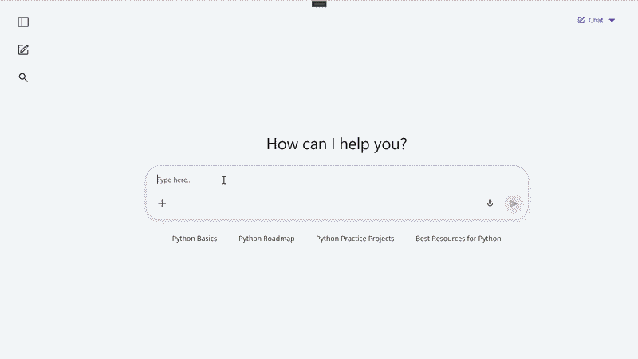

# AI-Powered Context-Aware Suggestions in .NET MAUI AI AssistView

This article demonstrates how to build an intelligent conversational experience using the Syncfusion [.NET MAUI AIAssistView](https://help.syncfusion.com/cr/maui/Syncfusion.Maui.AIAssistView.SfAIAssistView.html) control. The sample integrates Azure OpenAI to generate AI responses along with context-aware follow-up suggestions that help users continue the conversation naturally.

The generated suggestions are dynamically tailored based on the current AI response, providing users with relevant next-step prompts and improving overall chat engagement.

## Integrating Azure AI for Context-Aware Suggestions

Before proceeding, ensure that Azure OpenAI is configured and integrated with your .NET MAUI application. Refer to the [Azure OpenAI integration prerequisites](https://help.syncfusion.com/maui/smartaisolutions/prerequisites) and complete the required setup steps.

The `GetResultsFromAI` method sends the user's prompt to Azure OpenAI and retrieves an AI-generated response. In addition to the answer, the AI generates context-aware follow-up suggestions that help users continue the conversation naturally.

To ensure predictable and structured output, the AI model is instructed through a system prompt to return a JSON response containing both the generated answer and contextual suggestions.




public async Task<ContextSuggestionResponse?>GetResultsFromAI(string prompt)
{
    var client = CreateClient();

    ChatClient chatClient = client.GetChatClient(DeploymentName);

    var messages =  new List<ChatMessage>()
                    {
                        new SystemChatMessage(SystemPrompt),

                        new UserChatMessage(prompt)
                    };

    ChatCompletion completion = await chatClient.CompleteChatAsync(messages);

    string result = completion.Content[0].Text;

    return JsonSerializer.Deserialize<ContextSuggestionResponse>(result);
}




## Creating the ViewModel

Create a ViewModel to manage the AI conversation, suggestions, and user interactions.

The ViewModel contains:

* A collection of chat messages.
* Initial suggestion prompts.
* Request handling logic.
* Azure AI integration.




public ObservableCollection<IAssistItem> Messages { get; set; }

public ObservableCollection<ISuggestion> Suggestions { get; set; }

public ICommand RequestCommand { get; }




## Generating Context-Aware Suggestions

When a user submits a prompt, the application sends the request to Azure OpenAI and retrieves the response.

The AI-generated suggestions are converted into `AssistSuggestion` objects and attached to the response item.




private async Task SendPromptAsync(string prompt)
{
    var response = await aiService.GetResponseAsync(prompt);

    var suggestionItems =
        new ObservableCollection<ISuggestion>();

    foreach (var suggestion in response.Suggestions)
    {
        suggestionItems.Add(
            new AssistSuggestion
            {
                Text = suggestion
            });
    }

    Messages.Add(
        new AssistItem
        {
            Text = response.Answer,
            IsRequested = false,
            Suggestion = new AssistItemSuggestion
            {
                Items = suggestionItems,
                Orientation =
                    SuggestionsOrientation.Horizontal
            }
        });
}




The `AssistItemSuggestion` object enables response-specific suggestions to be displayed directly below the AI response.

## Configuring the .NET MAUI AI AssistView

The Syncfusion AI AssistView control provides built-in support for:

* User requests.
* AI responses.
* Response suggestions.
* Like and dislike actions.
* Copy functionality.

Bind the control to the ViewModel collections.




<assistview:SfAIAssistView
    AssistItems="{Binding Messages}"
    Suggestions="{Binding Suggestions}"
    RequestCommand="{Binding RequestCommand}"
    ShowHeader="True"
    ShowToolbar="True"
    ShowActionButtons="True"/>




## Customizing Response Suggestions

Customize the appearance of response suggestions using the `ResponseSuggestionTemplate`.




<assistview:SfAIAssistView.ResponseSuggestionTemplate>

    <DataTemplate>

        <Border
            Padding="14,8"
            Background="White"
            Stroke="#E5EAF3"
            StrokeThickness="1.5"
            StrokeShape="RoundRectangle 6">

            <HorizontalStackLayout>

                <Label
                    Text="{Binding Text}"
                    FontSize="14"/>

            </HorizontalStackLayout>

        </Border>

    </DataTemplate>

</assistview:SfAIAssistView.ResponseSuggestionTemplate>




These suggestions are generated dynamically based on the AI response and provide users with a seamless conversational flow.

## Output

The following image demonstrates AI-generated responses with context-aware follow-up suggestions displayed directly beneath each response.

**Users can**:

* Send natural language prompts.
* Receive AI-generated responses.
* Select relevant follow-up suggestions.
* Continue conversations with minimal typing.
* Provide feedback using built-in like and dislike actions.

You can find the complete sample from this repository [link](https://github.com/syncfusion/maui-ai-usecase-demos/tree/master/AI%20Solutions/AIAssistView/Context%20Aware%20Suggestions).

## See also

* [Getting Started with AIAssistView](https://help.syncfusion.com/maui/aiassistview/getting-started)
* [Customization in .NET MAUI AIAssistView](https://help.syncfusion.com/maui/aiassistview/appearance)
* [Suggestions in .NET MAUI AIAssistView](https://help.syncfusion.com/maui/aiassistview/suggestions)