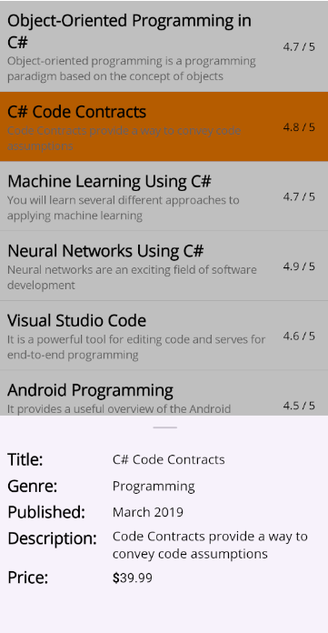

# Set Main Content and Bottom Sheet Content in .NET MAUI Bottom Sheet

* The main content of the [Bottom Sheet]() is always visible and can be set using the [Content]() property.

* The `Bottom Sheet` content is viewable only when the sheet is in the FullExpanded, HalfExpanded, or Collapsed state. Its content can be set using the [BottomSheetContent]() property.



<Grid>
    <Grid.BindingContext>
        <local:BookViewModel />
    </Grid.BindingContext>
    <ListView ItemsSource="{Binding Books}" ItemTapped="OnListViewItemTapped" HasUnevenRows="True">
        <ListView.ItemTemplate>
            <DataTemplate>
                <ViewCell>
                    <Grid ColumnDefinitions="*, 60" Padding="10">
                        <VerticalStackLayout>
                            <Label Text="{Binding Title}" FontSize="20" FontAttributes="Bold"/>
                            <Label Text="{Binding Description}" FontSize="14" TextColor="Gray"/>
                        </VerticalStackLayout>
                        <Label Text="{Binding Rating, StringFormat='{}{0} / 5'}" Grid.Column="1" />
                    </Grid>
                </ViewCell>
            </DataTemplate>
        </ListView.ItemTemplate>
    </ListView>
    <bottomSheet:SfBottomSheet x:Name="bottomSheet" HalfExpandedRatio="0.35" ContentPadding="10">
        <bottomSheet:SfBottomSheet.BottomSheetContent>
            <VerticalStackLayout Spacing="5" x:Name="bottomSheetContent">
                <Grid ColumnDefinitions="120, *" ColumnSpacing="10">
                    <Label Text="Title:" FontSize="20" FontAttributes="Bold"/>
                    <Label Text="{Binding Title}" FontSize="16" VerticalTextAlignment="Center" Grid.Column="1"/>
                </Grid>
                <Grid ColumnDefinitions="120, *" ColumnSpacing="10">
                    <Label Text="Genre:" FontSize="20" FontAttributes="Bold"/>
                    <Label Text="{Binding Genre}" FontSize="16" VerticalTextAlignment="Center" Grid.Column="1"/>
                </Grid>
                <Grid ColumnDefinitions="120, *" ColumnSpacing="10">
                    <Label Text="Published:" FontSize="20" FontAttributes="Bold"/>
                    <Label Text="{Binding Published}" FontSize="16" VerticalTextAlignment="Center" Grid.Column="1"/>
                </Grid>
                <Grid ColumnDefinitions="120, *" ColumnSpacing="10">
                    <Label Text="Description:" FontSize="20" FontAttributes="Bold"/>
                    <Label Text="{Binding Description}" FontSize="16" VerticalTextAlignment="Center" Grid.Column="1"/>
                </Grid>
                <Grid ColumnDefinitions="120, *" ColumnSpacing="10">
                    <Label Text="Price:" FontSize="20" FontAttributes="Bold"/>
                    <Label FontSize="16" VerticalTextAlignment="Center" Grid.Column="1">
                        <Label.FormattedText>
                            <FormattedString>
                                
                                
                            </FormattedString>
                        </Label.FormattedText>
                    </Label>
                </Grid>
            </VerticalStackLayout>
        </bottomSheet:SfBottomSheet.BottomSheetContent>
    </bottomSheet:SfBottomSheet>
</Grid>


SfBottomSheet bottomSheet;
public MainPage()
{
    InitializeComponent();
    BindingContext = new BookViewModel();

    var listView = new ListView
    {
        HasUnevenRows = true
    };

    listView.SetBinding(ListView.ItemsSourceProperty, "Books");

    listView.ItemTemplate = new DataTemplate(() =>
    {
        var titleLabel = new Label
        {
            FontSize = 20,
            FontAttributes = FontAttributes.Bold
        };
        titleLabel.SetBinding(Label.TextProperty, "Title");

        var descriptionLabel = new Label
        {
            FontSize = 14,
            TextColor = Colors.Gray
        };
        descriptionLabel.SetBinding(Label.TextProperty, "Description");

        var detailsLayout = new VerticalStackLayout
        {
            Children =
            {
                titleLabel,
                descriptionLabel
            }
        };

        var ratingLabel = new Label();

        ratingLabel.SetBinding(
            Label.TextProperty,
            new Binding("Rating", stringFormat: "{0} / 5"));

        var itemGrid = new Grid
        {
            Padding = 10,
            ColumnDefinitions =
            {
                new ColumnDefinition
                {
                    Width = new GridLength(1, GridUnitType.Star)
                },
                new ColumnDefinition
                {
                    Width = 60
                }
            }
        };

        itemGrid.Children.Add(detailsLayout);
        Grid.SetColumn(detailsLayout, 0);

        itemGrid.Children.Add(ratingLabel);
        Grid.SetColumn(ratingLabel, 1);

        return new ViewCell
        {
            View = itemGrid
        };
    });

    SfBottomSheet bottomSheet = new SfBottomSheet
    {
        HalfExpandedRatio = 0.35,
        ContentPadding = new Thickness(10)
    };

    var bottomSheetContent = new VerticalStackLayout
    {
        Spacing = 5
    };

    void AddRow(string labelText, string bindingPath)
    {
        var rowGrid = new Grid
        {
            ColumnDefinitions =
            {
                new ColumnDefinition { Width = 120 },
                new ColumnDefinition { Width = new GridLength(1, GridUnitType.Star) }
            },
            ColumnSpacing = 10
        };

        var label = new Label
        {
            Text = labelText,
            FontSize = 20,
            FontAttributes = FontAttributes.Bold
        };

        var valueLabel = new Label
        {
            FontSize = 16,
            VerticalTextAlignment = TextAlignment.Center
        };

        valueLabel.SetBinding(Label.TextProperty, bindingPath);

        rowGrid.Children.Add(label);
        Grid.SetColumn(label, 0);

        rowGrid.Children.Add(valueLabel);
        Grid.SetColumn(valueLabel, 1);

        bottomSheetContent.Children.Add(rowGrid);
    }

    AddRow("Title:", "Title");
    AddRow("Genre:", "Genre");
    AddRow("Published:", "Published");
    AddRow("Description:", "Description");

    // Price row (equivalent to XAML FormattedString)
    var priceGrid = new Grid
    {
        ColumnDefinitions =
        {
            new ColumnDefinition { Width = 120 },
            new ColumnDefinition { Width = new GridLength(1, GridUnitType.Star) }
        },
        ColumnSpacing = 10
    };

    var priceTitleLabel = new Label
    {
        Text = "Price:",
        FontSize = 20,
        FontAttributes = FontAttributes.Bold
    };

    var priceValueLabel = new Label
    {
        FontSize = 16,
        VerticalTextAlignment = TextAlignment.Center
    };

    var formattedString = new FormattedString();

    formattedString.Spans.Add(new Span
    {
        Text = "$",
        FontAttributes = FontAttributes.Bold
    });

    var priceSpan = new Span();

    priceSpan.SetBinding(
        Span.TextProperty,
        new Binding("Price", stringFormat: "{0:F2}")
    );

    formattedString.Spans.Add(priceSpan);

    priceValueLabel.FormattedText = formattedString;

    priceGrid.Children.Add(priceTitleLabel);
    Grid.SetColumn(priceTitleLabel, 0);

    priceGrid.Children.Add(priceValueLabel);
    Grid.SetColumn(priceValueLabel, 1);

    bottomSheetContent.Children.Add(priceGrid);

    bottomSheet.BottomSheetContent = bottomSheetContent;

    // Equivalent of ItemTapped="OnListViewItemTapped"
    listView.ItemTapped += OnListViewItemTapped;

    // Root Grid
    var rootGrid = new Grid();

    rootGrid.Children.Add(listView);
    rootGrid.Children.Add(bottomSheet);

    Content = rootGrid;
}
  



public class BookViewModel
{
    private ObservableCollection<Book>? _books;

    public ObservableCollection<Book>? Books
    {
        get => _books;
        set
        {
            _books = value;
        }
    }

    public BookViewModel()
    {
        Books = new ObservableCollection<Book>
        {
            new Book
            {
                Title = "Object-Oriented Programming in C#",
                Genre = "Programming, Software Development",
                Published = "July 2023",
                Description = "Object-oriented programming is a programming paradigm based on the concept of objects",
                Rating = 4.7,
                Price = 49.99M
            },
            new Book
            {
                Title = "C# Code Contracts",
                Genre = "Programming",
                Published = "March 2019",
                Description = "Code Contracts provide a way to convey code assumptions",
                Rating = 4.8,
                Price = 39.99M
            },
            new Book
            {
                Title = "Machine Learning Using C#",
                Genre = "Programming, Software Engineering",
                Published = "August 2008",
                Description = "You will learn several different approaches to applying machine learning",
                Rating = 4.7,
                Price = 34.99M
            },
            // Add more items
        };
    }
}

public class Book
{
    public string Title { get; set; } = string.Empty;
    public string Genre { get; set; } = string.Empty;
    public string Published { get; set; } = string.Empty;
    public string Description { get; set; } = string.Empty;
    public double Rating { get; set; }
    public decimal Price { get; set; }
}







private void OnListViewItemTapped(object? sender, ItemTappedEventArgs e)
{
    bottomSheet.BottomSheetContent.BindingContext = e.Item;
    bottomSheet.Show();
}




