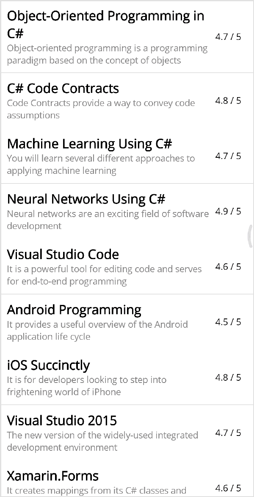

# Toggle Methods in .NET MAUI Bottom Sheet

The Bottom Sheet can be toggled using

* IsOpen property
* Show method
* Close method

## Opening and closing the sheet programmatically using property

The [IsOpen]() property allows you to open or close the Bottom Sheet programmatically. By default, the `IsOpen` property is set to `false`.





<Grid>
    <bottomSheet:SfBottomSheet IsOpen="True">
        <bottomSheet:SfBottomSheet.BottomSheetContent>
            <!--Add your content here-->
        </bottomSheet:SfBottomSheet.BottomSheetContent>
    </bottomSheet:SfBottomSheet>
</Grid>




SfBottomSheet bottomSheet = new SfBottomSheet();
bottomSheet.IsOpen = true;




## Opening and closing sheet programmatically using method

The [Show]() method is used to open the Bottom Sheet, and the [Close]() method is used to close the Bottom Sheet programmatically.





<bottomSheet:SfBottomSheet x:Name="bottomSheet">
    <bottomSheet:SfBottomSheet.BottomSheetContent>
        <!--Add your content here-->
    </bottomSheet:SfBottomSheet.BottomSheetContent>
</bottomSheet:SfBottomSheet>




SfBottomSheet bottomSheet = new SfBottomSheet();




Using `Show` and `Close` methods,



private void OnListViewItemTapped(object? sender, ItemTappedEventArgs e)
{
    bottomSheet.BottomSheetContent.BindingContext = e.Item;
    bottomSheet.Show();
}

private void CloseBottomSheet(object sender, EventArgs e)
{
    bottomSheet.Close();
}



