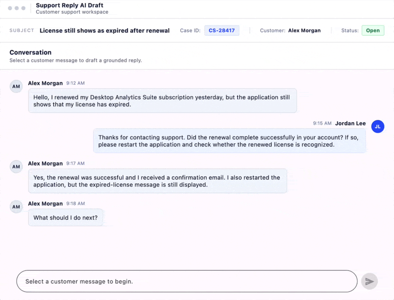

# Support Reply AI Drafting in .NET MAUI Chat

This guide helps you build a support reply feature using the Syncfusion [.NET MAUI Chat](https://help.syncfusion.com/cr/maui/Syncfusion.Maui.Chat.SfChat.html) control (SfChat) and Azure OpenAI. The Chat control displays the conversation history between support agents and customers. When your support team selects a customer message and taps "Draft," Azure OpenAI generates a professional reply that agents can review, edit, or regenerate before sending it through the Chat control.

## What You'll Build

By the end, you'll have a working app with this complete workflow:

1. Agent selects a customer message
2. Agent taps the "Draft" button
3. AI generates a professional reply
4. Agent reviews, edits, or regenerates the draft
5. Agent sends the final reply through the Chat control

## Before You Start

You should have:

- A .NET MAUI project (or create one now)
- Azure OpenAI configured (see Prerequisites below)
- Basic C# and XAML knowledge

If you don't have Azure OpenAI set up yet, complete the Prerequisites section first.

## Prerequisites

Complete the shared [AI solution prerequisites](/maui/SmartAISolutions/Prerequisites) to configure Azure OpenAI (Microsoft's AI service) and your .NET MAUI application. Also complete the [Chat getting started](/maui/chat/getting-started) steps.

## Setting Up Your Project

### Step 1: Install the Required Packages

Your app needs three NuGet packages:

- **Syncfusion.Maui.Chat** - The Chat control for displaying conversations and messages
- **Syncfusion.Maui.Core** - Base components that Chat depends on
- **Azure.AI.OpenAI** - The client library to connect with Azure OpenAI

Install the Azure OpenAI package:



Install-Package Azure.AI.OpenAI -Version 2.1.0


dotnet add package Azure.AI.OpenAI --version 2.1.0



## Step 2: Build the Chat UI with AI Drafting

**Note:** Step 1 is completing the prerequisites above.

The Chat control displays the conversation history between customer and agent. Below the Chat control, add a message composer where your support agent can see the AI-drafted reply and prepare to send it.

The layout has three parts:

1. **Chat messages** (SfChat) - Shows the customer and agent messages
2. **Text input** (Entry) - Where the agent reviews or edits the AI reply
3. **Action buttons** - "Draft" to generate the reply, "Send" to submit it

### Creating the Chat Interface




<Grid RowDefinitions="*, Auto">
    <!-- Chat Messages Display -->
    <chat:SfChat x:Name="ChatControl"
                 Messages="{Binding Messages}"
                 ShowTypingIndicator="False"
                 VerticalOptions="FillAndExpand" />

    <!-- Message Composer -->
    <Grid Grid.Row="1" Padding="10" ColumnDefinitions="*, Auto, Auto">
        <Entry x:Name="ComposerEntry"
               Placeholder="Type your reply..."
               Text="{Binding ComposerText}"
               VerticalOptions="Center" />

        <Button Grid.Column="1"
                Text="Draft"
                Clicked="OnDraftReplyClicked"
                Margin="5, 0"
                Padding="15, 10" />

        <Button Grid.Column="2"
                Text="Send"
                Clicked="OnSendReplyClicked"
                Margin="5, 0"
                Padding="15, 10" />
    </Grid>
</Grid>




## Understanding SfChat Messages

The SfChat control displays messages using the `TextMessage` class. Each message has two essential parts:

- **Text** - The message content (e.g., "How do I reset my password?")
- **Author** - Who sent it (a name and optional avatar image)

The Chat control stores all messages in a collection. When you add a message to this collection, SfChat automatically displays it in the conversation area. Customer messages appear on the left, and agent messages appear on the right.

Example of creating a message for SfChat:




// Create a customer message
var customerMessage = new TextMessage
{
    Text = "How do I reset my password?",
    Author = new Author 
    { 
        Name = "Customer",
        Avatar = "customer.png"
    }
};

// Create an agent reply
var agentReply = new TextMessage
{
    Text = "Click Settings > Security > Change Password.",
    Author = new Author 
    { 
        Name = "Support Agent",
        Avatar = "agent.png"
    }
};

// Add to SfChat's Messages collection
chatControl.Messages.Add(customerMessage);
chatControl.Messages.Add(agentReply);




## Step 3: Create the Message Data Model

Your support team needs a way to select customer messages. You'll create a view model that holds a list of predefined customer messages. When an agent picks one, it becomes the input for the AI draft.

This is important because it gives your support team a quick way to practice drafting without waiting for real customer messages. For production, you'd replace this list with actual customer messages from your system.

### Understanding the View Model and MVVM Pattern

Your view model implements `INotifyPropertyChanged`. This is a .NET pattern that tells the UI when data changes. When you set a property like `ComposerText`, the `OnPropertyChanged()` method notifies the UI to update its display. This keeps the Chat control and Entry field in sync with your data.

Your support team needs a way to select customer messages. You'll create a view model that holds a list of predefined customer messages. When an agent picks one, it becomes the input for the AI draft.

This is important because it gives your support team a quick way to practice drafting without waiting for real customer messages. For production, you'd replace this list with actual customer messages from your system.

Here's the view model with predefined messages:




public class SupportViewModel : INotifyPropertyChanged
{
    private ObservableCollection<TextMessage> _messages;
    private ObservableCollection<string> _predefinedMessages;
    private string _selectedCustomerMessage;
    private string _composerText;
    private bool _isLoading;

    // Collection of messages displayed in SfChat
    public ObservableCollection<TextMessage> Messages
    {
        get => _messages;
        set
        {
            _messages = value;
            OnPropertyChanged();
        }
    }

    // List of predefined customer messages to select from
    public ObservableCollection<string> PredefinedMessages
    {
        get => _predefinedMessages;
        set
        {
            _predefinedMessages = value;
            OnPropertyChanged();
        }
    }

    // The currently selected customer message
    public string SelectedCustomerMessage
    {
        get => _selectedCustomerMessage;
        set
        {
            _selectedCustomerMessage = value;
            OnPropertyChanged();
        }
    }

    // The text in the composer (AI-drafted reply or edited version)
    public string ComposerText
    {
        get => _composerText;
        set
        {
            _composerText = value;
            OnPropertyChanged();
        }
    }

    // Whether we're currently waiting for AI to generate a reply
    public bool IsLoading
    {
        get => _isLoading;
        set
        {
            _isLoading = value;
            OnPropertyChanged();
        }
    }

    public SupportViewModel()
    {
        Messages = new ObservableCollection<TextMessage>();
        PredefinedMessages = new ObservableCollection<string>
        {
            "License still shows as expired after renewal",
            "How do I upgrade my subscription?",
            "The application crashed on startup",
            "How can I export my data?"
        };
    }

    public event PropertyChangedEventHandler PropertyChanged;

    // This method is called whenever a property changes
    // It notifies the UI to update its display
    protected void OnPropertyChanged([CallerMemberName] string name = null)
    {
        PropertyChanged?.Invoke(this, new PropertyChangedEventArgs(name));
    }
}




## Step 4: Create the OpenAI Service

Think of the `OpenAIService` as a translator between your Chat app and the AI engine. It takes a customer message and sends it to Azure OpenAI, which generates a professional reply.

The service works in three steps:

1. It creates a connection to Azure OpenAI using your endpoint and API key
2. It sends a system instruction (like "be professional and friendly") and the customer message
3. It returns the AI-generated reply for display in the composer

Here's the service implementation with comments explaining each step:




public class OpenAIService
{
    private readonly AzureOpenAIClient _client;
    private readonly string _deploymentName;

    // Constructor initializes the Azure OpenAI connection
    public OpenAIService(string endpoint, string apiKey, string deploymentName)
    {
        // Create a client connected to your Azure OpenAI resource
        _client = new AzureOpenAIClient(new Uri(endpoint), new AzureKeyCredential(apiKey));
        _deploymentName = deploymentName;
    }

    // Generate an AI-drafted reply based on the customer message
    public async Task<string> GetDraftReplyAsync(string customerMessage, CancellationToken cancellationToken = default)
    {
        // This is the "system prompt" - it tells the AI how to behave
        // You can customize this to match your support team's style
        var systemPrompt = "You are a helpful and professional customer support agent. Draft a clear, " +
                          "concise, and empathetic reply to the customer's message. Keep the tone professional " +
                          "yet friendly. The reply should address the customer's concern directly.";

        // Build the message list for the AI
        var messages = new List<ChatMessage>
        {
            // The system message tells the AI its role and behavior
            new SystemChatMessage(systemPrompt),
            // The user message is the customer's question
            new UserChatMessage(customerMessage)
        };

        // Send to Azure OpenAI and wait for the response
        // Using 'await' keeps the UI responsive while waiting
        ChatCompletion response = await _client
            .GetChatClient(_deploymentName)
            .CompleteChatAsync(messages, cancellationToken: cancellationToken);

        // Extract and return the AI-generated reply
        return response.Content[0].Text.Trim();
    }
}




### Understanding Async/Await

The `GetDraftReplyAsync` method uses `async` and `await`. This allows your app to wait for Azure OpenAI's response without freezing the UI. While the AI is thinking, your support agent can still interact with the app. When the response arrives, the reply automatically appears in the composer.

## Step 5: Generate the AI Draft

Now you'll implement what happens when your support agent taps "Draft." The code sends the selected customer message to Azure OpenAI and displays the generated reply in the composer.

Here's what happens behind the scenes:

1. Agent taps "Draft"
2. Your app checks if a customer message is selected
3. Your app shows a loading indicator while waiting
4. Azure OpenAI generates the reply
5. The reply appears in the composer, ready to edit
6. If something goes wrong, an error message appears

Implement the draft button click handler:




private readonly OpenAIService _openAIService;

private async void OnDraftReplyClicked(object sender, EventArgs e)
{
    // Validate that a customer message is selected
    if (string.IsNullOrEmpty(ViewModel.SelectedCustomerMessage))
    {
        await DisplayAlert("Info", "Please select a customer message to draft a reply.", "OK");
        return;
    }

    // Show a loading indicator
    ViewModel.IsLoading = true;

    try
    {
        // Call the OpenAI service to generate a reply
        // Using 'await' waits for the response without freezing the UI
        var draftReply = await _openAIService.GetDraftReplyAsync(
            ViewModel.SelectedCustomerMessage);

        // Display the AI-generated reply in the composer
        ViewModel.ComposerText = draftReply;
    }
    catch (Exception ex)
    {
        // If something goes wrong, show an error message
        await DisplayAlert("Error", $"Failed to generate draft: {ex.Message}", "OK");
    }
    finally
    {
        // Always hide the loading indicator
        ViewModel.IsLoading = false;
    }
}




### Implementing Draft Button Click

Now you'll implement what happens when your support agent taps "Draft." The code sends the selected customer message to Azure OpenAI and displays the generated reply in the composer.

Here's what happens behind the scenes:

1. Agent taps "Draft"
2. Your app checks if a customer message is selected
3. Your app shows a loading indicator while waiting
4. Azure OpenAI generates the reply
5. The reply appears in the composer, ready to edit
6. If something goes wrong, an error message appears

Implement the draft button click handler:




private readonly OpenAIService _openAIService;

private async void OnDraftReplyClicked(object sender, EventArgs e)
{
    // Validate that a customer message is selected
    if (string.IsNullOrEmpty(ViewModel.SelectedCustomerMessage))
    {
        await DisplayAlert("Info", "Please select a customer message to draft a reply.", "OK");
        return;
    }

    // Show a loading indicator
    ViewModel.IsLoading = true;

    try
    {
        // Call the OpenAI service to generate a reply
        // Using 'await' waits for the response without freezing the UI
        var draftReply = await _openAIService.GetDraftReplyAsync(
            ViewModel.SelectedCustomerMessage);

        // Display the AI-generated reply in the composer
        ViewModel.ComposerText = draftReply;
    }
    catch (Exception ex)
    {
        // If something goes wrong, show an error message
        await DisplayAlert("Error", $"Failed to generate draft: {ex.Message}", "OK");
    }
    finally
    {
        // Always hide the loading indicator
        ViewModel.IsLoading = false;
    }
}




### Step 6: Let Agents Control the Draft

Your support team should have full control over the AI-generated draft. They might want to:

- **Regenerate** – Get a different reply if they don't like the current one
- **Discard** – Clear the draft and start over
- **Send** – Submit the final reply to the Chat control (after reviewing or editing)

Implement these three actions:




// Regenerate the draft by calling Azure OpenAI again
private async void OnRegenerateDraftClicked(object sender, EventArgs e)
{
    // Check if a customer message is selected
    if (string.IsNullOrEmpty(ViewModel.SelectedCustomerMessage))
        return;

    // Show loading indicator
    ViewModel.IsLoading = true;

    try
    {
        // Call AI again with the same customer message to get a different reply
        var newDraft = await _openAIService.GetDraftReplyAsync(
            ViewModel.SelectedCustomerMessage);

        // Replace the current draft with the new one
        ViewModel.ComposerText = newDraft;
    }
    catch (Exception ex)
    {
        // Show error if regeneration fails
        await DisplayAlert("Error", $"Failed to regenerate draft: {ex.Message}", "OK");
    }
    finally
    {
        // Hide loading indicator
        ViewModel.IsLoading = false;
    }
}

// Clear the current draft and start over
private void OnDiscardDraftClicked(object sender, EventArgs e)
{
    ViewModel.ComposerText = string.Empty;
}

// Add the final reply to SfChat and clear the composer
private async void OnSendReplyClicked(object sender, EventArgs e)
{
    // Validate that there's a reply to send
    if (string.IsNullOrEmpty(ViewModel.ComposerText))
    {
        await DisplayAlert("Info", "Please enter a reply before sending.", "OK");
        return;
    }

    // Create a TextMessage for SfChat
    // This is what displays in the Chat control
    var message = new TextMessage
    {
        Text = ViewModel.ComposerText,
        // The Author identifies who sent the message (agent name and optional avatar)
        Author = new Author { Name = "Support Agent", Avatar = "agent.png" }
    };

    // Add the message to SfChat's Messages collection
    // SfChat automatically displays it in the conversation
    ViewModel.Messages.Add(message);

    // Clear the composer for the next reply
    ViewModel.ComposerText = string.Empty;
}




## Step 7: Register Services in Your App Startup

Your app needs to know where to find the `OpenAIService` and `SupportViewModel`. Register them in your .NET MAUI startup code (`MauiProgram.cs`) so the app can use them anywhere. This is called dependency injection—it makes your code cleaner and testable.




public static class MauiProgram
{
    public static MauiApp CreateMauiApp()
    {
        var builder = MauiApp.CreateBuilder()
            .UseMauiApp<App>()
            .ConfigureFonts(fonts =>
            {
                fonts.AddFont("OpenSans-Regular.ttf", "OpenSansRegular");
            })
            // Register Syncfusion license
            .ConfigureSyncfusionCore();

        // Register your services
        // AddSingleton means the same instance is used throughout the app lifetime
        
        // Register OpenAIService for accessing Azure OpenAI
        builder.Services.AddSingleton<OpenAIService>();
        
        // Register SupportViewModel for the view model logic
        builder.Services.AddSingleton<SupportViewModel>();
        
        // Register SupportPage (your XAML page)
        builder.Services.AddSingleton<SupportPage>();

        return builder.Build();
    }
}




## Optional: Customize the AI Reply Tone

*This section is optional. Your app works fine with the default prompt included in the `GetDraftReplyAsync` method.*

The AI generates replies based on the system prompt you provide. Different prompts create different tones. Here are two examples you can use in the `OpenAIService` class:

### For Technical Support

Use a professional, formal tone:




// Replace the systemPrompt variable in GetDraftReplyAsync with this:
var systemPrompt = "You are a professional technical support specialist. Provide clear, " +
                  "technical, and accurate solutions to customer problems. Use formal language " +
                  "and ensure the reply addresses the root cause of the issue.";




### For General Customer Support

Use a warm, empathetic tone:




// Replace the systemPrompt variable in GetDraftReplyAsync with this:
var systemPrompt = "You are a friendly and empathetic customer support agent. Respond warmly " +
                  "to customer concerns, validate their feelings, and provide helpful solutions. " +
                  "Keep the tone conversational yet professional.";




### For Billing Support

Use a reassuring, solution-focused tone:




// Replace the systemPrompt variable in GetDraftReplyAsync with this:
var systemPrompt = "You are a knowledgeable billing support representative. Help customers " +
                  "resolve their payment and subscription concerns with clarity. Always verify " +
                  "account details and offer clear next steps to resolve issues quickly.";




### Tips for Creating Your Own Prompt

Try different prompts to match your team's style. Each prompt produces different reply quality and tone. To create a custom prompt:

1. Start with a clear role: "You are a..." statement
2. Specify the tone: "Be professional and friendly" or "Be empathetic and warm"
3. Set expectations: "Keep replies under 150 words" or "Provide step-by-step instructions"
4. Define boundaries: "Only suggest official solutions" or "Always offer to escalate"

Find what works best for your support team by testing with real customer messages. Then update your `GetDraftReplyAsync` method with the systemPrompt that works best.

## See It in Action

The following image shows the complete workflow—from selecting a message to reviewing and sending the AI-drafted reply:

## Next Steps

Find the complete, working sample in the [AI use-case demos repository](https://github.com/syncfusion/maui-ai-usecase-demos).