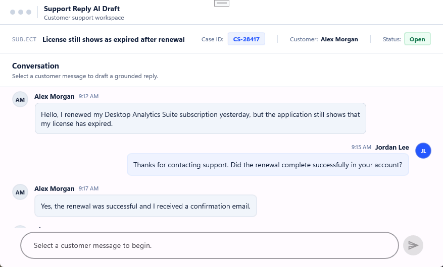

# Support Reply AI Drafting in .NET MAUI Chat

This article shows how to add AI reply drafting to a support conversation with the Syncfusion® [.NET MAUI Chat](https://help.syncfusion.com/maui/chat/overview) (`SfChat`) control.

The agent selects a customer message and taps **Draft Reply**. The AI writes a reply into the chat composer. The agent can edit it, regenerate it, or discard it. The AI never sends anything. The agent sends the reply with the Send button.

## Prerequisites

* Complete the shared [AI solution prerequisites](/maui/SmartAISolutions/Prerequisites).
* Complete the [Chat getting started](/maui/chat/getting-started) steps.
* Install the `CommunityToolkit.Mvvm` NuGet package.

## Step 1: Add the chat

Bind `SfChat` to a view model. The built-in composer handles editing and sending. The `Suggestions` property shows the action chips.




<chat:SfChat x:Name="ConversationChat"
             Messages="{Binding Messages}"
             CurrentUser="{Binding CurrentUser}"
             Suggestions="{Binding ChatSuggestions}"
             SuggestionItemSelected="OnSuggestionItemSelected"
             SendMessageCommand="{Binding NativeSendCommand}"
             ShowMessageInputView="True"
             AllowMultilineInput="True" />




## Step 2: Load the conversation

`SfChat` shows `TextMessage` objects. Set the support agent as `CurrentUser`, and add the conversation to `Messages`.




public Author CurrentUser { get; } = new Author { Name = "Support Agent" };

public ObservableCollection<object> Messages { get; } = new()
{
    new TextMessage
    {
        Author = new Author { Name = "Alex Morgan" },
        Text = "License still shows as expired after renewal"
    }
};




In your app, load the messages from your own data source.

## Step 3: Select a customer message

Use a [message template](/maui/chat/messages) so a customer message can be tapped. Bind the tap to a `SelectMessageCommand` in the view model.

* Only customer messages can be selected, one at a time.
* Tap the selected message again to clear it.
* If a draft exists, selecting another message asks for confirmation.

## Step 4: Track the drafting state

The view model tracks where the agent is in the workflow and shows the matching chips.




public sealed partial class SupportChatViewModel : ObservableObject
{
    [ObservableProperty]
    public partial TextMessage? SelectedMessage { get; set; }

    [ObservableProperty]
    public partial ChatSuggestions? ChatSuggestions { get; set; }

    [ObservableProperty]
    public partial string EditorText { get; set; } = string.Empty;

    [ObservableProperty]
    public partial bool IsComposerEnabled { get; set; }

    [ObservableProperty]
    public partial bool IsComposerReadOnly { get; set; }

    public ICommand NativeSendCommand { get; }
}




| State | Chips shown |
|-------|-------------|
| Customer message selected | **Draft Reply** |
| Draft ready | **Regenerate**, **Discard** |
| First draft failed | **Retry** |

While a draft is generating, the composer is locked and the progress text ("Drafting reply..." or "Regenerating reply...") appears inside the selected message.

## Step 5: Generate the draft

Create a service that takes the selected message and the recent conversation, and returns a checked reply.




public sealed record SupportReplyRequest(
    string SelectedMessageText,
    IReadOnlyList<string> RecentConversationContext);

public interface ISupportReplyService
{
    Task<SupportReplyValidationResult> DraftReplyAsync(
        SupportReplyRequest request,
        CancellationToken cancellationToken);
}




The service sends the request to your AI service with a system prompt. The prompt should tell the model to:

* Write a professional reply based on the selected message and earlier messages.
* Not repeat steps the customer already tried.
* Not invent menus, links, account status, policies, or timelines.
* Not ask for passwords, API keys, or authentication codes.
* Return plain text under 1,000 characters.

Treat customer text as untrusted data, and tell the model not to follow instructions inside it.

When the reply comes back, place it in the composer for review:




var result = await _supportReplyService.DraftReplyAsync(request, cancellationToken);

if (result.IsValid && result.Response is not null)
{
    EditorText = result.Response.Reply;
}




## Step 6: Check the reply

Check every reply before it reaches the composer. `SupportReplyValidator` rejects a reply that:

* Is empty or longer than 1,000 characters.
* Contains links.
* Mentions passwords, API keys, or authentication codes.
* Claims something that did not happen, such as a completed verification, an escalation, a refund, or a guaranteed outcome.

If a reply is rejected, the agent sees an error and can retry.

## Step 7: Handle the chips

Handle chip taps in `SuggestionItemSelected`. Cancel the default send and keep the chips visible, so the chip text never becomes message content.




private async void OnSuggestionItemSelected(object? sender, SuggestionItemSelectedEventArgs e)
{
    e.CancelSendMessage = true;
    e.HideAfterSelection = false;

    await ViewModel.HandleSuggestionActionAsync((e.SelectedItem as Suggestion)?.Text);
}




| Chip | What it does |
|------|--------------|
| **Draft Reply** | Generates the first draft. |
| **Regenerate** | Asks "Replace draft?", then generates a new draft. If it fails, the previous draft stays. |
| **Discard** | Clears the draft and the selection. |
| **Retry** | Tries again after a failed first draft. |

## Step 8: Send the reply

The Send button runs `SendMessageCommand`. Mark the event as handled, then add the reviewed text as a support agent message.




private void SendNativeMessage(object? args)
{
    if (args is not SendMessageEventArgs sendArgs) return;
    sendArgs.Handled = true;

    var text = sendArgs.Message?.Text?.Trim() ?? string.Empty;
    if (text.Length == 0 || text != EditorText.Trim()) return;

    Messages.Add(new TextMessage { Author = CurrentUser, DateTime = DateTime.Now, Text = text });
    SelectedMessage = null;
}




## Step 9: Register the services

Register the services in `MauiProgram.cs`.




builder.Services.AddSingleton<ConversationService>();
builder.Services.AddSingleton<IChatSuggestionService, ChatSuggestionService>();
builder.Services.AddSingleton<ISupportReplyService, SupportReplyService>();
builder.Services.AddSingleton<SupportReplyValidator>();
builder.Services.AddTransient<SupportChatViewModel>();
builder.Services.AddTransient<SupportChatPage>();




## Change the reply tone

To change the tone, edit the system prompt in `SupportReplyService`. Keep the 1,000-character limit, or the validator rejects the reply.

## See also

Get the complete sample from the [AI use-case demos](https://github.com/syncfusion/maui-ai-usecase-demos) repository.
