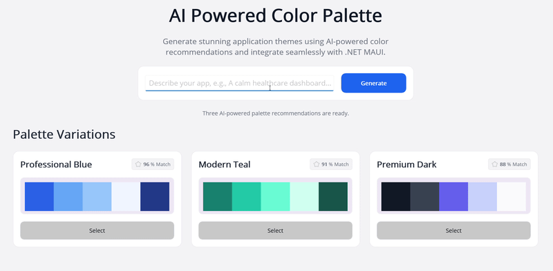

# AI-Powered Color Palette Generation in .NET MAUI Color Picker

This article demonstrates how to generate color palettes with Azure OpenAI and display them in the Syncfusion® [.NET MAUI Color Picker](https://help.syncfusion.com/maui/colorpicker/overview) control. The user describes an app or product in free text, and the AI returns three distinct palettes. Each palette is shown in its own inline Color Picker in `Palette` mode.

The AI analyzes the following inputs for each request:

- App or product description
- Industry and purpose
- Mood and style keywords
- Color harmony
- Visual accessibility
- Relevance of each palette to the prompt

Each palette recommendation contains a theme name, a match percentage, five hex colors, and a rationale. Palettes are sorted from the highest to the lowest match percentage. For example, the description `A calm healthcare dashboard` returns the best match as palette 1 and two alternative combinations as palettes 2 and 3.

## Integrating Azure OpenAI with the .NET MAUI app

Before implementing palette generation, complete the shared [AI solution prerequisites](/maui/SmartAISolutions/Prerequisites) to configure Azure OpenAI and your .NET MAUI application. Also complete the [Color Picker getting started](https://help.syncfusion.com/maui/colorpicker/getting-started) steps.

## Implementing AI-Powered Color Palette Generation

**Step 1: Create the models**

`ColorPaletteResponse` matches the JSON returned by the AI. `SmartColorPalette` is the model the page binds to.



using System.Text.Json.Serialization;

namespace SmartColorPalette.Models;

public class ColorPaletteResponse
{
    [JsonPropertyName("themeName")]
    public string ThemeName { get; set; } = string.Empty;

    [JsonPropertyName("matchPercentage")]
    public int MatchPercentage { get; set; }

    [JsonPropertyName("colors")]
    public List<string> Colors { get; set; } = new();

    [JsonPropertyName("rationale")]
    public string Rationale { get; set; } = string.Empty;
}

public class SmartColorPalette
{
    public string ThemeName { get; set; } = string.Empty;

    public int MatchPercentage { get; set; }

    public string Rationale { get; set; } = string.Empty;

    public IList<string> Colors { get; set; } = new List<string>();
}



**Step 2: Create the Azure OpenAI service**

The service reads the endpoint, deployment name, and API key from environment variables and sends a chat completion request. It returns an empty string when the configuration is missing or the request fails, so the app can use the fallback palettes.



using System.Net.Http.Headers;
using System.Text;
using System.Text.Json;

namespace SmartColorPalette.Services;

public interface IAzureAIService
{
    Task<string> GetResultsFromAI(string prompt);
}

public abstract class AzureBaseService
{
    protected static readonly string endpoint = (Environment.GetEnvironmentVariable("AZURE_OPENAI_ENDPOINT") ?? string.Empty).TrimEnd('/') + "/";
    protected static readonly string deploymentName = Environment.GetEnvironmentVariable("AZURE_OPENAI_DEPLOYMENT") ?? string.Empty;
    protected static readonly string key = Environment.GetEnvironmentVariable("AZURE_OPENAI_API_KEY") ?? string.Empty;

    protected static bool IsConfigured => endpoint.Length > 1 && deploymentName.Length > 0 && key.Length > 0;
}

public class AzureAIService : AzureBaseService, IAzureAIService
{
    private static readonly HttpClient httpClient = new();

    public async Task<string> GetResultsFromAI(string prompt)
    {
        if (!IsConfigured || string.IsNullOrWhiteSpace(prompt))
        {
            return string.Empty;
        }

        var requestBody = new
        {
            messages = new[]
            {
                new { role = "system", content = "You are a UI/UX color designer. Return only valid JSON. No markdown, no explanation." },
                new { role = "user", content = prompt }
            },
            temperature = 0.7,
            max_tokens = 1200
        };

        var request = new HttpRequestMessage(HttpMethod.Post, $"{endpoint}openai/deployments/{deploymentName}/chat/completions?api-version=2024-06-01")
        {
            Content = new StringContent(JsonSerializer.Serialize(requestBody), Encoding.UTF8, "application/json")
        };
        request.Headers.Add("api-key", key);
        request.Headers.Accept.Add(new MediaTypeWithQualityHeaderValue("application/json"));

        try
        {
            using var response = await httpClient.SendAsync(request);
            if (!response.IsSuccessStatusCode)
            {
                return string.Empty;
            }

            var json = await response.Content.ReadAsStringAsync();
            using var document = JsonDocument.Parse(json);
            return document.RootElement
                .GetProperty("choices")[0]
                .GetProperty("message")
                .GetProperty("content")
                .GetString() ?? string.Empty;
        }
        catch
        {
            return string.Empty;
        }
    }
}



N> Never store an API key in source code. The service above reads the `AZURE_OPENAI_ENDPOINT`, `AZURE_OPENAI_DEPLOYMENT`, and `AZURE_OPENAI_API_KEY` environment variables. For production apps, use a secrets manager or secure configuration provider.

**Step 3: Build the prompt and parse the response**

`SmartColorPaletteService` builds the prompt from the user description and asks for a JSON array of exactly three recommendations. The service then parses the response, sorts the palettes by match percentage, and keeps only valid hex colors.



var prompt =
    "You are a professional UI/UX color designer and naming expert.\n\n" +
    "Analyze the following product or app description:\n\n" +
    $"\"{styleDescription}\"\n\n" +
    "Return ONLY valid JSON as an array of exactly three palette recommendations.\n" +
    "Each recommendation must include: themeName, matchPercentage, colors (five hex values), and rationale.\n\n" +
    "Guidelines:\n" +
    "- Generate three distinct recommendations with unique names and color combinations.\n" +
    "- Match percentages should be believable, sorted highest to lowest.\n" +
    "- Colors must be visually accessible and relevant to the prompt.\n" +
    "- Return only JSON without markdown or commentary.";

var response = await aiService.GetResultsFromAI(prompt);



If the response is empty or invalid, the service returns built-in fallback palettes so the page always has three palettes to display.

**Step 4: Create the ViewModel**

`MainViewModel` holds the prompt, the busy state, the status message, and the three generated palettes. The **Generate** button calls the service and updates these properties.

The ViewModel exposes the following members:

| Member | Description |
|--------|-------------|
| `UserPrompt` | The description entered by the user. |
| `IsBusy` | Shows the busy indicator while the request runs. |
| `StatusMessage` | Reports progress, the source of the palettes, or an input error. |
| `FirstPalette`, `SecondPalette`, `ThirdPalette` | The three palettes, ordered by match percentage. |

**Step 5: Register the dependencies**

Register the services, ViewModel, and page in `MauiProgram.cs`. Also register the Syncfusion® core handlers with `ConfigureSyncfusionCore`.



using Syncfusion.Maui.Core.Hosting;

builder
    .UseMauiApp<App>()
    .ConfigureSyncfusionCore();

builder.Services.AddSingleton<IAzureAIService, AzureAIService>();
builder.Services.AddSingleton<SmartColorPaletteService>();
builder.Services.AddSingleton<MainViewModel>();
builder.Services.AddSingleton<MainPage>();



**Step 6: Add the Color Picker to the page**

Add one inline Color Picker for each palette. Set `ColorMode` to `Palette` and size the grid to a single row of five cells, so that each picker shows only the five generated colors.



<inputs:SfColorPicker
    x:Name="FirstColorPicker"
    ColorMode="Palette"
    IsInline="True"
    IsOpen="True"
    PaletteColumnCount="5"
    PaletteRowCount="1"
    PaletteCellSize="80"
    ShowRecentColors="False"
    IsActionButtonsVisible="False"
    IsColorModeSwitcherVisible="False" />



Repeat the same configuration for the second and third palettes. For more information about these properties, refer to [Inline rendering](https://help.syncfusion.com/maui/colorpicker/inline-rendering) and [Customization](https://help.syncfusion.com/maui/colorpicker/customization).

**Step 7: Apply the palette to the Color Picker**

Convert each hex value to a `Color`, and assign the collection to [PaletteColors](https://help.syncfusion.com/cr/maui/Syncfusion.Maui.Inputs.SfColorPicker.html#Syncfusion_Maui_Inputs_SfColorPicker_PaletteColors). Then select the first color by default.



var paletteColors = new ObservableCollection<Color>();

foreach (var color in colors.Take(5))
{
    if (Color.TryParse(color, out var parsedColor))
    {
        paletteColors.Add(parsedColor);
    }
}

picker.PaletteColors = paletteColors;

if (paletteColors.Count > 0)
{
    picker.SelectedColor = paletteColors[0];
}



## How It Works

1. The user enters a description of the app or desired style, such as `A calm healthcare dashboard`.
2. The user selects **Generate**.
3. The app sends the description to Azure OpenAI.
4. Azure OpenAI returns a JSON array of three palette recommendations.
5. The app parses and validates the response. If the response is empty or invalid, the fallback palettes are used.
6. Each palette is assigned to its own Color Picker as `PaletteColors`.
7. The first color of each palette is selected by default.
8. The user can pick any color from the generated palettes.

A busy indicator and a status message are shown while the request runs.

## Output

The generated palettes appear in inline Color Picker controls, each with its theme name and match percentage.

## Troubleshooting

### Palette generation failed

If the default or fallback palettes are shown instead of AI-generated palettes:

- Verify the Azure OpenAI connectivity and that the environment variables are set.
- Check that the deployment is available.
- Review the debug output for the raw AI response.
- Confirm the response is a JSON array containing `themeName`, `matchPercentage`, `colors`, and `rationale`.

### Color Picker not updating

If the Color Picker does not show the generated colors:

- Ensure `PaletteColors` is assigned an `ObservableCollection<Color>`.
- Verify that the generated values are valid hex colors.
- Confirm `ColorMode` is set to `Palette`.

## See Also

- [AI solution prerequisites](/maui/SmartAISolutions/Prerequisites)
- [Color Picker getting started](https://help.syncfusion.com/maui/colorpicker/getting-started)
- [Color Picker mode](https://help.syncfusion.com/maui/colorpicker/mode)
- [Azure OpenAI overview](https://azure.microsoft.com/en-us/products/ai-foundry/models/openai#ProductOverview)
