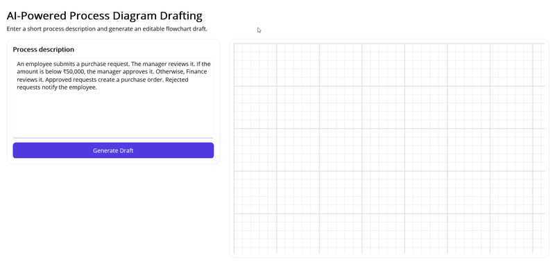

# AI-Powered Process Diagram Drafting in .NET MAUI Diagram

Demonstrates how to combine Azure OpenAI with the Syncfusion® [.NET MAUI Diagram](https://help.syncfusion.com/maui/diagram/getting-started) control to generate a workflow diagram from a natural-language process description.

The sample converts that description into a structured workflow, validates the response, and renders it as a diagram. The AI service returns workflow structure only; the sample creates the final diagram layout locally by building nodes and connectors for the Syncfusion diagram control.

## Prerequisites

Before implementing the draft generation flow, complete the shared [AI solution prerequisites](https://help.syncfusion.com/maui/smartaisolutions/prerequisites) to configure Azure OpenAI and your .NET MAUI application. Also complete the [Diagram getting started](https://help.syncfusion.com/maui/diagram/getting-started) steps.

## Define the AI service contract

The ViewModel depends on an interface so the workflow extraction service can be replaced with a fake implementation for testing or with an Azure OpenAI implementation in production.



namespace AIProcessDiagramDrafting.Services;

public interface IWorkflowExtractionService
{
    Task<WorkflowResponse> ExtractAsync(
        string processDescription,
        CancellationToken cancellationToken = default);
}



## Create the workflow response model

The AI service returns a structured workflow response that contains a title, workflow nodes, connectors, and optional warnings.



namespace AIProcessDiagramDrafting.Models;

public sealed class WorkflowResponse
{
    public string Title { get; set; } = string.Empty;
    public IList<WorkflowNode> Nodes { get; set; } = new List<WorkflowNode>();
    public IList<WorkflowConnector> Connectors { get; set; } = new List<WorkflowConnector>();
    public IList<WorkflowWarning> Warnings { get; set; } = new List<WorkflowWarning>();
}



The workflow node type supports the following values:

- `Start`
- `Process`
- `Decision`
- `End`

The sample also enforces workflow limits to keep the output readable and valid.



namespace AIProcessDiagramDrafting.Models;

public static class WorkflowLimits
{
    public const int ProcessDescription = 1500;
    public const int Nodes = 20;
    public const int DecisionNodes = 6;
    public const int Connectors = 30;
    public const int NodeLabel = 60;
    public const int ConnectorLabel = 30;
}



## Create the Azure OpenAI service

The Azure OpenAI service sends the process description to the model and asks it to return JSON only. The response must contain workflow nodes and connectors, but it must not contain coordinates.



using System.Text.Json;
using Azure.AI.OpenAI;
using AIProcessDiagramDrafting.Models;

namespace AIProcessDiagramDrafting.Services;

public sealed class AzureOpenAIWorkflowExtractionService : AzureBaseService, IWorkflowExtractionService
{
    private static readonly JsonSerializerOptions JsonOptions = new()
    {
        PropertyNameCaseInsensitive = true
    };

    private const string SystemPrompt = """
        You extract a process workflow from a short business description.
        Return JSON only.
        Do not include markdown, code fences, or explanations.
        The response must match this shape:
        {
          "title": "string",
          "nodes": [{ "id": "string", "type": "start|process|decision|end", "label": "string" }],
          "connectors": [{ "id": "string", "sourceId": "string", "targetId": "string", "label": "string" }],
          "warnings": ["string"]
        }
        Do not generate coordinates.
        Do not add unsupported workflow steps.
        """;

    public async Task<WorkflowResponse> ExtractAsync(
        string processDescription,
        CancellationToken cancellationToken = default)
    {
        ArgumentException.ThrowIfNullOrWhiteSpace(processDescription);

        var client = CreateClient();
        var chatClient = client.GetChatClient(DeploymentName);

        var messages = new List<OpenAI.Chat.ChatMessage>
        {
            new OpenAI.Chat.SystemChatMessage(SystemPrompt),
            new OpenAI.Chat.UserChatMessage(processDescription)
        };

        var options = new OpenAI.Chat.ChatCompletionOptions
        {
            Temperature = 0f,
            ResponseFormat = OpenAI.Chat.ChatResponseFormat.CreateJsonObjectFormat(),
            MaxOutputTokenCount = 2048
        };

        var completion = await chatClient.CompleteChatAsync(messages, options, cancellationToken);
        var json = string.Concat(completion.Value.Content.Select(content => content.Text ?? string.Empty));

        return JsonSerializer.Deserialize<WorkflowResponse>(json, JsonOptions)
            ?? throw new InvalidOperationException("Azure OpenAI returned an empty workflow response.");
    }
}



## Build the diagram draft

The AI service returns the workflow structure only. The sample then builds the actual Syncfusion diagram elements locally.

The `DiagramDraftBuilder`:
- maps workflow nodes to Syncfusion diagram nodes
- maps workflow connectors to Syncfusion diagram connectors
- assigns shapes based on node type
- uses orthogonal connectors
- arranges nodes into rows based on workflow depth



using System.Collections.ObjectModel;
using AIProcessDiagramDrafting.Models;
using Syncfusion.Maui.Diagram;

namespace AIProcessDiagramDrafting.Services;

public sealed class DiagramDraftBuilder
{
    public DiagramDraft Build(WorkflowResponse response)
    {
        var orderedNodes = response.Nodes.ToList();
        var startNode = orderedNodes.First(node => node.Type == WorkflowNodeType.Start);
        var levels = BuildLevels(orderedNodes, response.Connectors, startNode.Id);

        var diagramNodes = new List<Node>(orderedNodes.Count);

        // Nodes are positioned locally by the app; the AI does not generate coordinates.
        // ...
        var diagramConnectors = new List<Connector>(response.Connectors.Count);

        foreach (var workflowConnector in response.Connectors)
        {
            var connector = new Connector
            {
                Id = workflowConnector.Id,
                SourceID = workflowConnector.SourceId,
                TargetID = workflowConnector.TargetId,
                Type = ConnectorSegmentType.Orthogonal
            };

            if (!string.IsNullOrWhiteSpace(workflowConnector.Label))
            {
                connector.Annotations = new ObservableCollection<PathAnnotation>
                {
                    new PathAnnotation(workflowConnector.Label)
                };
            }

            diagramConnectors.Add(connector);
        }

        return new DiagramDraft(diagramNodes, diagramConnectors);
    }
}



## Implement the ViewModel

The `ProcessDiagramViewModel` owns the user-entered description, the generated diagram, the status text, and the busy state.

### GenerateDraftAsync



public async Task GenerateDraftAsync()
{
    var description = ProcessDescription.Trim();
    if (string.IsNullOrWhiteSpace(description))
    {
        StatusMessage = "Enter a process description before generating a draft.";
        return;
    }

    if (description.Length > WorkflowLimits.ProcessDescription)
    {
        StatusMessage = $"The process description must be {WorkflowLimits.ProcessDescription} characters or fewer.";
        return;
    }

    IsBusy = true;
    CurrentDiagram = null;
    StatusMessage = "Generating draft...";

    try
    {
        var workflow = await workflowExtractionService.ExtractAsync(description);
        if (!validator.Validate(workflow, out var errorMessage))
        {
            StatusMessage = errorMessage;
            return;
        }

        CurrentDiagram = draftBuilder.Build(workflow);
        StatusMessage = "Draft generated.";
    }
    catch
    {
        StatusMessage = "Unable to generate the draft right now. Please try again.";
    }
    finally
    {
        IsBusy = false;
    }
}



### RegenerateAsync and AcceptDraft

`RegenerateAsync()` simply calls `GenerateDraftAsync()` again. `AcceptDraft()` updates the status message to indicate that the draft was accepted.



public async Task RegenerateAsync()
    => await GenerateDraftAsync();

public void AcceptDraft()
{
    StatusMessage = "Draft accepted.";
}



## Register the services in MauiProgram.cs

The app uses dependency injection to register the workflow extraction service, validator, draft builder, ViewModel, and page.

The sample chooses the workflow service like this:

- If `AI_PROCESS_DIAGRAM_FAKE_MODE` is set, it uses the fake workflow service.
- Otherwise, if `AZURE_OPENAI_ENDPOINT`, `AZURE_OPENAI_DEPLOYMENT`, and `AZURE_OPENAI_API_KEY` are available, it uses Azure OpenAI.
- If neither is available, it falls back to the fake service.



builder.Services.AddSingleton<IWorkflowExtractionService>(_ => CreateWorkflowExtractionService());
builder.Services.AddSingleton<WorkflowResponseValidator>();
builder.Services.AddSingleton<DiagramDraftBuilder>();
builder.Services.AddSingleton<ProcessDiagramViewModel>();
builder.Services.AddSingleton<ProcessDiagramPage>();



## Build the page

The page uses a split layout:
- the left side contains the description editor and actions
- the right side contains the diagram host



<VerticalStackLayout x:Name="DetailsSection" Spacing="16">
    <Border Stroke="#E5E7EB"
            StrokeThickness="1"
            BackgroundColor="White"
            Padding="16"
            StrokeShape="RoundRectangle 16">
        <VerticalStackLayout Spacing="12">
            <Label Text="Process description"
                   FontAttributes="Bold"
                   FontSize="16" />

            <Editor x:Name="ProcessDescriptionEditor"
                    Text="{Binding ProcessDescription, Mode=TwoWay}"
                    HeightRequest="220"
                    TextChanged="OnProcessDescriptionTextChanged"
                    Placeholder="Describe the workflow in a few sentences..." />

            <Button Text="Generate Draft"
                    BackgroundColor="#4F46E5"
                    TextColor="White"
                    Clicked="OnGenerateDraftClicked" />

            <Label Text="{Binding StatusMessage}"
                   IsVisible="{Binding HasStatusMessage}"
                   TextColor="#B91C1C" />
        </VerticalStackLayout>
    </Border>

    <Border Stroke="#E5E7EB"
            StrokeThickness="1"
            BackgroundColor="White"
            Padding="16"
            StrokeShape="RoundRectangle 16">
        <VerticalStackLayout Spacing="12">
            <Label Text="Review actions"
                   FontAttributes="Bold"
                   FontSize="16" />
            <Grid ColumnDefinitions="*,*"
                  ColumnSpacing="10">
                <Button Grid.Column="0"
                        Text="Accept Draft"
                        BackgroundColor="#4F46E5"
                        TextColor="White"
                        Clicked="OnAcceptDraftClicked" />
                <Button Grid.Column="1"
                        Text="Regenerate"
                        BackgroundColor="#4F46E5"
                        TextColor="White"
                        Clicked="OnRegenerateClicked" />
            </Grid>
        </VerticalStackLayout>
    </Border>
</VerticalStackLayout>

<Border x:Name="DiagramSection"
        Stroke="#E5E7EB"
        StrokeThickness="1"
        BackgroundColor="White"
        Padding="12"
        StrokeShape="RoundRectangle 16">
    <Grid x:Name="DiagramHost" />
</Border>



The code-behind listens for `CurrentDiagram` changes, clears the old surface, adds the new nodes and connectors, and then fits the diagram to the available space.

## Output

The generated workflow appears in the Syncfusion® .NET MAUI Diagram control.

You can find the complete sample in the [MAUI AI use-case demos repository]().

## See Also

- [AI solution prerequisites](https://help.syncfusion.com/maui/smartaisolutions/prerequisites)
- [.NET MAUI Diagram getting started](https://help.syncfusion.com/maui/diagram/getting-started)
- [Azure OpenAI overview](https://azure.microsoft.com/en-us/products/ai-foundry/models/openai#ProductOverview)
- [Dependency injection in .NET MAUI](https://learn.microsoft.com/dotnet/maui/fundamentals/dependency-injection)