# Customization in .NET MAUI OTP Input

An OTP Input consists of multiple customizable elements to enhance its appearance and functionality.

## Placeholder

The placeholder specifies the hint text that appears until the user enters a value

Use the Placeholder property to set this text. If a single character is assigned, each input field will display the same character.

	


<otpInput:SfOtpInput Placeholder="_" />
	



SfOtpInput otpInput = new SfOtpInput()
{
    Placeholder = "_"
};




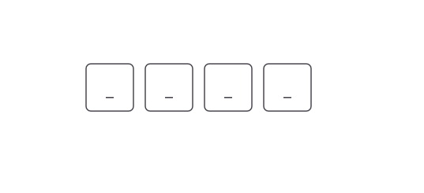

For placeholders with multiple characters, available input fields will sequentially display each character.

	


<otpInput:SfOtpInput Placeholder="wxyz" />
	



SfOtpInput otpInput = new SfOtpInput()
{
    Placeholder = "wxyz"
};




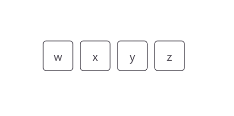

### Placeholder color

The color of placeholder text can be changed using the PlaceholderColor property.




<otpInput:SfOtpInput Placeholder="x" PlaceholderColor="Red" />




SfOtpInput otpInput = new SfOtpInput()
{
    Placeholder = "x",
    PlaceholderColor = Colors.Red
};




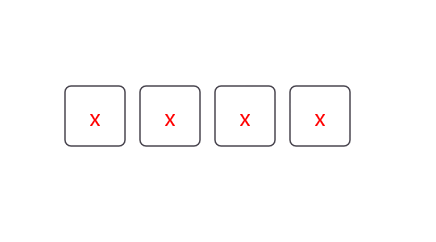

## Separator

The Separator property defines a character or symbol used to separate each input field, visually distinguishing inputs.




<otpInput:SfOtpInput Separator="/" />




SfOtpInput otpInput = new SfOtpInput()
{
    Separator = "/"
};




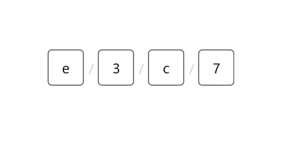

## Setting input length

You can specify the number of input fields to match the desired OTP code length by using the Length property. The default value is `4`.




<otpInput:SfOtpInput Length="6" />




SfOtpInput otpInput = new SfOtpInput()
{
    Length = 6
};




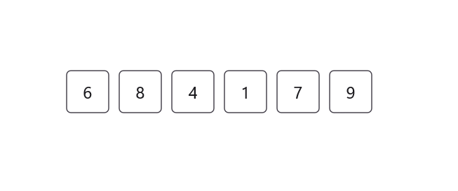

## Input box size

You can specify the width and height of each input box by using the BoxWidth and BoxHeight properties. This customization allows you to tailor the OTP input appearance to match your application's design. The default values are 40 for both width and height.

 
 

<otpInput:SfOtpInput BoxWidth="50" BoxHeight="50" /> 

 
 

SfOtpInput otpInput = new SfOtpInput() 
{ 
    BoxWidth = 50, 
    BoxHeight = 50 
}; 

 


## Input background

The InputBackground property customizes the appearance of input fields. This property works when StylingMode is set to Filled.




<otpInput:SfOtpInput InputBackground="LightPink" StylingMode="Filled" />




SfOtpInput otpInput = new SfOtpInput()
{
    InputBackground = Colors.LightPink,
    StylingMode = OtpInputStyle.Filled
};




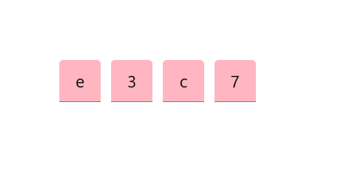

## Stroke

You can set the Stroke property to any color to customize the border appearance of the input fields. 




<otpInput:SfOtpInput Stroke="Blue" />




SfOtpInput otpInput = new SfOtpInput()
{
    Stroke = Colors.Blue
};




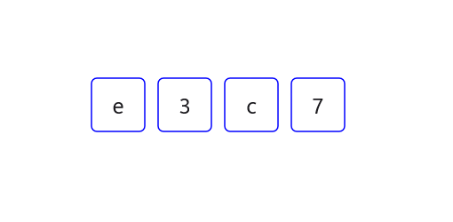

## Text color

You can set the TextColor property to any color to customize the text appearance of the input fields. 




<otpInput:SfOtpInput TextColor="Orange" />




SfOtpInput otpInput = new SfOtpInput()
{
    TextColor = Colors.Orange
};




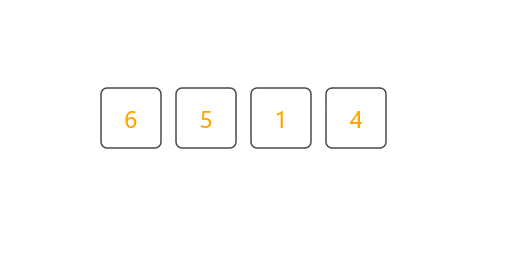

## Mask character

Set the MaskCharacter property to any character to define how the masked input is displayed, enhancing security by obscuring sensitive information. The `MaskCharacter` property applies only when Type is set to Password.




<otpInput:SfOtpInput Type="Password" MaskCharacter="#" />




SfOtpInput otpInput = new SfOtpInput()
{
    Type = OtpInputType.Password,
    MaskCharacter = '#'
};




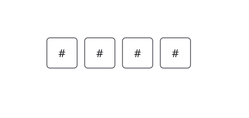

## Input state

The InputState property visually represent the validation status of the input fields.

### Success

The InputState can be set to Success to indicate that the input is correct. When the `InputState` is set to `Success`, the stroke of the OTP Input turns green.




<otpInput:SfOtpInput InputState="Success" />




SfOtpInput otpInput = new SfOtpInput()
{
    InputState = OtpInputState.Success
};




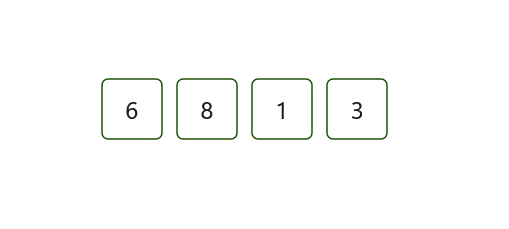

### Warning

The InputState can be set to Warning to indicate a potential issue with the input, prompting the user to correct it. The stroke of the OTP Input turns orange-brown when `InputState` is set to `Warning`.




<otpInput:SfOtpInput InputState="Warning" />




SfOtpInput otpInput = new SfOtpInput()
{
    InputState = OtpInputState.Warning
};




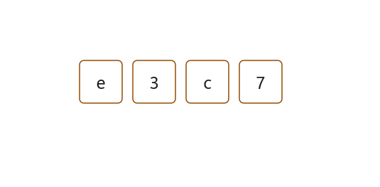

### Error

The InputState can be set to Error to indicate that the input is invalid or requires correction. The stroke of OTP Input turns red when `InputState` is set to `Error`.




<otpInput:SfOtpInput InputState="Error" />




SfOtpInput otpInput = new SfOtpInput()
{
    InputState = OtpInputState.Error
};




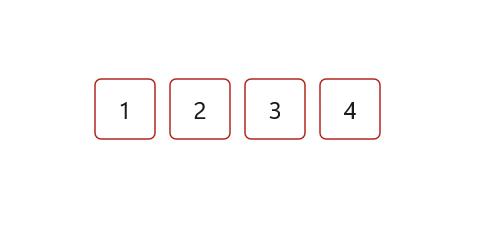

## Auto focus

The AutoFocus property in SfOtpInput is used to automatically set focus to the first input field when the control is loaded. This improves usability by allowing users to start entering the OTP immediately without manually selecting a field.




<otpInput:SfOtpInput AutoFocus="True" />




SfOtpInput otpInput = new SfOtpInput()
{
    AutoFocus = true
};


