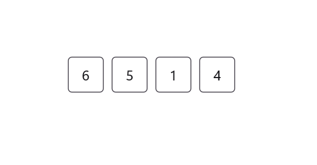
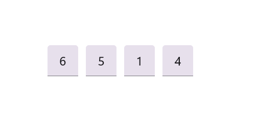
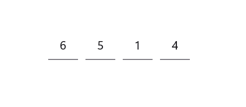

# Styling Modes in .NET MAUI OTP Input

Styling modes specify the visual style variants for input fields in the OTP Input component, allowing you to customize appearances according to your application's design needs.

## Outline mode

Customize the appearance of input fields with a border around them by setting the StylingMode property to Outlined. This is the default styling mode for the OTP Input component.

	


<otpInput:SfOtpInput StylingMode="Outlined" />
	



SfOtpInput otpInput = new SfOtpInput()
{
    StylingMode = OtpInputStyle.Outlined
};




## Filled mode

Customize the appearance of input fields by filling them with color by setting the StylingMode property to Filled.

	


<otpInput:SfOtpInput StylingMode="Filled" />
	



SfOtpInput otpInput = new SfOtpInput()
{
    StylingMode = OtpInputStyle.Filled
};




## Underline mode

Customize the appearance of input fields with an underline by setting the StylingMode property to Underlined.

	


<otpInput:SfOtpInput StylingMode="Underlined" />
	



SfOtpInput otpInput = new SfOtpInput()
{
    StylingMode = OtpInputStyle.Underlined
};




