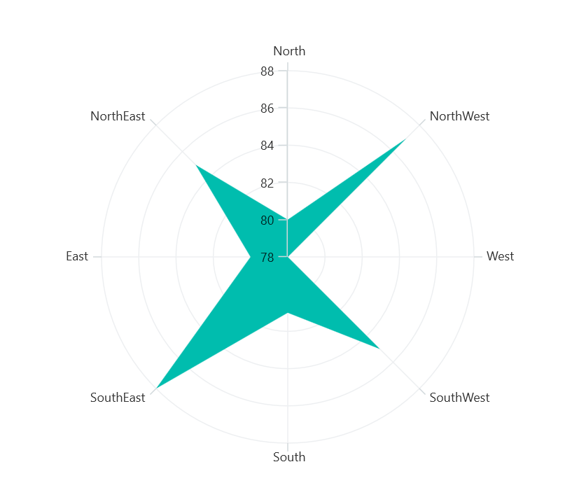
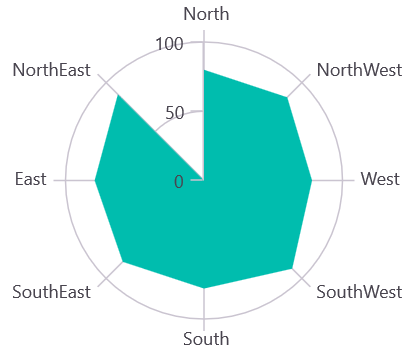

# Polar Area Chart in .NET MAUI Polar Chart

## Polar Area Chart

To display an area series in a polar chart, instantiate the [PolarAreaSeries](https://help.syncfusion.com/cr/maui/Syncfusion.Maui.Charts.PolarAreaSeries.html) and include it in the [Series](https://help.syncfusion.com/cr/maui/Syncfusion.Maui.Charts.SfPolarChart.html#Syncfusion_Maui_Charts_SfPolarChart_Series) collection property of [SfPolarChart](https://help.syncfusion.com/cr/maui/Syncfusion.Maui.Charts.SfPolarChart.html).

N> **Prerequisite:** Ensure that the required NuGet package is installed, the necessary namespaces are imported, and the **SfPolarChart** control is properly configured in your application. For detailed setup and configuration instructions, refer to the **[Getting Started](https://help.syncfusion.com/maui/polar-charts/getting-started)** guide.





<chart:SfPolarChart> 
    <chart:SfPolarChart.PrimaryAxis>
        <chart:CategoryAxis/>
    </chart:SfPolarChart.PrimaryAxis>

    <chart:SfPolarChart.SecondaryAxis>
        <chart:NumericalAxis/>
    </chart:SfPolarChart.SecondaryAxis>   

    <chart:PolarAreaSeries ItemsSource = "{Binding PlantDetails}"
                           XBindingPath = "Direction" 
                           YBindingPath = "Tree"/>  
</chart:SfPolarChart>





SfPolarChart chart = new SfPolarChart();

CategoryAxis primaryAxis = new CategoryAxis();
chart.PrimaryAxis = primaryAxis;

NumericalAxis secondaryAxis = new NumericalAxis();
chart.SecondaryAxis = secondaryAxis;

PolarAreaSeries series = new PolarAreaSeries()
{
    ItemsSource = new PlantViewModel().PlantDetails,
    XBindingPath = "Direction",
    YBindingPath = "Tree"
};

chart.Series.Add(series);
this.Content = chart;





## Closed Series

The [IsClosed](https://help.syncfusion.com/cr/maui/Syncfusion.Maui.Charts.PolarSeries.html#Syncfusion_Maui_Charts_PolarSeries_IsClosed) property is used to render the series with or without a closed path. The default value is `true`, which creates a closed polygon shape. Set to `false` to create an open path that doesn't connect the last point to the first.

**Note:** Negative Y values are not recommended for polar area charts as they may produce unexpected visualizations. Ensure all Y values are non-negative for optimal results.





<chart:SfPolarChart> 
    <!-- code omitted for brevity -->
    <chart:PolarAreaSeries ItemsSource = "{Binding PlantDetails}" 
                           XBindingPath = "Direction" 
                           YBindingPath = "Tree"
                           IsClosed = "False"/>  
</chart:SfPolarChart>





SfPolarChart chart = new SfPolarChart();
// code omitted for brevity
PolarAreaSeries series = new PolarAreaSeries()
{
    ItemsSource = new PlantViewModel().PlantDetails,
    XBindingPath = "Direction",
    YBindingPath = "Tree",
    IsClosed  = false
};

chart.Series.Add(series);
this.Content = chart;





