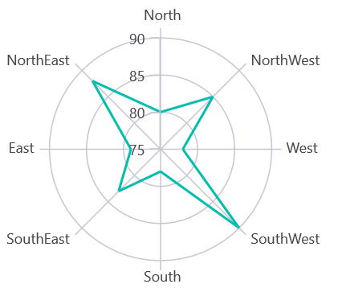
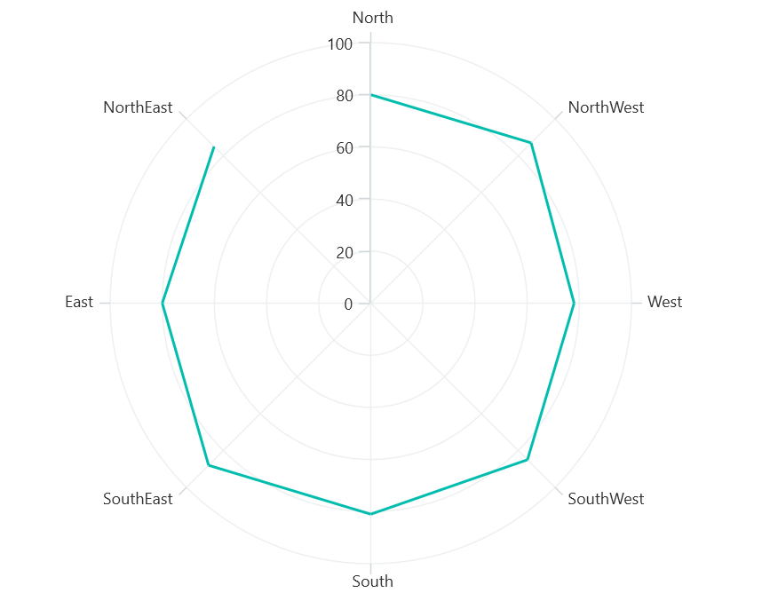

# Polar Line Chart in .NET MAUI Polar Chart

## Polar Line Chart

To display a line series in a polar chart, instantiate the [PolarLineSeries](https://help.syncfusion.com/cr/maui/Syncfusion.Maui.Charts.PolarLineSeries.html) and include it in the [Series](https://help.syncfusion.com/cr/maui/Syncfusion.Maui.Charts.SfPolarChart.html#Syncfusion_Maui_Charts_SfPolarChart_Series) collection property of [SfPolarChart](https://help.syncfusion.com/cr/maui/Syncfusion.Maui.Charts.SfPolarChart.html).

N> **Prerequisite:** Ensure that the required NuGet package is installed, the necessary namespaces are imported, and the **SfPolarChart** control is properly configured in your application. For detailed setup and configuration instructions, refer to the **[Getting Started](https://help.syncfusion.com/maui/polar-charts/getting-started)** guide.





<chart:SfPolarChart>
    <chart:SfPolarChart.PrimaryAxis>
        <chart:CategoryAxis/>
    </chart:SfPolarChart.PrimaryAxis>

    <chart:SfPolarChart.SecondaryAxis>
        <chart:NumericalAxis/>
    </chart:SfPolarChart.SecondaryAxis>   

    <chart:PolarLineSeries ItemsSource = "{Binding PlantDetails}"
                           XBindingPath = "Direction"
                           YBindingPath = "Tree"/>  
</chart:SfPolarChart>





SfPolarChart chart = new SfPolarChart();

CategoryAxis primaryAxis = new CategoryAxis();
chart.PrimaryAxis = primaryAxis;

NumericalAxis secondaryAxis = new NumericalAxis();
chart.SecondaryAxis = secondaryAxis;

PolarLineSeries series = new PolarLineSeries()
{
    ItemsSource = new PlantViewModel().PlantDetails,
    XBindingPath = "Direction",
    YBindingPath = "Tree"
};

chart.Series.Add(series);
this.Content = chart;





## Customizing Line Appearance

You can customize the polar line series appearance using the following properties:

* [Stroke](https://help.syncfusion.com/cr/maui/Syncfusion.Maui.Charts.ChartSeries.html#Syncfusion_Maui_Charts_ChartSeries_Stroke) - Gets or sets the brush for the line color
* [StrokeWidth](https://help.syncfusion.com/cr/maui/Syncfusion.Maui.Charts.ChartSeries.html#Syncfusion_Maui_Charts_ChartSeries_StrokeWidth) - Gets or sets the thickness of the line
* [StrokeDashArray](https://help.syncfusion.com/cr/maui/Syncfusion.Maui.Charts.ChartSeries.html#Syncfusion_Maui_Charts_ChartSeries_StrokeDashArray) - Gets or sets the pattern for dashed lines

The following code example demonstrates line customization:





<chart:SfPolarChart>
    <!-- code omitted for brevity -->
    <chart:PolarLineSeries ItemsSource = "{Binding PlantDetails}" 
                           XBindingPath = "Direction" 
                           YBindingPath = "Tree"
                           Stroke = "Blue" 
                           StrokeWidth = "2"/>
</chart:SfPolarChart>





SfPolarChart chart = new SfPolarChart();
// code omitted for brevity
PolarLineSeries series = new PolarLineSeries()
{
    ItemsSource = new PlantViewModel().PlantDetails,
    XBindingPath = "Direction",
    YBindingPath = "Tree",
    Stroke = Colors.Blue,
    StrokeWidth = 2
};

chart.Series.Add(series);
this.Content = chart;





## Closed Series

The [IsClosed](https://help.syncfusion.com/cr/maui/Syncfusion.Maui.Charts.PolarSeries.html#Syncfusion_Maui_Charts_PolarSeries_IsClosed) property is used to render the series with or without closed path. The default value of [IsClosed](https://help.syncfusion.com/cr/maui/Syncfusion.Maui.Charts.PolarSeries.html#Syncfusion_Maui_Charts_PolarSeries_IsClosed) is `true`.





<chart:SfPolarChart> 
    <!-- code omitted for brevity -->
    <chart:PolarLineSeries ItemsSource = "{Binding PlantDetails}"
                           XBindingPath = "Direction" 
                           YBindingPath = "Tree"
                           IsClosed = "False"/>  
</chart:SfPolarChart>





SfPolarChart chart = new SfPolarChart();
// code omitted for brevity
PolarLineSeries series = new PolarLineSeries()
{
    ItemsSource = new PlantViewModel().PlantDetails,
    XBindingPath = "Direction",
    YBindingPath = "Tree",
    IsClosed  = false
};

chart.Series.Add(series);
this.Content = chart;





