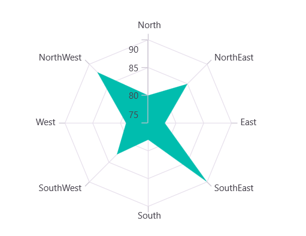
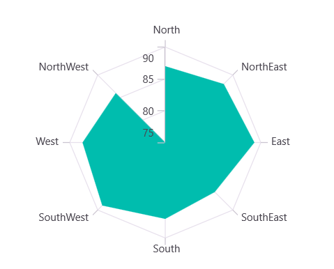

# Radar Area Chart in .NET MAUI Polar Chart

## Radar Area Chart

To display an area series in a radar chart, instantiate the [PolarAreaSeries](https://help.syncfusion.com/cr/maui/Syncfusion.Maui.Charts.PolarAreaSeries.html), set the [GridLineType](https://help.syncfusion.com/cr/maui/Syncfusion.Maui.Charts.SfPolarChart.html#Syncfusion_Maui_Charts_SfPolarChart_GridLineType) property of `SfPolarChart` to `Polygon`, and add the series to the `Series` collection. The polygon grid lines create the radar chart appearance.

N> **Prerequisite:** Ensure that the required NuGet package is installed, the necessary namespaces are imported, and the **SfPolarChart** control is properly configured in your application. For detailed setup and configuration instructions, refer to the **[Getting Started](https://help.syncfusion.com/maui/polar-charts/getting-started)** guide.





<chart:SfPolarChart GridLineType="Polygon">

    <chart:SfPolarChart.PrimaryAxis>
        <chart:CategoryAxis/>
    </chart:SfPolarChart.PrimaryAxis>

    <chart:SfPolarChart.SecondaryAxis>
        <chart:NumericalAxis/>
    </chart:SfPolarChart.SecondaryAxis>

    <chart:PolarAreaSeries ItemsSource="{Binding PlantDetails}"
                           XBindingPath="Direction"
                           YBindingPath="Tree"/>

</chart:SfPolarChart>





SfPolarChart chart = new SfPolarChart();
chart.GridLineType = PolarChartGridLineType.Polygon;

CategoryAxis primaryAxis = new CategoryAxis();
chart.PrimaryAxis = primaryAxis;

NumericalAxis secondaryAxis = new NumericalAxis();
chart.SecondaryAxis = secondaryAxis;

PolarAreaSeries series = new PolarAreaSeries()
{
    ItemsSource = new PlantViewModel().PlantDetails,
    XBindingPath = "Direction",
    YBindingPath = "Tree"
};

chart.Series.Add(series);
this.Content = chart;





## Closed Series

The [IsClosed](https://help.syncfusion.com/cr/maui/Syncfusion.Maui.Charts.PolarSeries.html#Syncfusion_Maui_Charts_PolarSeries_IsClosed) property is used to render the series with or without a closed path. The default value is `true`, which creates a closed polygon shape. Set it to `false` to create an open path that does not connect the last point to the first.

> **Note:** Negative Y values are not recommended for radar area charts as they may produce unexpected visualizations. Ensure all Y values are non-negative for optimal results.





<chart:SfPolarChart GridLineType="Polygon">
    <!-- code omitted for brevity -->

    <chart:PolarAreaSeries ItemsSource="{Binding PlantDetails}"
                           XBindingPath="Direction"
                           YBindingPath="Tree"
                           IsClosed="False"/>

</chart:SfPolarChart>





SfPolarChart chart = new SfPolarChart();
chart.GridLineType = PolarChartGridLineType.Polygon;

// code omitted for brevity

PolarAreaSeries series = new PolarAreaSeries()
{
    ItemsSource = new PlantViewModel().PlantDetails,
    XBindingPath = "Direction",
    YBindingPath = "Tree",
    IsClosed = false
};

chart.Series.Add(series);
this.Content = chart;





