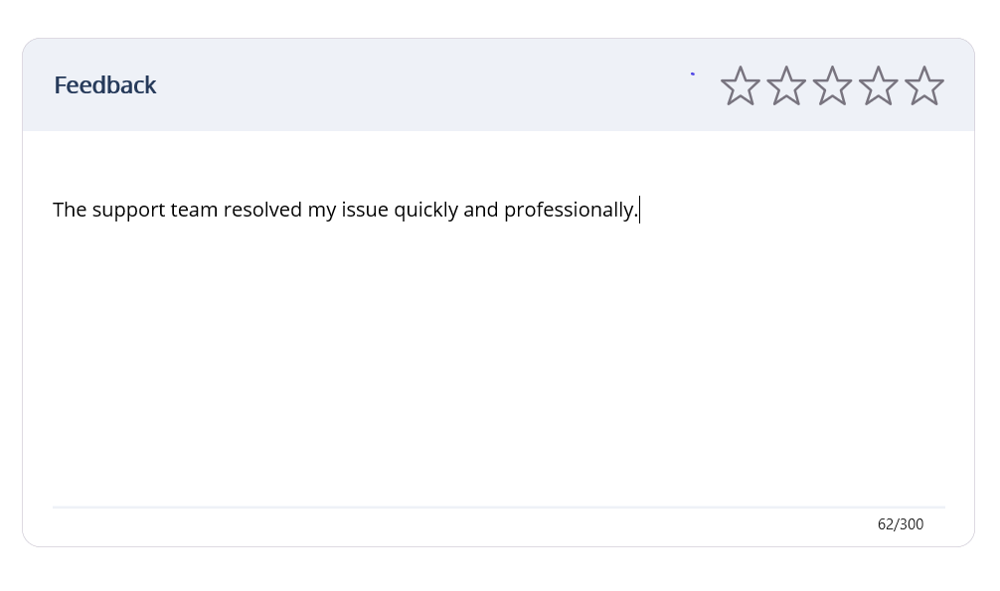

# AI-Powered Rating Feedback in .NET MAUI Rating

This sample uses Azure OpenAI to analyze customer support feedback and display a suggested satisfaction rating with the Syncfusion [.NET MAUI Rating](https://help.syncfusion.com/cr/maui/Syncfusion.Maui.Inputs.SfRating.html) control. As the user enters feedback, the app waits briefly before sending it for analysis and updates the read-only rating with the result.

## Prerequisites

- A .NET MAUI app with the Syncfusion [.NET MAUI Rating](https://help.syncfusion.com/maui/rating/overview) and TextInputLayout controls.
- An Azure OpenAI resource with a deployed chat model.
- The [Azure.AI.OpenAI](https://www.nuget.org/packages/Azure.AI.OpenAI) NuGet package.

Configure your Azure OpenAI endpoint, deployment name, and API key as environment variables for the app.

## Integrating Azure OpenAI with the .NET MAUI App

The sample's `OpenAIService` creates an `AzureOpenAIClient` and uses the configured deployment to submit the feedback. Add the NuGet package to an app that does not already include it:




dotnet add package Azure.AI.OpenAI




The service sends a system instruction describing the rating scale and the feedback text as the user message.

## Implementing AI-Powered Rating Feedback

### Step 1: Create the Feedback and Rating UI

Use an `Editor` inside `SfTextInputLayout` to collect feedback. The `CharMaxLength` property limits the input to 300 characters, and the `TextChanged` event passes changes to the view model.




<inputLayout:SfTextInputLayout CharMaxLength="300"
                               ShowCharCount="True">
    <Editor Placeholder="Describe your customer support experience..."
            TextChanged="OnFeedbackTextChanged" />
</inputLayout:SfTextInputLayout>




Bind `SfRating` to the view model's `Rating` property and set `IsReadOnly` to `True` so the suggested score is controlled by the AI response.




<rating:SfRating ItemCount="5"
                 ItemSize="32"
                 Value="{Binding Rating, Mode=OneWay}"
                 IsReadOnly="True" />




The sample also binds an `ActivityIndicator` to `IsAnalyzing` and displays `ErrorMessage` when a request fails.

### Step 2: Analyze Feedback and Update the Rating

The page forwards editor changes to `MainViewModel.OnFeedbackChanged`. The view model cancels the previous request, resets the displayed rating, and waits 500 milliseconds before requesting a new rating. It uses cancellation and a request-version check to prevent an older response from replacing the result for newer text.

`OpenAIService.GetSuggestedRatingAsync` sends the feedback to the configured chat deployment. It parses the response as an invariant-culture decimal and clamps valid numbers to the `0.0`–`5.0` range before returning them:




var messages = new List<ChatMessage>
{
    new SystemChatMessage(SystemPrompt),
    new UserChatMessage(feedback)
};

ChatCompletion response = await _client
    .GetChatClient(_deploymentName)
    .CompleteChatAsync(messages, cancellationToken: cancellationToken);

string result = response.Content[0].Text.Trim();
if (double.TryParse(result, NumberStyles.Float, CultureInfo.InvariantCulture, out double rating))
{
    return Math.Clamp(rating, 0.0, 5.0);
}

throw new InvalidOperationException(
    $"AI returned a value that could not be parsed as a number: '{result}'.");




The system instruction asks the model to return a rating from `0.0` to `5.0`.

### Step 3: Register the Services

Register `OpenAIService`, `MainViewModel`, and `MainPage` with the .NET MAUI dependency injection container in `MauiProgram`.




builder.Services.AddSingleton<OpenAIService>();
builder.Services.AddSingleton<MainViewModel>();
builder.Services.AddSingleton<MainPage>();




The app validates the Azure OpenAI configuration at startup and displays an alert if the service cannot be configured.

## Output

The following image shows the AI-powered rating feedback sample.

You can find the complete sample in the [AI use-case demos repository](https://github.com/syncfusion/maui-ai-usecase-demos/tree/master/AI%20Solutions/Rating/AIRatingFeedback).
