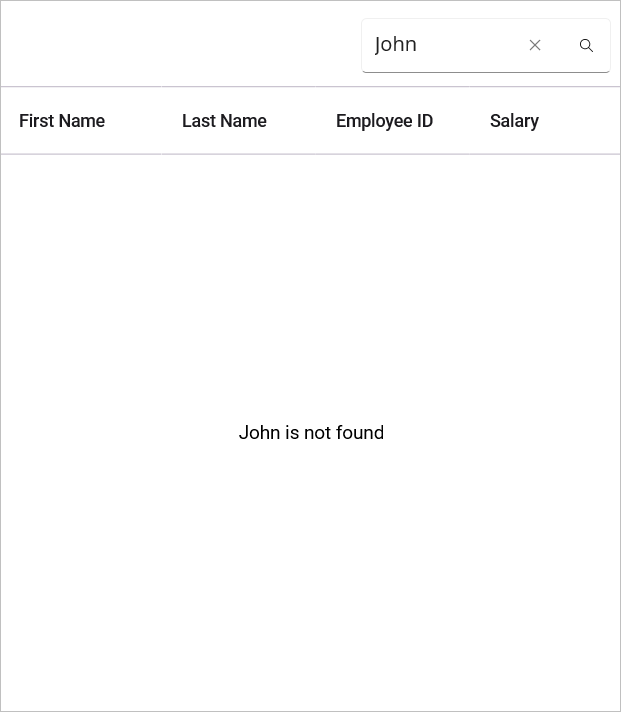

# Empty View in .NET MAUI Tree Grid

The [SfTreeGrid](https://help.syncfusion.com/cr/maui/Syncfusion.Maui.TreeGrid.SfTreeGrid.html) provides options to display and customize an empty view when no data is available. The empty view is displayed below the header row when the [ItemsSource](https://help.syncfusion.com/cr/maui/Syncfusion.Maui.TreeGrid.SfTreeGrid.html#Syncfusion_Maui_TreeGrid_SfTreeGrid_ItemsSource) is `null` or when no rows are available for display, such as when the collection is empty or a filter excludes all records. The empty view is automatically hidden as soon as at least one row becomes available.

* [EmptyView](): An object that can be set to a string or a view when the `SfTreeGrid` has no items to display. The default value is `null`. The empty view is displayed only when this property is not `null`. 
* [EmptyViewTemplate](): A [DataTemplate](https://learn.microsoft.com/en-us/dotnet/api/microsoft.maui.controls.datatemplate) used to customize the appearance and layout of the empty view. The default value is `null`. A [DataTemplateSelector](https://learn.microsoft.com/en-us/dotnet/api/microsoft.maui.controls.datatemplateselector) can also be assigned.

N> The TreeGrid does not expose any events or methods related to the empty view.

## Display a string when TreeGrid has no items

The `EmptyView` property can be set to a string that is displayed when the [ItemsSource](https://help.syncfusion.com/cr/maui/Syncfusion.Maui.TreeGrid.SfTreeGrid.html#Syncfusion_Maui_TreeGrid_SfTreeGrid_ItemsSource) property is null, or when the collection specified by the `ItemsSource` property is either empty or null.



<syncfusion:SfTreeGrid x:Name="treeGrid"
                       ItemsSource="{Binding PersonDetails}"
                       ChildPropertyName="Children"
                       EmptyView="No records found">
</syncfusion:SfTreeGrid>


SfTreeGrid treeGrid = new SfTreeGrid();
EmployeeViewModel employeeViewModel = new EmployeeViewModel();
treeGrid.ItemsSource = employeeViewModel.PersonDetails;
treeGrid.ChildPropertyName = "Children";
treeGrid.EmptyView = "No records found";
this.Content = treeGrid;



## Display views when TreeGrid has no items

The `EmptyView` property can also be set to any custom view, such as a layout containing icons, labels, or buttons. This view is displayed whenever the `ItemsSource` is null or contains no items.



<syncfusion:SfTreeGrid x:Name="treeGrid"
                       ItemsSource="{Binding PersonDetails}"
                       ChildPropertyName="Children">
        <syncfusion:SfTreeGrid.EmptyView>
                <StackLayout HorizontalOptions="Center"
                             VerticalOptions="Center"
                             Spacing="10">
                        <Label Text="&#xE7A4;"
                               FontSize="28"
                               TextColor="Gray"
                               FontFamily="MauiMaterialAssets.ttf"
                               HorizontalOptions="Center"/>
                        <Label Text="No records to display"
                               FontSize="16"
                               TextColor="Gray"
                               HorizontalOptions="Center"/>
                </StackLayout>
        </syncfusion:SfTreeGrid.EmptyView>
</syncfusion:SfTreeGrid>


SfTreeGrid treeGrid = new SfTreeGrid();
EmployeeViewModel employeeViewModel = new EmployeeViewModel();
treeGrid.ItemsSource = employeeViewModel.PersonDetails;
treeGrid.ChildPropertyName = "Children";

StackLayout stackLayout = new StackLayout()
{
    HorizontalOptions = LayoutOptions.Center,
    VerticalOptions = LayoutOptions.Center,
    Spacing = 10
};

var iconLabel = new Label()
{
    Text = "\uE7A4",
    FontSize = 28,
    TextColor = Colors.Gray,
    FontFamily = "MauiMaterialAssets.ttf",
    HorizontalOptions = LayoutOptions.Center,
};

var textLabel = new Label()
{
    Text = "No records to display",
    FontSize = 16,
    TextColor = Colors.Gray,
    HorizontalOptions = LayoutOptions.Center,
};

stackLayout.Children.Add(iconLabel);
stackLayout.Children.Add(textLabel);

treeGrid.EmptyView = stackLayout;
this.Content = treeGrid;



> **Note:** The `EmptyView` can be a single view (such as an `Image` or `Label`) or a layout container that contains multiple child controls. When a string value is assigned to the EmptyView property, the TreeGrid displays it in a `Label` centered within the available area.

## Display a DataTemplate when TreeGrid has no items

### Using EmptyViewTemplate

Users can set the `EmptyViewTemplate` property to a [DataTemplate](https://learn.microsoft.com/en-us/dotnet/api/microsoft.maui.controls.datatemplate) to define the appearance and layout of the empty view. When an EmptyViewTemplate is provided, its content is displayed instead of the value specified in the `EmptyView` property.



<syncfusion:SfTreeGrid x:Name="treeGrid"
                       ItemsSource="{Binding PersonDetails}"
                       ChildPropertyName="Children"
                       EmptyView="No records found">
        <syncfusion:SfTreeGrid.EmptyViewTemplate>
                <DataTemplate>
                        <Label Text="Records not found"
                               TextColor="Gray"
                               FontSize="18"
                               HorizontalOptions="Center"
                               VerticalOptions="Center"/>
                </DataTemplate>
        </syncfusion:SfTreeGrid.EmptyViewTemplate>
</syncfusion:SfTreeGrid>


SfTreeGrid treeGrid = new SfTreeGrid();
EmployeeViewModel employeeViewModel = new EmployeeViewModel();
treeGrid.ItemsSource = employeeViewModel.PersonDetails;
treeGrid.ChildPropertyName = "Children";
treeGrid.EmptyView = "No records found";
treeGrid.EmptyViewTemplate = new DataTemplate(() =>
{
    return new Label
    {
        Text = "Records not found",
        TextColor = Colors.Gray,
        FontSize = 18,
        HorizontalOptions = LayoutOptions.Center,
        VerticalOptions = LayoutOptions.Center
    };
});
this.Content = treeGrid;



N> Set the `EmptyView` property to a non-null value when using `EmptyViewTemplate`. The TreeGrid displays the empty view only when `EmptyView` is not `null`, even if an `EmptyViewTemplate` is assigned.

### Using DataTemplateSelector

The `EmptyViewTemplate` property also supports a `DataTemplateSelector`, allowing the template to be selected dynamically at runtime. The TreeGrid passes its `ItemsSource` as the item and the TreeGrid instance as the container to the `OnSelectTemplate` method.



<ContentPage.BindingContext>
    <local:EmployeeViewModel/>
</ContentPage.BindingContext>

<ContentPage.Resources>
    <ResourceDictionary>
        <DataTemplate x:Key="BasicTemplate">
            <Label Text="Records not found"
                   HorizontalTextAlignment="Center"
                   VerticalTextAlignment="Center"/>
        </DataTemplate>
        <DataTemplate x:Key="AdvancedTemplate">
            <Label Text="No data source is assigned"
                   HorizontalTextAlignment="Center"
                   VerticalTextAlignment="Center"/>
        </DataTemplate>
    </ResourceDictionary>
</ContentPage.Resources>

<syncfusion:SfTreeGrid x:Name="treeGrid"
                       ItemsSource="{Binding PersonDetails}"
                       ChildPropertyName="Children"
                       EmptyView="No records found">
        <syncfusion:SfTreeGrid.EmptyViewTemplate>
                <local:EmptyViewTemplateSelector BasicTemplate="{StaticResource BasicTemplate}"
                                                 AdvancedTemplate="{StaticResource AdvancedTemplate}"/>
        </syncfusion:SfTreeGrid.EmptyViewTemplate>
</syncfusion:SfTreeGrid>


SfTreeGrid treeGrid = new SfTreeGrid();
EmployeeViewModel employeeViewModel = new EmployeeViewModel();
treeGrid.ItemsSource = employeeViewModel.PersonDetails;
treeGrid.ChildPropertyName = "Children";
treeGrid.EmptyView = "No records found";
treeGrid.EmptyViewTemplate = new EmptyViewTemplateSelector
{
    BasicTemplate = new DataTemplate(() => new Label { Text = "Records not found", HorizontalTextAlignment = TextAlignment.Center, VerticalTextAlignment = TextAlignment.Center }),
    AdvancedTemplate = new DataTemplate(() => new Label { Text = "No data source is assigned", HorizontalTextAlignment = TextAlignment.Center, VerticalTextAlignment = TextAlignment.Center })
};
this.Content = treeGrid;





public class EmptyViewTemplateSelector : DataTemplateSelector
{
    public DataTemplate? BasicTemplate { get; set; }

    public DataTemplate? AdvancedTemplate { get; set; }

    protected override DataTemplate? OnSelectTemplate(object item, BindableObject container)
    {
        // item is the ItemsSource of the TreeGrid.
        return item == null ? AdvancedTemplate : BasicTemplate;
    }
}



N> The `DataTemplateSelector` is evaluated when the `EmptyViewTemplate` property is assigned, not each time the empty view is displayed.

### Using EmptyViewTemplate with Custom Binding

For dynamic scenarios such as filtering or searching hierarchical data, you can set the `EmptyView` property to a custom object and bind it to dynamic data, such as search text. The `EmptyViewTemplate` property can then be used to define how the object is displayed when no records match the filter criteria or when the data source is empty.



<ContentPage xmlns="http://schemas.microsoft.com/dotnet/2021/maui"
             xmlns:x="http://schemas.microsoft.com/winfx/2009/xaml"
             xmlns:syncfusion="clr-namespace:Syncfusion.Maui.TreeGrid;assembly=Syncfusion.Maui.TreeGrid"
             xmlns:local="clr-namespace:YourAppNamespace"
             x:Class="YourAppNamespace.MainPage">

    <StackLayout>
        <SearchBar x:Name="filterText"
                   FontSize="16"
                   Placeholder="Filter Employees"
                   WidthRequest="250"
                   Margin="0,0,0,10"/>

        <syncfusion:SfTreeGrid x:Name="treeGrid"
                               ItemsSource="{Binding PersonDetails}"
                               ChildPropertyName="Children">
            <syncfusion:SfTreeGrid.EmptyView>
                <local:FilterItem Filter="{Binding Source={x:Reference filterText}, Path=Text}"
                                  x:Name="filter"/>
            </syncfusion:SfTreeGrid.EmptyView>
            <syncfusion:SfTreeGrid.EmptyViewTemplate>
                <DataTemplate>
                    <Label Text="{Binding Source={x:Reference filterText}, Path=Text, StringFormat='{0} is not found'}"
                           TextColor="Black"
                           HorizontalTextAlignment="Center"
                           VerticalOptions="Center"
                           FontSize="15"
                           FontFamily="Roboto-Regular"/>
                </DataTemplate>
            </syncfusion:SfTreeGrid.EmptyViewTemplate>
        </syncfusion:SfTreeGrid>
    </StackLayout>
</ContentPage>


StackLayout stackLayout = new StackLayout();

// SearchBar for filtering
var filterText = new SearchBar()
{
    FontSize = 16,
    Placeholder = "Filter Employees",
    WidthRequest = 250,
    Margin = new Thickness(0, 0, 0, 10),
};

// Initialize SfTreeGrid
SfTreeGrid treeGrid = new SfTreeGrid();
EmployeeViewModel employeeViewModel = new EmployeeViewModel();
treeGrid.ItemsSource = employeeViewModel.PersonDetails;
treeGrid.ChildPropertyName = "Children";

// Define custom EmptyView object
var filterItem = new FilterItem();
filterItem.SetBinding(
    FilterItem.FilterProperty,
    new Binding(
        path: nameof(SearchBar.Text),
        source: filterText
    )
);

treeGrid.EmptyView = filterItem;

// Define EmptyViewTemplate
treeGrid.EmptyViewTemplate = new DataTemplate(() =>
{
    var label = new Label
    {
        TextColor = Colors.Black,
        HorizontalTextAlignment = TextAlignment.Center,
        VerticalOptions = LayoutOptions.Center,
        FontSize = 15,
        FontFamily = "Roboto-Regular"
    };

    label.SetBinding(
        Label.TextProperty,
        new Binding(
            path: nameof(SearchBar.Text),
            source: filterText,
            stringFormat: "\"{0}\" is not found"
        )
    );

    return label;
});

stackLayout.Children.Add(filterText);
stackLayout.Children.Add(treeGrid);
this.Content = stackLayout;



The `FilterItem` class defines a bindable property for the filter text:



public class FilterItem : BindableObject
{
    public static readonly BindableProperty FilterProperty = BindableProperty.Create(nameof(Filter), typeof(string), typeof(FilterItem), null);

    public string Filter
    {
        get { return (string)GetValue(FilterProperty); }
        set { SetValue(FilterProperty, value); }
    }
}



> **Note:** Place the `FilterItem.cs` file in your app's main project directory or in a Models folder (e.g., `Models/FilterItem.cs`) alongside your XAML pages.

In this scenario, a `FilterItem` object is assigned to the `EmptyView` property, and its `Filter` property is bound to the `SearchBar.Text` property. When the `SearchBar.TextChanged` event is raised, the current search text is stored in the `Filter` property. If filtering results in no visible tree nodes, the `EmptyViewTemplate` is displayed and uses the bound Filter value to show a dynamic message based on the search term.

 **How FilterProperty works:** `BindableProperty.Create` enables property binding in .NET MAUI. The `FilterProperty` BindableProperty allows the `Filter` property to respond to changes from external bindings, such as `SearchBar.Text`, ensuring that the empty view content is updated automatically whenever the search text changes.

 
