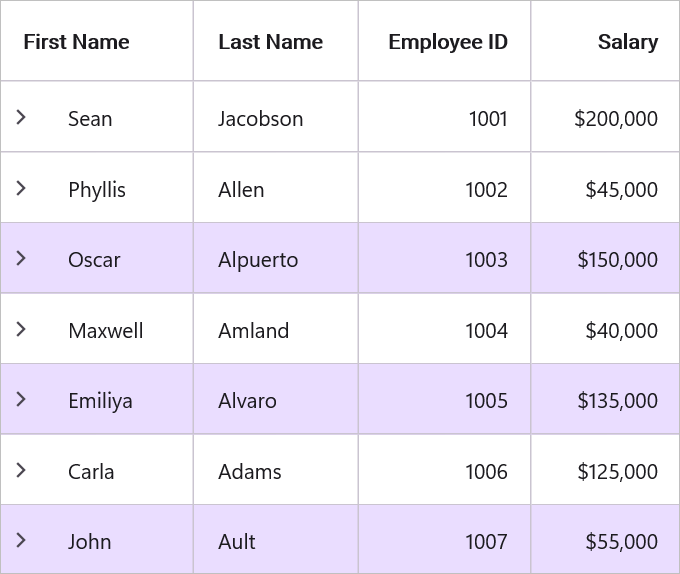
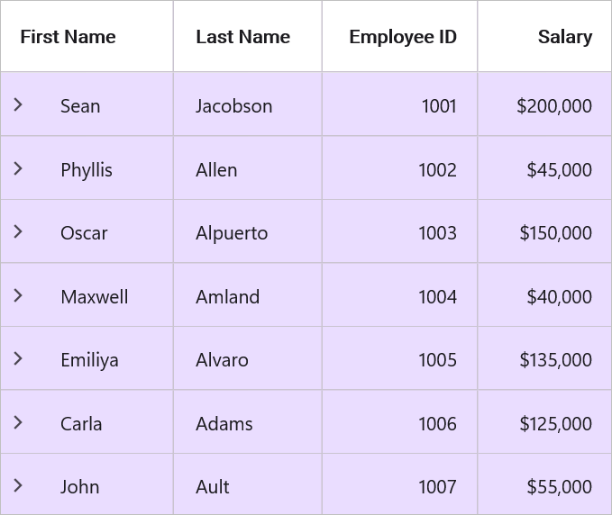
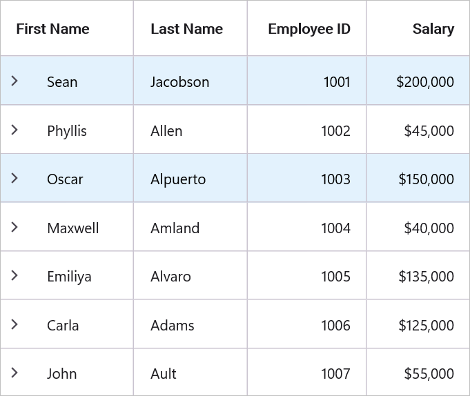

# Selection in .NET MAUI TreeGrid

The MAUI TreeGrid [SfTreeGrid](https://help.syncfusion.com/cr/maui/Syncfusion.Maui.TreeGrid.html) allows you to select one or more rows or cells. The [SelectionMode](https://help.syncfusion.com/cr/maui/Syncfusion.Maui.TreeGrid.SfTreeGrid.html#Syncfusion_Maui_TreeGrid_SfTreeGrid_SelectionMode) property determines how many items can be selected, and the [SelectionUnit](https://help.syncfusion.com/cr/maui/Syncfusion.Maui.TreeGrid.SfTreeGrid.html#Syncfusion_Maui_TreeGrid_SfTreeGrid_SelectionUnit) property determines whether the selection is performed on rows or on cells.

## Selection unit

The `SelectionUnit` property accepts the following [TreeGridSelectionUnit](https://help.syncfusion.com/cr/maui/Syncfusion.Maui.TreeGrid.TreeGridSelectionUnit.html) values.

<table>
<tr>
<th>Unit</th>
<th>Description</th>
</tr>
<tr>
<td>Row</td>
<td>Allows selection of a row or a group of rows, either programmatically or by user interaction. Tapping a cell selects the entire row. This is the default value.</td>
</tr>
<tr>
<td>Cell</td>
<td>Allows selection of a cell or a group of cells, either programmatically or by user interaction. Tapping a cell selects only that cell and not the entire row.</td>
</tr>
</table>



<treeGrid:SfTreeGrid x:Name="treeGrid"
                     ItemsSource="{Binding PersonDetails}"
                     ChildPropertyName="Children"
                     NavigationMode="Cell"
                     SelectionUnit="Cell"
                     SelectionMode="Multiple">
</treeGrid:SfTreeGrid>



SfTreeGrid treeGrid = new SfTreeGrid();
treeGrid.ItemsSource = viewModel.PersonDetails;
treeGrid.ChildPropertyName = "Children";
treeGrid.NavigationMode = TreeGridNavigationMode.Cell;
treeGrid.SelectionUnit = TreeGridSelectionUnit.Cell;
treeGrid.SelectionMode = TreeGridSelectionMode.Multiple;
this.Content = treeGrid;



N> `SelectionUnit.Cell` requires `NavigationMode` to be `Cell`. An `InvalidOperationException` is thrown if you set `SelectionUnit` to `Cell` while `NavigationMode` is `Row`, or set `NavigationMode` to `Row` while `SelectionUnit` is not `Row`.

## Current cell navigation

Keyboard navigation is determined by the [NavigationMode](https://help.syncfusion.com/cr/maui/Syncfusion.Maui.TreeGrid.SfTreeGrid.html#Syncfusion_Maui_TreeGrid_SfTreeGrid_NavigationMode) property, which accepts [TreeGridNavigationMode](https://help.syncfusion.com/cr/maui/Syncfusion.Maui.TreeGrid.TreeGridNavigationMode.html) values.

* `Cell` (default) - Navigates between the cells of a row as well as between rows. The current cell border is displayed.
* `Row` - Navigates only between rows. The current row highlight is displayed.

Keyboard navigation can be turned off by setting [AllowKeyboardNavigation](https://help.syncfusion.com/cr/maui/Syncfusion.Maui.TreeGrid.SfTreeGrid.html#Syncfusion_Maui_TreeGrid_SfTreeGrid_AllowKeyboardNavigation) to `false`.

## Selection Modes

The [TreeGridSelectionMode](https://help.syncfusion.com/cr/maui/Syncfusion.Maui.TreeGrid.TreeGridSelectionMode.html) enumeration applies to both row and cell selection.

<table>
<tr>
<th>Modes</th>
<th>Description</th>
</tr>
<tr>
<td>None</td>
<td>Disables selection entirely. No rows or cells can be selected. This is the default value.</td>
</tr>
<tr>
<td>Single</td>
<td>Allows selection of a single row or cell. Previous selection is cleared when selecting a different row or cell.</td>
</tr>
<tr>
<td>Multiple</td>
<td>Allows selection of more than one row or cell. Selection is not cleared when selecting additional rows or cells. Tap an already selected row or cell a second time to deselect it.</td>
</tr>
<tr>
<td>SingleDeselect</td>
<td>Allows selection of a single row or cell only. Tap the row or cell again to deselect it. Previous selection is cleared when selecting a different row or cell.</td>
</tr>
<tr>
<td>Extended</td>
<td>Allows selection of multiple rows or cells using the <kbd>Ctrl</kbd> and <kbd>Shift</kbd> key modifiers, or by dragging the mouse. See See <a href="#extended-selection" aria-label="Jump to details about extended row and cell selection">Extended selection</a>.</td>
</tr>
</table>



<treeGrid:SfTreeGrid x:Name="treeGrid"
                     ItemsSource="{Binding PersonDetails}"
                     ChildPropertyName="Children"
                     SelectionMode="Multiple">
</treeGrid:SfTreeGrid>



SfTreeGrid treeGrid = new SfTreeGrid();
treeGrid.ItemsSource = viewModel.PersonDetails;
treeGrid.SelectionMode = TreeGridSelectionMode.Multiple;
treeGrid.ChildPropertyName = "Children";
this.Content = treeGrid;



When `SelectionMode` is changed at runtime, the existing selection is adjusted: `None` clears the selection, `Single` and `SingleDeselect` keep only one selected item when more than one is selected, and `Multiple` and `Extended` keep the selection as it is.

## Disable selection for rows, cells, and columns

Disable selection for a particular row, cell, or column by handling the [CurrentCellActivating](https://help.syncfusion.com/cr/maui/Syncfusion.Maui.TreeGrid.SfTreeGrid.html#Syncfusion_Maui_TreeGrid_SfTreeGrid_CurrentCellActivating) event and setting `Cancel` to `true`. The [TreeGridCurrentCellActivatingEventArgs](https://help.syncfusion.com/cr/maui/Syncfusion.Maui.TreeGrid.TreeGridCurrentCellActivatingEventArgs.html) provides `OldRowColumnIndex` and `NewRowColumnIndex`.



treeGrid.CurrentCellActivating += TreeGrid_CurrentCellActivating;

private void TreeGrid_CurrentCellActivating(object? sender, TreeGridCurrentCellActivatingEventArgs e)
{
    // Prevent the first column from becoming the current cell.
    if (e.NewRowColumnIndex.ColumnIndex == 0)
        e.Cancel = true;
}



To prevent a column from receiving focus, set the [AllowFocus](https://help.syncfusion.com/cr/maui/Syncfusion.Maui.TreeGrid.TreeGridColumn.html#Syncfusion_Maui_TreeGrid_TreeGridColumn_AllowFocus) property of the column to `false`.



<treeGrid:SfTreeGrid.Columns>
    <treeGrid:TreeGridTextColumn MappingName="FirstName" AllowFocus="False" />
</treeGrid:SfTreeGrid.Columns>



## Getting selected rows

The `SfTreeGrid` provides [SelectedIndex](https://help.syncfusion.com/cr/maui/Syncfusion.Maui.TreeGrid.SfTreeGrid.html#Syncfusion_Maui_TreeGrid_SfTreeGrid_SelectedIndex), [SelectedRow](https://help.syncfusion.com/cr/maui/Syncfusion.Maui.TreeGrid.SfTreeGrid.html#Syncfusion_Maui_TreeGrid_SfTreeGrid_SelectedRow), [SelectedRows](https://help.syncfusion.com/cr/maui/Syncfusion.Maui.TreeGrid.SfTreeGrid.html#Syncfusion_Maui_TreeGrid_SfTreeGrid_SelectedRows), and [CurrentRow](https://help.syncfusion.com/cr/maui/Syncfusion.Maui.TreeGrid.SfTreeGrid.html#Syncfusion_Maui_TreeGrid_SfTreeGrid_CurrentRow) properties to get details of selected rows when `SelectionUnit` is `Row`.

`SfTreeGrid.SelectedIndex` : Provides the row index of `SfTreeGrid.SelectedRow`. Denotes the index of the first selected row in multiple selections.

`SfTreeGrid.SelectedRow` : Provides the underlying data object of the selected row. Denotes the underlying data object of the first selected row in multiple selections.

`SfTreeGrid.SelectedRows` : Provides all selected records when multiple selection is enabled.

`SfTreeGrid.CurrentRow` : Provides the underlying data object of the row that contains the current cell.

## Getting selected cells

When `SelectionUnit` is `Cell`, the `SfTreeGrid` provides the [GetSelectedCells](https://help.syncfusion.com/cr/maui/Syncfusion.Maui.TreeGrid.SfTreeGrid.html#Syncfusion_Maui_TreeGrid_SfTreeGrid_GetSelectedCells) and [GetSelectedCellInfo](https://help.syncfusion.com/cr/maui/Syncfusion.Maui.TreeGrid.SfTreeGrid.html#Syncfusion_Maui_TreeGrid_SfTreeGrid_GetSelectedCellInfo_Syncfusion_Maui_GridCommon_ScrollAxis_RowColumnIndex_) methods to get the details of selected cells. Both return an empty result (an empty list or `null`) when `SelectionUnit` is not `Cell`.

`SfTreeGrid.GetSelectedCells()` : Returns an `IList<TreeGridCellInfo>` with one item for each selected cell.



IList<TreeGridCellInfo> selectedCells = this.treeGrid.GetSelectedCells();



`SfTreeGrid.GetSelectedCellInfo()` : Returns the `TreeGridCellInfo` of the cell at the specified row and column index, or `null` when the position does not refer to a valid data cell. The row index includes the header row.



TreeGridCellInfo? cellInfo = this.treeGrid.GetSelectedCellInfo(new RowColumnIndex(2, 1));



The [TreeGridCellInfo](https://help.syncfusion.com/cr/maui/Syncfusion.Maui.TreeGrid.TreeGridCellInfo.html) class contains the following properties:

<table>
<tr>
<th>Property</th>
<th>Description</th>
</tr>
<tr>
<td>Column</td>
<td>Gets the <code>TreeGridColumn</code> that contains the selected cell.</td>
</tr>
<tr>
<td>RowData</td>
<td>Gets the underlying data object of the row that contains the selected cell.</td>
</tr>
<tr>
<td>NodeEntry</td>
<td>Gets the <code>TreeNode</code> of the row that contains the selected cell.</td>
</tr>
<tr>
<td>RowIndex</td>
<td>Gets the row index of the selected cell. The value is <code>-1</code> when the record is under a collapsed parent node.</td>
</tr>
<tr>
<td>IsDataRow</td>
<td>Gets a value indicating whether the selected cell belongs to a data row.</td>
</tr>
</table>

You can also get the data object of a row from its row index using [GetRecordAtRowIndex](https://help.syncfusion.com/cr/maui/Syncfusion.Maui.TreeGrid.SfTreeGrid.html#Syncfusion_Maui_TreeGrid_SfTreeGrid_GetRecordAtRowIndex_System_Int32_). The row index includes the header row.

## CurrentCell and CurrentRow

The [CurrentCell](https://help.syncfusion.com/cr/maui/Syncfusion.Maui.TreeGrid.SfTreeGrid.html#Syncfusion_Maui_TreeGrid_SfTreeGrid_CurrentCell) property gets or sets the `RowColumnIndex` of the current cell, and `CurrentRow` provides the data object of the row that contains it. The current cell is the cell that has keyboard focus, which is not always the same as a selected cell. In multiple selection, `SelectedRow` holds the first selected record, whereas `CurrentRow` holds the record of the most recently activated cell.

## Programmatic Selection

### Process selection using properties

When the selection mode is set to a value other than None, you can programmatically select a row by setting the row index to the `SelectedIndex` property or by setting the underlying data object to the `SelectedRow` property.

When `SelectionMode` is set to Multiple, select more than one row by adding the underlying data objects to the `SelectedRows` collection.



public partial class MainPage : ContentPage
{
    public MainPage()
    {
        InitializeComponent();

        // Perform selection using the selected index
        this.treeGrid.SelectedIndex = 3;

        // Perform selection using the selected row
        this.treeGrid.SelectedRow = viewModel.PersonDetails[3];
    }
}



### Multiple Selection

When the selection mode is multiple, programmatically select more than one row by adding the underlying data objects to the `SelectedRows` collection.



public partial class MainPage : ContentPage
{
    public MainPage()
    {
        InitializeComponent();

        treeGrid.SelectedRows.Add(viewModel.PersonDetails[2]);
        treeGrid.SelectedRows.Add(viewModel.PersonDetails[4]);
        treeGrid.SelectedRows.Add(viewModel.PersonDetails[6]);
    }
}



### Process cell selection using methods

When `SelectionUnit` is `Cell`, select a cell using the [SelectCell](https://help.syncfusion.com/cr/maui/Syncfusion.Maui.TreeGrid.SfTreeGrid.html#Syncfusion_Maui_TreeGrid_SfTreeGrid_SelectCell_System_Object_Syncfusion_Maui_TreeGrid_TreeGridColumn_) method. The selected cell becomes the current cell.



// Selects the cell at the given row and column.
this.treeGrid.SelectCell(this.treeGrid.GetRecordAtRowIndex(3), this.treeGrid.Columns[1]);



Select a range of cells using the [SelectCells](https://help.syncfusion.com/cr/maui/Syncfusion.Maui.TreeGrid.SfTreeGrid.html#Syncfusion_Maui_TreeGrid_SfTreeGrid_SelectCells_System_Object_Syncfusion_Maui_TreeGrid_TreeGridColumn_System_Object_Syncfusion_Maui_TreeGrid_TreeGridColumn_) method. This is useful when the selection mode is `Multiple` or `Extended`.



// Selects the range of cells between the specified start/end row data and start/end column.
this.treeGrid.SelectCells(
    this.treeGrid.GetRecordAtRowIndex(3), this.treeGrid.Columns[1],
    this.treeGrid.GetRecordAtRowIndex(7), this.treeGrid.Columns[3]);



N> `SelectCell` and `SelectCells` take effect only when `SelectionUnit` is `Cell`.

### Select All

Select all rows or cells in the TreeGrid using the [SelectAll()](https://help.syncfusion.com/cr/maui/Syncfusion.Maui.TreeGrid.SfTreeGrid.html#Syncfusion_Maui_TreeGrid_SfTreeGrid_SelectAll) method. When `SelectionUnit` is `Row`, all rows are selected; when it is `Cell`, all cells are selected. You can also press <kbd>Ctrl</kbd>+<kbd>A</kbd>.



public partial class MainPage : ContentPage
{
    public MainPage()
    {
        InitializeComponent();
        treeGrid.TreeGridLoaded += TreeGrid_TreeGridLoaded;
    }

    private void TreeGrid_TreeGridLoaded(object? sender, EventArgs e)
    {
        treeGrid.SelectAll();
    }
}



N> `SelectAll` selects items only when `SelectionMode` is `Multiple`. It has no effect in `Extended` mode.

## Programmatic Navigation

The `SfTreeGrid` supports navigation without using keys. Use the following methods to move the current cell.

* [MoveToNextCell](https://help.syncfusion.com/cr/maui/Syncfusion.Maui.TreeGrid.SfTreeGrid.html#Syncfusion_Maui_TreeGrid_SfTreeGrid_MoveToNextCell) - Moves the current cell to the next cell when `NavigationMode` is `Cell`.
* [MoveToPreviousCell](https://help.syncfusion.com/cr/maui/Syncfusion.Maui.TreeGrid.SfTreeGrid.html#Syncfusion_Maui_TreeGrid_SfTreeGrid_MoveToPreviousCell) - Moves the current cell to the previous cell when `NavigationMode` is `Cell`.
* [MoveToNextRow](https://help.syncfusion.com/cr/maui/Syncfusion.Maui.TreeGrid.SfTreeGrid.html#Syncfusion_Maui_TreeGrid_SfTreeGrid_MoveToNextRow) - Moves to the next row.
* [MoveToPreviousRow](https://help.syncfusion.com/cr/maui/Syncfusion.Maui.TreeGrid.SfTreeGrid.html#Syncfusion_Maui_TreeGrid_SfTreeGrid_MoveToPreviousRow) - Moves to the previous row.
* [MoveCurrentCellTo](https://help.syncfusion.com/cr/maui/Syncfusion.Maui.TreeGrid.SfTreeGrid.html#Syncfusion_Maui_TreeGrid_SfTreeGrid_MoveCurrentCellTo_Syncfusion_Maui_GridCommon_ScrollAxis_RowColumnIndex_System_Boolean_) - Moves the current cell to the specified `RowColumnIndex` and scrolls it into view. The `needToClearSelection` parameter (default `true`) specifies whether the existing selection is cleared.



this.treeGrid.MoveCurrentCellTo(new RowColumnIndex(3, 2));
this.treeGrid.MoveToNextCell();



N> `MoveCurrentCellTo` does nothing when `SelectionMode` is `None` or `NavigationMode` is `Row`.

## Extended selection

In `Extended` mode, you can select multiple rows or cells (depending on `SelectionUnit`) using the keyboard modifiers or the mouse.



<treeGrid:SfTreeGrid x:Name="treeGrid"
                     ItemsSource="{Binding PersonDetails}"
                     ChildPropertyName="Children"
                     NavigationMode="Cell"
                     SelectionUnit="Cell"
                     SelectionMode="Extended">
</treeGrid:SfTreeGrid>



treeGrid.NavigationMode = TreeGridNavigationMode.Cell;
treeGrid.SelectionUnit = TreeGridSelectionUnit.Cell;
treeGrid.SelectionMode = TreeGridSelectionMode.Extended;



### Mouse interactions

<table>
<tr>
<th>Interaction</th>
<th>Behavior</th>
</tr>
<tr>
<td>Click</td>
<td>Clears the existing selection and selects the clicked row or cell, which becomes the anchor for range selection.</td>
</tr>
<tr>
<td><kbd>Ctrl</kbd> + Click</td>
<td>Selects the row or cell without clearing the existing selection. Clicking a selected row or cell deselects it.</td>
</tr>
<tr>
<td><kbd>Shift</kbd> + Click</td>
<td>Selects the range between the anchor and the clicked row or cell, and removes selection outside that range. For cells, the range is rectangular.</td>
</tr>
<tr>
<td><kbd>Ctrl</kbd> + <kbd>Shift</kbd> + Click</td>
<td>Selects the range between the anchor and the clicked row or cell and keeps the existing selection outside the range.</td>
</tr>
<tr>
<td>Drag</td>
<td>Press and drag the mouse to extend the selection from the anchor to the row or cell under the pointer. The grid scrolls automatically when the pointer is held at the top or bottom edge.</td>
</tr>
</table>

N> Pointer-based range selection and dragging are available for mouse input on Windows and macOS.

## Keyboard behavior

Keyboard navigation works when `AllowKeyboardNavigation` is `true` and `SelectionMode` is not `None`.

<table>
<tr>
<th>Key</th>
<th>Action</th>
</tr>
<tr>
<td><kbd>Up</kbd> / <kbd>Down</kbd></td>
<td>Moves the current cell or row up or down by one row.</td>
</tr>
<tr>
<td><kbd>Left</kbd> / <kbd>Right</kbd></td>
<td>Moves the current cell to the previous or next column. Applies when <code>NavigationMode</code> is <code>Cell</code>. The direction is reversed for right-to-left flow direction.</td>
</tr>
<tr>
<td><kbd>Enter</kbd></td>
<td>Commits the edit (if any) and moves to the next row, like <kbd>Down</kbd>.</td>
</tr>
<tr>
<td><kbd>Page Up</kbd> / <kbd>Page Down</kbd></td>
<td>Moves the current cell up or down by one page.</td>
</tr>
<tr>
<td><kbd>Home</kbd> / <kbd>End</kbd></td>
<td>Moves to the first or last cell of the current row.</td>
</tr>
<tr>
<td><kbd>Ctrl</kbd> + <kbd>Home</kbd> / <kbd>Ctrl</kbd> + <kbd>End</kbd></td>
<td>Moves to the first cell of the first row or the last cell of the last row.</td>
</tr>
<tr>
<td><kbd>Ctrl</kbd> + <kbd>Up</kbd> / <kbd>Ctrl</kbd> + <kbd>Down</kbd></td>
<td>Moves to the first or last row.</td>
</tr>
<tr>
<td><kbd>Ctrl</kbd> + <kbd>Left</kbd> / <kbd>Ctrl</kbd> + <kbd>Right</kbd></td>
<td>Behaves like <kbd>Home</kbd> and <kbd>End</kbd>.</td>
</tr>
<tr>
<td><kbd>Tab</kbd> / <kbd>Shift</kbd> + <kbd>Tab</kbd></td>
<td>Moves to the next or previous cell.</td>
</tr>
<tr>
<td><kbd>Space</kbd></td>
<td>Selects the current row or cell. In <code>SingleDeselect</code>, <code>Multiple</code>, and <code>Extended</code> modes, it deselects an already selected cell.</td>
</tr>
<tr>
<td><kbd>Ctrl</kbd> + <kbd>A</kbd></td>
<td>Selects all rows or cells. Subject to the <code>SelectAll</code> restriction described above.</td>
</tr>
<tr>
<td><kbd>F2</kbd> / <kbd>Esc</kbd></td>
<td>Begins editing the current cell / cancels editing.</td>
</tr>
<tr>
<td><kbd>Delete</kbd></td>
<td>Deletes the selected records when <code>AllowDeleting</code> is <code>true</code> (default).</td>
</tr>
</table>

In `Extended` mode, holding <kbd>Shift</kbd> with the navigation keys extends the selection from the anchor to the new current cell.

## Selection behavior

The following properties control when selection is applied.

<table>
<tr>
<th>Property</th>
<th>Default</th>
<th>Description</th>
</tr>
<tr>
<td>AllowSelectionOnPress</td>
<td>false</td>
<td>Applies the selection as soon as the pointer is pressed, instead of when the tap is released.</td>
</tr>
<tr>
<td>AllowSelectionOnSecondaryTap</td>
<td>true</td>
<td>Applies the selection on right click (Windows and macOS). When <code>false</code>, the selection is unchanged on right click.</td>
</tr>
<tr>
<td>AllowSelectionOnExpanderClick</td>
<td>true</td>
<td>Applies the selection when the expander of a node is tapped. When <code>false</code>, tapping the expander only expands or collapses the node.</td>
</tr>
</table>



<treeGrid:SfTreeGrid x:Name="treeGrid"
                     SelectionMode="Single"
                     AllowSelectionOnPress="True"
                     AllowSelectionOnSecondaryTap="False"
                     AllowSelectionOnExpanderClick="False" />



## Clear Selection

The TreeGrid allows you to clear selection either by setting the `SelectionMode` to None or by calling the [ClearSelection()](https://help.syncfusion.com/cr/maui/Syncfusion.Maui.TreeGrid.SfTreeGrid.html#Syncfusion_Maui_TreeGrid_SfTreeGrid_ClearSelection) method, which clears both selected rows and cells.



public partial class MainPage : ContentPage
{
    public MainPage()
    {
        InitializeComponent();

        // Clear selection using selection mode
        treeGrid.SelectionMode = TreeGridSelectionMode.None;

        // Clear selection using method
        treeGrid.ClearSelection();
    }
}



## Events in Selection

The TreeGrid provides the following events for selection. They are raised for both row and cell selection.

### SelectionChanging

The [SelectionChanging](https://help.syncfusion.com/cr/maui/Syncfusion.Maui.TreeGrid.SfTreeGrid.html#Syncfusion_Maui_TreeGrid_SfTreeGrid_SelectionChanging) event is raised before the selection is changed. It allows you to cancel the selection operation by setting the `Cancel` property of [TreeGridSelectionChangingEventArgs](https://help.syncfusion.com/cr/maui/Syncfusion.Maui.TreeGrid.TreeGridSelectionChangingEventArgs.html). The `AddedRows` and `RemovedRows` properties contain the items about to be added to or removed from the selection.



public partial class MainPage : ContentPage
{
    public MainPage()
    {
        InitializeComponent();
        treeGrid.SelectionChanging += TreeGrid_SelectionChanging;
    }

    private void TreeGrid_SelectionChanging(object sender, TreeGridSelectionChangingEventArgs e)
    {
        e.Cancel = true;
    }
}



### SelectionChanged

This event is raised after the selection is changed.

The [TreeGridSelectionChangedEventArgs](https://help.syncfusion.com/cr/maui/Syncfusion.Maui.TreeGrid.TreeGridSelectionChangedEventArgs.html) contains the following properties:

- [AddedRows](https://help.syncfusion.com/cr/maui/Syncfusion.Maui.TreeGrid.TreeGridSelectionChangedEventArgs.html#Syncfusion_Maui_TreeGrid_TreeGridSelectionChangedEventArgs_AddedRows) : Gets the collection of items added to the selection.
- [RemovedRows](https://help.syncfusion.com/cr/maui/Syncfusion.Maui.TreeGrid.TreeGridSelectionChangedEventArgs.html#Syncfusion_Maui_TreeGrid_TreeGridSelectionChangedEventArgs_RemovedRows) : Gets the collection of items removed from the selection.

N> When `SelectionUnit` is `Cell`, the items in `AddedRows` and `RemovedRows` are `TreeGridCellInfo` objects; when it is `Row`, they are the underlying data objects of the rows.

To get the selected item in the [SelectionChanged](https://help.syncfusion.com/cr/maui/Syncfusion.Maui.TreeGrid.SfTreeGrid.html#Syncfusion_Maui_TreeGrid_SfTreeGrid_SelectionChanged) event:



public partial class MainPage : ContentPage
{
    public MainPage()
    {
        InitializeComponent();
        treeGrid.SelectionChanged += TreeGrid_SelectionChanged;
    }

    private void TreeGrid_SelectionChanged(object sender, TreeGridSelectionChangedEventArgs e)
    {
        if (e.AddedRows?.Count > 0)
        {
            var selectedItem = e.AddedRows[0];
        }
    }
}



### CurrentCellActivating and CurrentCellActivated

[CurrentCellActivating](https://help.syncfusion.com/cr/maui/Syncfusion.Maui.TreeGrid.SfTreeGrid.html#Syncfusion_Maui_TreeGrid_SfTreeGrid_CurrentCellActivating) is raised before the current cell changes and can be canceled. [CurrentCellActivated](https://help.syncfusion.com/cr/maui/Syncfusion.Maui.TreeGrid.SfTreeGrid.html#Syncfusion_Maui_TreeGrid_SfTreeGrid_CurrentCellActivated) is raised after it changes. Both provide `OldRowColumnIndex` and `NewRowColumnIndex`.

## Customizing Selection Appearance

### Selected Row Styling

Change the selection background color and text color of selected rows using the [SelectionBackground](https://help.syncfusion.com/cr/maui/Syncfusion.Maui.TreeGrid.TreeGridStyle.html#Syncfusion_Maui_TreeGrid_TreeGridStyle_SelectionBackground) and [SelectedRowTextColor](https://help.syncfusion.com/cr/maui/Syncfusion.Maui.TreeGrid.TreeGridStyle.html#Syncfusion_Maui_TreeGrid_TreeGridStyle_SelectedRowTextColor) properties.



<treeGrid:SfTreeGrid ItemsSource="{Binding PersonDetails}"
                     SelectionMode="Multiple">
    <treeGrid:SfTreeGrid.DefaultStyle>
        <treeGrid:TreeGridStyle SelectionBackground="#E3F2FD"
                                SelectedRowTextColor="Black"/>
    </treeGrid:SfTreeGrid.DefaultStyle>
</treeGrid:SfTreeGrid>





treeGrid.DefaultStyle.SelectionBackground = Color.FromArgb("#E3F2FD");
treeGrid.DefaultStyle.SelectedRowTextColor = Colors.Black;



### Current Cell Border Styling

The border drawn around the current cell can be customized using the [CurrentCellStroke](https://help.syncfusion.com/cr/maui/Syncfusion.Maui.TreeGrid.TreeGridStyle.html#Syncfusion_Maui_TreeGrid_TreeGridStyle_CurrentCellStroke) (default `#6750A4`) and [CurrentCellBorderWidth](https://help.syncfusion.com/cr/maui/Syncfusion.Maui.TreeGrid.TreeGridStyle.html#Syncfusion_Maui_TreeGrid_TreeGridStyle_CurrentCellBorderWidth) (default `2`) properties. When `NavigationMode` is `Row`, use [CurrentRowHighlightColor](https://help.syncfusion.com/cr/maui/Syncfusion.Maui.TreeGrid.TreeGridStyle.html#Syncfusion_Maui_TreeGrid_TreeGridStyle_CurrentRowHighlightColor) (default `#79747E`) to customize the current row highlight.



<treeGrid:SfTreeGrid ItemsSource="{Binding PersonDetails}"
                     SelectionUnit="Cell"
                     SelectionMode="Extended">
    <treeGrid:SfTreeGrid.DefaultStyle>
        <treeGrid:TreeGridStyle CurrentCellStroke="Red"
                                CurrentCellBorderWidth="3"
                                SelectionBackground="#FFE0B2"/>
    </treeGrid:SfTreeGrid.DefaultStyle>
</treeGrid:SfTreeGrid>



treeGrid.DefaultStyle.CurrentCellStroke = Colors.Red;
treeGrid.DefaultStyle.CurrentCellBorderWidth = 3;
treeGrid.DefaultStyle.SelectionBackground = Color.FromArgb("#FFE0B2");



## Binding Selection Properties

The `SfTreeGrid` allows binding selection-related properties such as `SelectedIndex` and `SelectedRow` directly to properties in the ViewModel.



<treeGrid:SfTreeGrid ItemsSource="{Binding PersonDetails}"
                     SelectedIndex="{Binding TreeGridSelectedIndex}"
                     SelectedRow="{Binding TreeGridSelectedRow}" />





public class ViewModel : INotifyPropertyChanged
{
    private int treeGridSelectedIndex;

    private object treeGridSelectedRow;

    public int TreeGridSelectedIndex
    {
        get => treeGridSelectedIndex;
        set
        {
            treeGridSelectedIndex = value;
            RaisePropertyChanged(nameof(TreeGridSelectedIndex));
        }
    }

    public object TreeGridSelectedRow
    {
        get => treeGridSelectedRow;
        set
        {
            treeGridSelectedRow = value;
            RaisePropertyChanged(nameof(TreeGridSelectedRow));
        }
    }

    public ViewModel()
    {
        TreeGridSelectedIndex = 2;
        TreeGridSelectedRow = PersonDetails[5];
    }

    public event PropertyChangedEventHandler? PropertyChanged;

    private void RaisePropertyChanged(string propertyName)
    {
        PropertyChanged?.Invoke(this, new PropertyChangedEventArgs(propertyName));
    }
}



## Customize selection behavior

The selection and keyboard handling is performed by the [SelectionController](https://help.syncfusion.com/cr/maui/Syncfusion.Maui.TreeGrid.SfTreeGrid.html#Syncfusion_Maui_TreeGrid_SfTreeGrid_SelectionController) property of type `TreeGridSelectionController`. Derive from [TreeGridRowSelectionController](https://help.syncfusion.com/cr/maui/Syncfusion.Maui.TreeGrid.TreeGridRowSelectionController.html) (for `SelectionUnit.Row`) or [TreeGridCellSelectionController](https://help.syncfusion.com/cr/maui/Syncfusion.Maui.TreeGrid.TreeGridCellSelectionController.html) (for `SelectionUnit.Cell`), override the required behavior, and assign the custom controller to `SfTreeGrid.SelectionController`.

For example, the following code disables the <kbd>Enter</kbd> key navigation.



public class CustomRowSelectionController : TreeGridRowSelectionController
{
    public CustomRowSelectionController(SfTreeGrid treeGrid) : base(treeGrid)
    {
    }

    protected override void ProcessKeyDown(KeyEventArgs args, bool isCtrlKeyPressed, bool isShiftKeyPressed)
    {
        if (args.Key == KeyboardKey.Enter)
            return;

        base.ProcessKeyDown(args, isCtrlKeyPressed, isShiftKeyPressed);
    }
}

// Usage
treeGrid.SelectionController = new CustomRowSelectionController(treeGrid);



N> `ProcessKeyDown` is a `protected internal virtual` member of `TreeGridSelectionController`, so it is overridden with `protected override` from your application assembly.

## Limitations

* `SelectAll` and <kbd>Ctrl</kbd>+<kbd>A</kbd> select items only in `Multiple` mode.
* `SelectionUnit.Cell` requires `NavigationMode.Cell`.
* `SelectCell`, `SelectCells`, `GetSelectedCells`, and `GetSelectedCellInfo` work only when `SelectionUnit` is `Cell`.
* The `SelectionUnit.Any` option available in the DataGrid is not supported in the TreeGrid.
* The row index of a `TreeGridCellInfo` is `-1` when its record is under a collapsed node.
