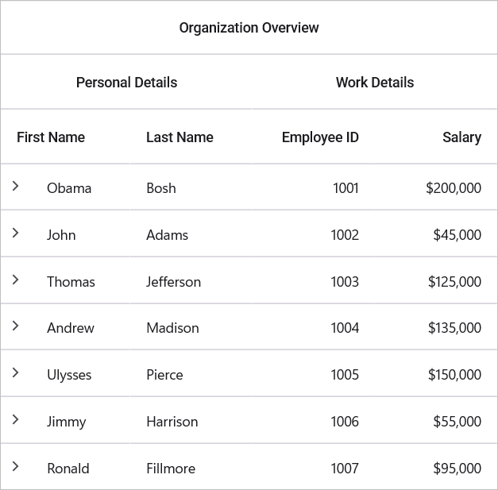
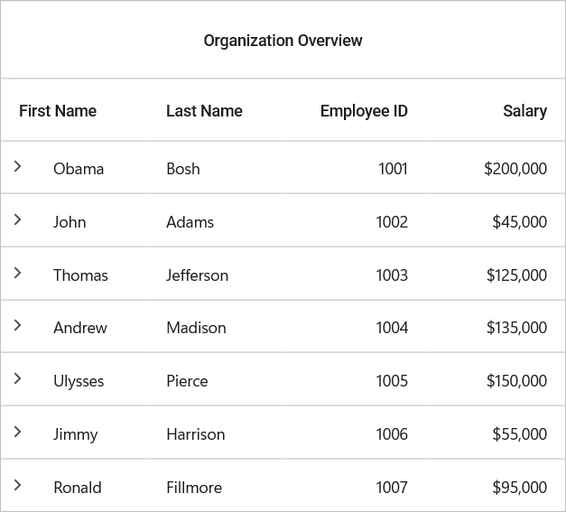
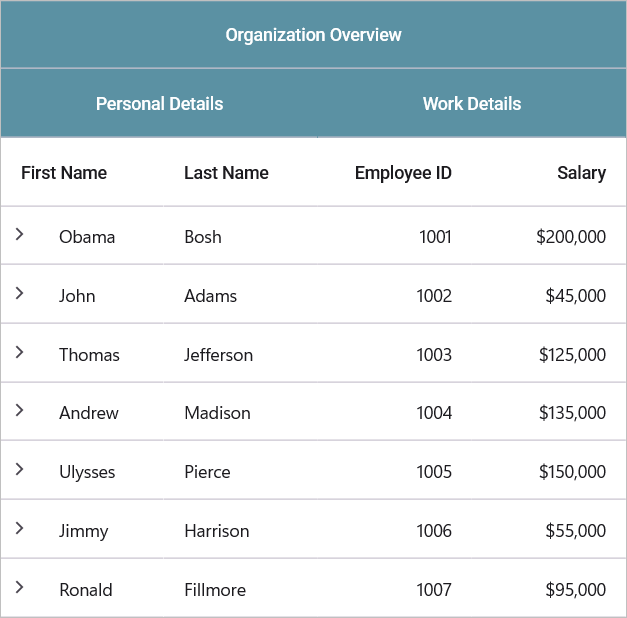
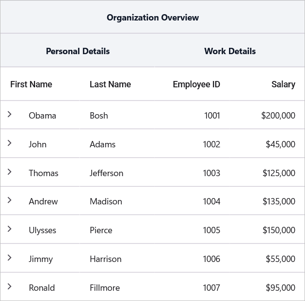
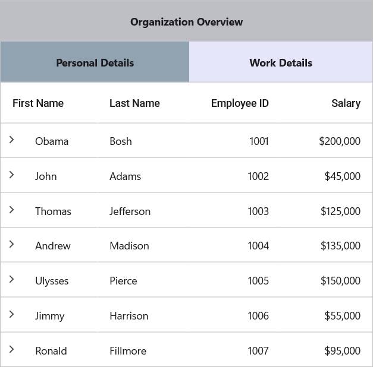
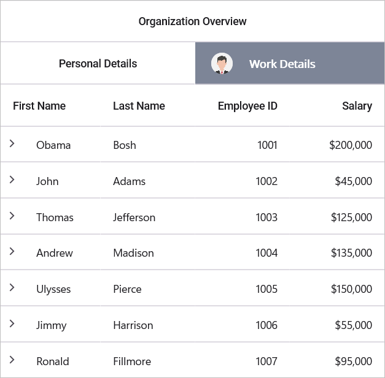

# Stacked Headers in .NET MAUI Tree Grid

The [.NET MAUI Tree Grid](https://www.syncfusion.com/maui-controls/maui-treegrid) supports displaying additional unbound, multiple or multilevel header rows known as [StackedHeaderRows](https://help.syncfusion.com/cr/maui/Syncfusion.Maui.TreeGrid.SfTreeGrid.html#Syncfusion_Maui_TreeGrid_SfTreeGrid_StackedHeaderRows) that span across multiple TreeGrid columns. You can group one or more related columns under each stacked header category to provide better visual organization for complex hierarchical data.

Each [TreeGridStackedHeaderRow](https://help.syncfusion.com/cr/maui/Syncfusion.Maui.TreeGrid.TreeGridStackedHeaderRow.html) contains a [Columns](https://help.syncfusion.com/cr/maui/Syncfusion.Maui.TreeGrid.TreeGridStackedHeaderRow.html#Syncfusion_Maui_TreeGrid_TreeGridStackedHeaderRow_Columns) collection of stacked columns. The [TreeGridStackedColumn.ColumnMappingNames](https://help.syncfusion.com/cr/maui/Syncfusion.Maui.TreeGrid.TreeGridStackedColumn.html#Syncfusion_Maui_TreeGrid_TreeGridStackedColumn_ColumnMappingNames) property contains the comma-separated column mapping names grouped under the stacked header row. The [TreeGridStackedColumn.MappingName](https://help.syncfusion.com/cr/maui/Syncfusion.Maui.TreeGrid.TreeGridStackedColumn.html#Syncfusion_Maui_TreeGrid_TreeGridStackedColumn_MappingName) is a unique name used to identify the stacked column, and the [TreeGridStackedColumn.Text](https://help.syncfusion.com/cr/maui/Syncfusion.Maui.TreeGrid.TreeGridStackedColumn.html#Syncfusion_Maui_TreeGrid_TreeGridStackedColumn_Text) specifies the text displayed in the stacked header cell.

## Adding stacked headers

Stacked headers can be added using the following steps:

1. Create a `TreeGridStackedHeaderRow` instance for each row of stacked headers.
2. Create `TreeGridStackedColumn` instances and specify the grouped child columns using the `ColumnMappingNames` property.
3. Set the header label using the `Text` property.
4. Add the `TreeGridStackedColumn` instances to the `Columns` collection of the `TreeGridStackedHeaderRow`.
5. Finally, add the `TreeGridStackedHeaderRow` to the [StackedHeaderRows](https://help.syncfusion.com/cr/maui/Syncfusion.Maui.TreeGrid.SfTreeGrid.html#Syncfusion_Maui_TreeGrid_SfTreeGrid_StackedHeaderRows) collection of the `SfTreeGrid`.



<ContentPage xmlns="http://schemas.microsoft.com/dotnet/2021/maui"
             xmlns:x="http://schemas.microsoft.com/winfx/2009/xaml"
             xmlns:syncfusion="clr-namespace:Syncfusion.Maui.TreeGrid;assembly=Syncfusion.Maui.TreeGrid"
             xmlns:local="clr-namespace:YourAppNamespace"
             x:Class="YourAppNamespace.MainPage">

    <ContentPage.BindingContext>
        <local:EmployeeViewModel />
    </ContentPage.BindingContext>

    <syncfusion:SfTreeGrid x:Name="treeGrid"
                           ItemsSource="{Binding Employees}"
                           ChildPropertyName="ReportsTo"
                           ParentPropertyName="ID"
                           SelfRelationRootValue="-1"
                           AutoGenerateColumnsMode="None">
        <syncfusion:SfTreeGrid.Columns>
            <syncfusion:TreeGridTextColumn MappingName="ID"
                                           HeaderText="Employee ID" />
            <syncfusion:TreeGridTextColumn MappingName="FirstName"
                                           HeaderText="First Name" />
            <syncfusion:TreeGridTextColumn MappingName="LastName"
                                           HeaderText="Last Name" />
            <syncfusion:TreeGridTextColumn MappingName="Title"
                                           HeaderText="Title" />
            <syncfusion:TreeGridNumericColumn MappingName="Salary"
                                             HeaderText="Salary"
                                             Format="C" />
        </syncfusion:SfTreeGrid.Columns>

        <syncfusion:SfTreeGrid.StackedHeaderRows>
            <syncfusion:TreeGridStackedHeaderRow>
                <syncfusion:TreeGridStackedHeaderRow.Columns>
                    <syncfusion:TreeGridStackedColumn ColumnMappingNames="ID,FirstName,LastName,Title,Salary"
                                                      Text="Organization Overview"
                                                      MappingName="OrganizationOverview" />
                </syncfusion:TreeGridStackedHeaderRow.Columns>
            </syncfusion:TreeGridStackedHeaderRow>
            <syncfusion:TreeGridStackedHeaderRow>
                <syncfusion:TreeGridStackedHeaderRow.Columns>
                    <syncfusion:TreeGridStackedColumn ColumnMappingNames="FirstName,LastName"
                                                      Text="Personal Details"
                                                      MappingName="PersonalDetails" />
                    <syncfusion:TreeGridStackedColumn ColumnMappingNames="Title,Salary"
                                                      Text="Work Details"
                                                      MappingName="WorkDetails" />
                </syncfusion:TreeGridStackedHeaderRow.Columns>
            </syncfusion:TreeGridStackedHeaderRow>
        </syncfusion:SfTreeGrid.StackedHeaderRows>
    </syncfusion:SfTreeGrid>
</ContentPage>


using Syncfusion.Maui.TreeGrid;

namespace YourAppNamespace;

public partial class MainPage : ContentPage
{
    EmployeeViewModel viewModel = new EmployeeViewModel();

    public MainPage()
    {
        InitializeComponent();

        SfTreeGrid treeGrid = new SfTreeGrid()
        {
            ItemsSource = viewModel.Employees,
            ChildPropertyName = "ReportsTo",
            ParentPropertyName = "ID",
            SelfRelationRootValue = -1,
            AutoGenerateColumnsMode = AutoGenerateColumnsMode.None,
        };

        treeGrid.Columns.Add(new TreeGridTextColumn { MappingName = "ID", HeaderText = "Employee ID" });
        treeGrid.Columns.Add(new TreeGridTextColumn { MappingName = "FirstName", HeaderText = "First Name" });
        treeGrid.Columns.Add(new TreeGridTextColumn { MappingName = "LastName", HeaderText = "Last Name" });
        treeGrid.Columns.Add(new TreeGridTextColumn { MappingName = "Title", HeaderText = "Title" });
        treeGrid.Columns.Add(new TreeGridNumericColumn { MappingName = "Salary", HeaderText = "Salary", Format = "C" });

        // First level stacked header row
        var topStackedRow = new TreeGridStackedHeaderRow();
        topStackedRow.Columns.Add(new TreeGridStackedColumn()
        {
            ColumnMappingNames = "ID,FirstName,LastName,Title,Salary",
            Text = "Organization Overview",
            MappingName = "OrganizationOverview",
        });
        treeGrid.StackedHeaderRows.Add(topStackedRow);

        // Second level stacked header row
        var subStackedRow = new TreeGridStackedHeaderRow();
        subStackedRow.Columns.Add(new TreeGridStackedColumn()
        {
            ColumnMappingNames = "FirstName,LastName",
            Text = "Personal Details",
            MappingName = "PersonalDetails",
        });
        subStackedRow.Columns.Add(new TreeGridStackedColumn()
        {
            ColumnMappingNames = "Title,Salary",
            Text = "Work Details",
            MappingName = "WorkDetails",
        });
        treeGrid.StackedHeaderRows.Add(subStackedRow);

        this.Content = treeGrid;
    }
}



## Adding child columns dynamically

You can add child columns to an existing stacked header row at runtime by modifying the `ColumnMappingNames` property of the target `TreeGridStackedColumn`.



// Append a new column mapping name to an existing stacked column
var existingMappings = treeGrid.StackedHeaderRows[0].Columns[0].ColumnMappingNames;
treeGrid.StackedHeaderRows[0].Columns[0].ColumnMappingNames = existingMappings + ",Department";



## Removing child columns dynamically

Similarly, you can remove child columns from a stacked header row programmatically by removing column names from the `ColumnMappingNames` property.



var columnsList = treeGrid.StackedHeaderRows[0].Columns[0].ColumnMappingNames.Split(',').ToList();
columnsList.Remove("ID");
treeGrid.StackedHeaderRows[0].Columns[0].ColumnMappingNames = string.Join(",", columnsList);



## Changing stacked header row height

You can change the height of all header rows, including stacked header rows, by setting the [SfTreeGrid.HeaderRowHeight](https://help.syncfusion.com/cr/maui/Syncfusion.Maui.TreeGrid.SfTreeGrid.html#Syncfusion_Maui_TreeGrid_SfTreeGrid_HeaderRowHeight) property.



<syncfusion:SfTreeGrid x:Name="treeGrid"
                       ItemsSource="{Binding Employees}"
                       ChildPropertyName="ReportsTo"
                       ParentPropertyName="ID"
                       SelfRelationRootValue="-1"
                       HeaderRowHeight="60">
</syncfusion:SfTreeGrid>


treeGrid.HeaderRowHeight = 60;



You can also customize the height of specific stacked header rows individually using the [SfTreeGrid.QueryRowHeight]() event.



treeGrid.QueryRowHeight += TreeGrid_QueryRowHeight;

private void TreeGrid_QueryRowHeight(object? sender, TreeGridQueryRowHeightEventArgs e)
{
    if (e.RowIndex < treeGrid.StackedHeaderRows.Count) // Customize Logic as required.
    {
        e.Height = 70;
        e.Handled = true;
    }
}



## Styling stacked headers

The appearance of stacked headers can be customized using default styling properties or implicit styles targeting stacked header cells.

### Customizing appearance via DefaultStyle

You can customize the background color and text color of stacked header rows using the [TreeGridStyle.StackedHeaderRowBackground](https://help.syncfusion.com/cr/maui/Syncfusion.Maui.TreeGrid.TreeGridStyle.html#Syncfusion_Maui_TreeGrid_TreeGridStyle_StackedHeaderRowBackground) and [TreeGridStyle.StackedHeaderRowTextColor](https://help.syncfusion.com/cr/maui/Syncfusion.Maui.TreeGrid.TreeGridStyle.html#Syncfusion_Maui_TreeGrid_TreeGridStyle_StackedHeaderRowTextColor) properties in [SfTreeGrid.DefaultStyle](https://help.syncfusion.com/cr/maui/Syncfusion.Maui.TreeGrid.SfTreeGrid.html#Syncfusion_Maui_TreeGrid_SfTreeGrid_DefaultStyle).



<syncfusion:SfTreeGrid x:Name="treeGrid"
                       ItemsSource="{Binding Employees}"
                       ChildPropertyName="ReportsTo"
                       ParentPropertyName="ID"
                       SelfRelationRootValue="-1">
    <syncfusion:SfTreeGrid.DefaultStyle>
        <syncfusion:TreeGridStyle StackedHeaderRowBackground="#5B91A3"
                                  StackedHeaderRowTextColor="White" />
    </syncfusion:SfTreeGrid.DefaultStyle>
</syncfusion:SfTreeGrid>


treeGrid.DefaultStyle.StackedHeaderRowBackground = Color.FromArgb("#5B91A3");
treeGrid.DefaultStyle.StackedHeaderRowTextColor = Colors.White;



### Font customization

Customize the font size, family and attributes of the stacked header text using the [TreeGridStyle.StackedHeaderRowFontSize](https://help.syncfusion.com/cr/maui/Syncfusion.Maui.TreeGrid.TreeGridStyle.html#Syncfusion_Maui_TreeGrid_TreeGridStyle_StackedHeaderRowFontSize), [TreeGridStyle.StackedHeaderRowFontFamily](https://help.syncfusion.com/cr/maui/Syncfusion.Maui.TreeGrid.TreeGridStyle.html#Syncfusion_Maui_TreeGrid_TreeGridStyle_StackedHeaderRowFontFamily) and [TreeGridStyle.StackedHeaderRowFontAttributes](https://help.syncfusion.com/cr/maui/Syncfusion.Maui.TreeGrid.TreeGridStyle.html#Syncfusion_Maui_TreeGrid_TreeGridStyle_StackedHeaderRowFontAttributes) properties, respectively.



<syncfusion:SfTreeGrid x:Name="treeGrid"
                       ItemsSource="{Binding Employees}"
                       ChildPropertyName="ReportsTo"
                       ParentPropertyName="ID"
                       SelfRelationRootValue="-1">
    <syncfusion:SfTreeGrid.DefaultStyle>
        <syncfusion:TreeGridStyle StackedHeaderRowFontSize="20"
                                  StackedHeaderRowFontFamily="Helvetica Neue"
                                  StackedHeaderRowFontAttributes="Bold" />
    </syncfusion:SfTreeGrid.DefaultStyle>
</syncfusion:SfTreeGrid>


treeGrid.DefaultStyle.StackedHeaderRowFontSize = 20;
treeGrid.DefaultStyle.StackedHeaderRowFontFamily = "Helvetica Neue";
treeGrid.DefaultStyle.StackedHeaderRowFontAttributes = FontAttributes.Bold;



### Customizing appearance using implicit styles

You can customize the appearance of stacked header cells by defining an implicit [Style](https://learn.microsoft.com/en-us/dotnet/api/microsoft.maui.controls.style) targeting [TreeGridStackedHeaderCell](https://help.syncfusion.com/cr/maui/Syncfusion.Maui.TreeGrid.TreeGridStackedHeaderCell.html).



<ContentPage.Resources>
    
</ContentPage.Resources>



### Customizing appearance using implicit styles
 
You can customize the appearance of stacked header cells by defining an implicit [Style](https://learn.microsoft.com/en-us/dotnet/api/microsoft.maui.controls.style) that targets the [TreeGridStackedHeaderCell]().
 


<ContentPage.Resources>
    
</ContentPage.Resources>

<syncfusion:SfTreeGrid x:Name="treeGrid"
                       ItemsSource="{Binding PersonDetails}"
                       ChildPropertyName="Children">
    <syncfusion:SfTreeGrid.StackedHeaderRows>
        <syncfusion:TreeGridStackedHeaderRow>
            <syncfusion:TreeGridStackedHeaderRow.Columns>
                <syncfusion:TreeGridStackedColumn ColumnMappingNames="FirstName,LastName,EmployeeId,Salary"
                                                  Text="Organization Overview"
                                                  MappingName="OrganizationOverview"/>
            </syncfusion:TreeGridStackedHeaderRow.Columns>
        </syncfusion:TreeGridStackedHeaderRow>

        <syncfusion:TreeGridStackedHeaderRow>
            <syncfusion:TreeGridStackedHeaderRow.Columns>
                <syncfusion:TreeGridStackedColumn ColumnMappingNames="FirstName,LastName"
                                                  Text="Personal Details"
                                                  MappingName="PersonalDetails"/>
                <syncfusion:TreeGridStackedColumn ColumnMappingNames="EmployeeId,Salary"
                                                  Text="Work Details"
                                                  MappingName="WorkDetails"/>
            </syncfusion:TreeGridStackedHeaderRow.Columns>
        </syncfusion:TreeGridStackedHeaderRow>
    </syncfusion:SfTreeGrid.StackedHeaderRows>
</syncfusion:SfTreeGrid>



 
### Conditional styling
 
The `SfTreeGrid` allows you to conditionally customize the appearance of stacked header cells based on their values.
 


<ContentPage xmlns="http://schemas.microsoft.com/dotnet/2021/maui"
             xmlns:x="http://schemas.microsoft.com/winfx/2009/xaml"
             xmlns:syncfusion="clr-namespace:Syncfusion.Maui.TreeGrid;assembly=Syncfusion.Maui.TreeGrid"
             xmlns:local="clr-namespace:YourAppNamespace"
             x:Class="YourAppNamespace.MainPage">

    <ContentPage.BindingContext>
        <local:EmployeeViewModel />
    </ContentPage.BindingContext>

    <ContentPage.Resources>
        
        <ResourceDictionary>
            <local:CellStyleConverter x:Key="cellStyleConverter"/>
            
        </ResourceDictionary>
    </ContentPage.Resources>

    <syncfusion:SfTreeGrid x:Name="treeGrid"
                           ItemsSource="{Binding PersonDetails}"
                           ChildPropertyName="Children">
        <syncfusion:SfTreeGrid.StackedHeaderRows>
            <syncfusion:TreeGridStackedHeaderRow>
                <syncfusion:TreeGridStackedHeaderRow.Columns>
                    <syncfusion:TreeGridStackedColumn ColumnMappingNames="FirstName,LastName,EmployeeId,Salary"
                                                      Text="Organization Overview"
                                                      MappingName="OrganizationOverview"/>
                </syncfusion:TreeGridStackedHeaderRow.Columns>
            </syncfusion:TreeGridStackedHeaderRow>

            <syncfusion:TreeGridStackedHeaderRow>
                <syncfusion:TreeGridStackedHeaderRow.Columns>
                    <syncfusion:TreeGridStackedColumn ColumnMappingNames="FirstName,LastName"
                                                      Text="Personal Details"
                                                      MappingName="PersonalDetails"/>
                    <syncfusion:TreeGridStackedColumn ColumnMappingNames="EmployeeId,Salary"
                                                      Text="Work Details"
                                                      MappingName="WorkDetails"/>
                </syncfusion:TreeGridStackedHeaderRow.Columns>
            </syncfusion:TreeGridStackedHeaderRow>
        </syncfusion:SfTreeGrid.StackedHeaderRows>
    </syncfusion:SfTreeGrid>
</ContentPage>


//Custom style class
public class CellStyleConverter : IValueConverter
{
    public object? Convert(object? value, Type targetType, object? parameter, CultureInfo culture)
    {
        if (value is TreeGridStackedHeaderCell cell && cell.CellValue != null)
        {
            return cell.CellValue.ToString() switch
            {
                "Organization Overview" => Color.FromArgb("#BEBFC5"),
                "Personal Details" => Color.FromArgb("#91A3B0"),
                "Work Details" => Color.FromArgb("#E6E6FA"),
                _ => Color.FromArgb("#FFFFFF")
            };
        }
        return Color.FromArgb("#FFFFFF");
    }

    public object? ConvertBack(object? value, Type targetType, object? parameter, CultureInfo culture)
    {
        throw new NotImplementedException();
    }
}



## Customizing stacked header with templates

You can customize the content and layout of stacked header cells by using the [TreeGridStackedColumn.Template](https://help.syncfusion.com/cr/maui/Syncfusion.Maui.TreeGrid.TreeGridStackedColumn.html#Syncfusion_Maui_TreeGrid_TreeGridStackedColumn_Template) property. A `DataTemplateSelector` can also be assigned to this property. When `Template` is set, the `Text` value and the `DefaultStyle` stacked header font and text color settings are not applied to the cell content.



<syncfusion:SfTreeGrid x:Name="treeGrid"
                       ItemsSource="{Binding Employees}"
                       ChildPropertyName="ReportsTo"
                       ParentPropertyName="ID"
                       SelfRelationRootValue="-1">
    <syncfusion:SfTreeGrid.StackedHeaderRows>
        <syncfusion:TreeGridStackedHeaderRow>
            <syncfusion:TreeGridStackedHeaderRow.Columns>
                <syncfusion:TreeGridStackedColumn ColumnMappingNames="FirstName,LastName"
                                                  MappingName="PersonalDetails">
                    <syncfusion:TreeGridStackedColumn.Template>
                        <DataTemplate>
                            <Grid BackgroundColor="#7d8597"
                                  Padding="10"
                                  ColumnDefinitions="40,*"
                                  ColumnSpacing="20">
                                <Image  Grid.Column="0"
                                        Source="Image0.png"
                                        HeightRequest="20"
                                        WidthRequest="20"
                                        Margin="10,0,0,0"/>
                                <Label Grid.Column="1"
                                       Text="Work Details"
                                       FontAttributes="Bold"
                                       TextColor="White"
                                       HorizontalTextAlignment="Start"
                                       VerticalTextAlignment="Center"
                                       HorizontalOptions="Fill"
                                       VerticalOptions="Center"/>
                            </Grid>
                        </DataTemplate>
                    </syncfusion:TreeGridStackedColumn.Template>
                </syncfusion:TreeGridStackedColumn>
            </syncfusion:TreeGridStackedHeaderRow.Columns>
        </syncfusion:TreeGridStackedHeaderRow>
    </syncfusion:SfTreeGrid.StackedHeaderRows>
</syncfusion:SfTreeGrid>



## Supported Combinations

### Works With:
* **Freeze Panes**: Stacked headers work seamlessly with frozen columns (`FrozenColumnCount` and `FooterFrozenColumnCount`). When columns grouped under a stacked header are frozen, the stacked header row appropriately aligns above the frozen and scrollable regions.
* **Column Sizing**: Stacked columns automatically adapt to column width modes (`ColumnWidthMode`) and dynamically resize with their underlying child columns.
* **Expander Column**: The tree expander column can be included as a child column under a stacked header row.
* **Sorting & Filtering**: Child columns under stacked headers retain full sorting and filtering capabilities.

// Second level stacked header row
var subStackedRow = new TreeGridStackedHeaderRow();

subStackedRow.Columns.Add(new TreeGridStackedColumn()
{
    ColumnMappingNames = "FirstName,LastName",
    Text = "Personal Details",
    MappingName = "PersonalDetails",
});

// Create the stacked header template
var workDetailsTemplate = new DataTemplate(() =>
{
    Grid grid = new Grid
    {
        BackgroundColor = Color.FromArgb("#7d8597"),
        Padding = new Thickness(10),
        ColumnSpacing = 20,
        ColumnDefinitions =
        {
            new ColumnDefinition { Width = 40 },
            new ColumnDefinition { Width = GridLength.Star }
        }
    };

    Image image = new Image
    {
        Source = "Image0.png",
        HeightRequest = 20,
        WidthRequest = 20,
        Margin = new Thickness(10, 0, 0, 0)
    };
    Grid.SetColumn(image, 0);

    Label label = new Label
    {
        Text = "Work Details",
        FontAttributes = FontAttributes.Bold,
        TextColor = Colors.White,
        HorizontalTextAlignment = TextAlignment.Start,
        VerticalTextAlignment = TextAlignment.Center,
        HorizontalOptions = LayoutOptions.Fill,
        VerticalOptions = LayoutOptions.Center
    };
    Grid.SetColumn(label, 1);

    grid.Children.Add(image);
    grid.Children.Add(label);

    return grid;
});

subStackedRow.Columns.Add(new TreeGridStackedColumn()
{
    ColumnMappingNames = "EmployeeId,Salary",
    MappingName = "WorkDetails",
    Template = workDetailsTemplate
});

treeGrid.StackedHeaderRows.Add(subStackedRow);

this.Content = treeGrid;



