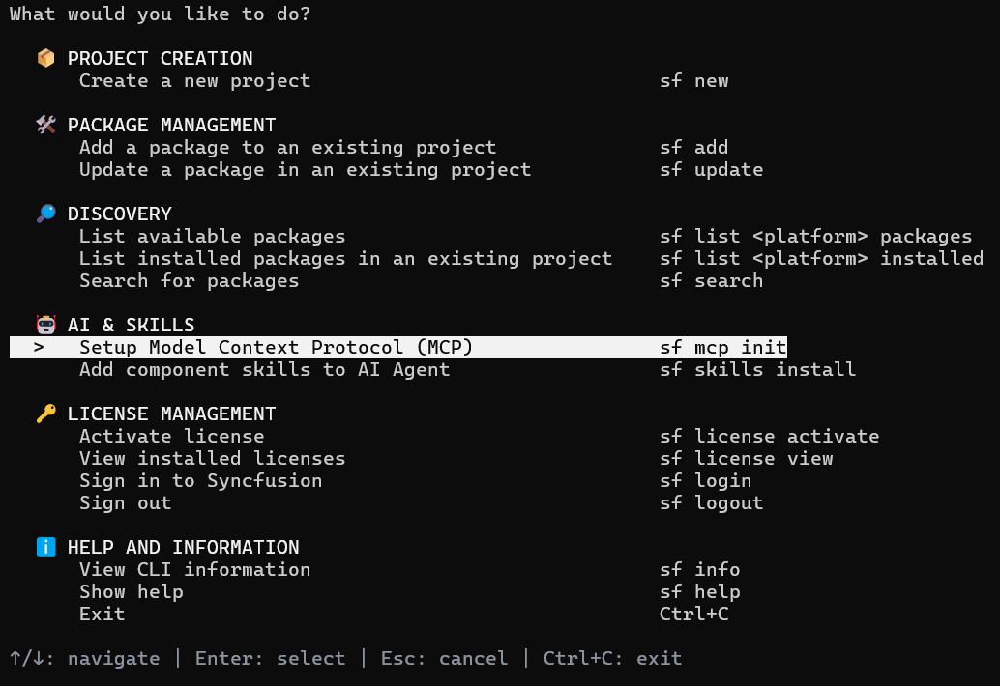
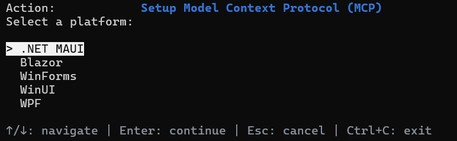
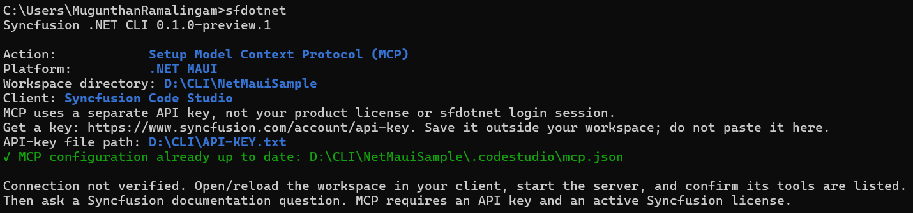

# Configure an MCP server

The `sf mcp init` command configures the official Syncfusion<sup>®</sup> .NET MAUI MCP server (`Syncfusion.Maui.MCP`) for an AI coding client in a project-local workspace. The MCP server exposes Syncfusion<sup>®</sup> documentation and product knowledge to AI agents, such as GitHub Copilot, Cursor, and Claude Code.

The MCP setup workflow does not install component libraries and does not modify application code. It only writes the client's project-local MCP configuration file and, when needed, installs the official MCP NuGet tool.

## Prerequisites

* A Syncfusion<sup>®</sup> MCP API key, generated at [https://www.syncfusion.com/account/api-key](https://www.syncfusion.com/account/api-key).
* An active Syncfusion<sup>®</sup> license for MCP usage.

N> The MCP API key is separate from your product license key and from the `sf login` session. It is used only by the MCP server.

## Configure MCP through the interactive menu

1. Run `sf` to open the main menu, and under **AI & Skills**, select **Setup Model Context Protocol (MCP)**.

    

2. Select the platform. Choose **.NET MAUI**.

    

3. Enter the workspace directory. The default is the current directory. The workspace directory must already exist.

4. Select the MCP client: **VS Code / GitHub Copilot**, **Cursor**, **Syncfusion Code Studio**, or **Claude Code**.

5. Enter the API-key file path. The CLI prints the API-key download location, and the file must exist before setup. It must remain outside the workspace directory.

    

6. Open or reload the workspace in the selected client, start the server, and confirm that its tools are listed. Then ask a Syncfusion documentation question to verify the integration.

N> Saving the configuration does not verify the connection to the MCP server. The CLI does not start the server or contact it during setup.

## Configure MCP using direct commands

```bash
sf mcp init maui --client vscode --key-file "%USERPROFILE%\.syncfusion\api-key.txt"
sf mcp init maui --client cursor --path "C:\Projects\MyApp" --key-file "C:\Keys\syncfusion.key"
sf mcp init maui --client codestudio --key-file "C:\Keys\syncfusion.key" --dry-run
sf mcp init maui --client claude-code --key-file "C:\Keys\syncfusion.key" --no-interactive --json
```

In a direct command, the platform is the positional argument. `--path` defaults to the current directory. In noninteractive or `--json` usage, the platform, client, and key file must be provided explicitly.

## MCP configuration file location

The CLI writes a project-local configuration file inside the workspace, next to the client's expected location:

| Client | Configuration file | Server property |
| --- | --- | --- |
| VS Code / GitHub Copilot | `.vscode/mcp.json` | `servers` |
| Cursor | `.cursor/mcp.json` | `mcpServers` |
| Syncfusion Code Studio | `.codestudio/mcp.json` | `servers` |
| Claude Code | `.mcp.json` | `mcpServers` |

The generated entry registers a server named `sf-maui-mcp`. For example, for VS Code the CLI adds the following entry to `.vscode/mcp.json`:

```json
{
  "servers": {
    "sf-maui-mcp": {
      "type": "stdio",
      "command": "dotnet",
      "args": ["tool", "run", "syncfusion-maui-mcp"],
      "env": {
        "Syncfusion_API_Key_Path": "C:\\Keys\\syncfusion.key"
      }
    }
  }
}
```

The CLI edits only the selected platform server entry. Unrelated JSON values, comments, and trailing commas in the file are preserved. Malformed files, duplicate JSON properties, and wrong-shaped configurations are rejected before any change is written. An identical existing entry is left untouched; a differing entry requires `--force`, which replaces only that platform's server entry.

## Runner modes

The MCP server runs as a .NET tool. The `--runner` option selects how the client starts it:

| Runner | Behavior |
| --- | --- |
| `auto` (default) | Checks the .NET SDK selected in the workspace (including `global.json`). SDK 10 or later uses `dnx`; SDK 8/9 uses the local tool mode. |
| `dnx` | Starts the server with `dnx Syncfusion.Maui.MCP --yes`. The package is downloaded when the client first starts the server. Requires .NET SDK 10 or later. |
| `local` | Creates a local tool manifest at `.config/dotnet-tools.json` if one does not exist, installs the `Syncfusion.Maui.MCP` tool into it, and configures `dotnet tool run syncfusion-maui-mcp`. |

N> When the local tool manifest already lists the MCP tool, the CLI restores the manifest's tools instead of reinstalling. This may also download other tools listed in that manifest. Run the client from the configured workspace so local-tool resolution uses that manifest.

## MCP API key configuration

The MCP server authenticates with a Syncfusion<sup>®</sup> API key that is different from the product license key. The CLI never reads, copies, or stores the key itself. It writes only the absolute file path into the configuration as the `Syncfusion_API_Key_Path` environment variable.

**Create the API key file:**

1. Sign in to your Syncfusion<sup>®</sup> account and generate an API key at [https://www.syncfusion.com/account/api-key](https://www.syncfusion.com/account/api-key).
2. Save the key into a `.txt` or `.key` file, such as `%USERPROFILE%\.syncfusion\api-key.txt` or `~/.syncfusion/api-key.key`. These are the only supported file extensions.
3. Keep the file outside the workspace directory. Setup rejects a key file located inside the workspace to prevent the credential from being committed to source control.
4. Pass the file path through `--key-file` or enter it at the prompt. The CLI suggests the path stored in the `Syncfusion_API_Key_Path` environment variable as the default.

**Update or manage the key:**

* To use a new key value, edit the existing file in place. The configuration stores the file path, not the key content, so no configuration change is needed.
* To use a different file, re-run `sf mcp init` with the new `--key-file` path.
* Symbolic links are rejected; pass the real file path.

W> Never commit the API-key file to source control, and never paste the key value directly into the terminal. Store the file in a location excluded from repositories, such as the user profile directory.

## MCP options

| Option | Description |
| --- | --- |
| `<platform>` | The platform: `maui`, `blazor`, `wpf`, `winforms`, or `winui` |
| `--client` | The MCP client: `vscode`, `cursor`, `codestudio`, or `claude-code` |
| `--key-file` | Path to an existing API-key `.txt`/`.key` file outside the workspace |
| `--runner` | Server runner: `auto` (default), `dnx`, or `local` |
| `-p`, `--path` | The workspace directory. Defaults to the current directory. The directory must already exist |
| `--dry-run` | Validate inputs and preview the destination without writing files or running tools |
| `--force` | Replace an existing, differing platform server entry |
| `--json` | Emit one JSON document |

## FAQs

**Is the MCP API key the same as my product license key?**

No. The MCP server uses a separate API key generated at [https://www.syncfusion.com/account/api-key](https://www.syncfusion.com/account/api-key). Store it in a `.txt` or `.key` file outside the workspace, and pass the file path through `--key-file`. The CLI writes only the file path into the MCP configuration; it never reads or copies the key.

**Does MCP setup verify the server connection?**

No. Setup writes the client configuration and installs the required tool, but does not contact the server. Open or reload the workspace in the client, start the server, confirm its tools are listed, and then ask a Syncfusion documentation question.

## See also

* [AI skills installation](/maui/dotnet-cli/install-skills)
* [License activation](/maui/dotnet-cli/licensing)
* [Syncfusion<sup>®</sup> .NET MAUI AI coding assistant](https://help.syncfusion.com/maui/ai-coding-assistant/overview)
