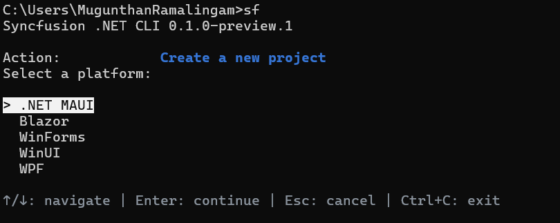

# Create a .NET MAUI project

You can create a .NET MAUI project through the interactive wizard or a direct command.

## Create a project using the interactive wizard

Run `sf` and select **Create a new project**, or run `sf new` without a project name, to start the wizard. The .NET MAUI creation flow is:

**Platform &rarr; project template &rarr; framework &rarr; project location &rarr; project name &rarr; setup &rarr; controls &rarr; post-create &rarr; review/confirmation**

1. Select **.NET MAUI** as the platform.

    

2. The **.NET MAUI App** template (`app`) is the only enabled project type and is recorded automatically without a picker. Blazor Hybrid creation is temporarily disabled.
3. Select the framework version: **.NET 10** (`net10.0`) or **.NET 9** (`net9.0`).
4. Enter the parent directory and the project name. The default locations are `%USERPROFILE%\source\repos` on Windows and `~/Projects` on Linux and macOS. The suggested name is `SyncfusionMauiApp`, and the first available numeric suffix is used when the destination name collides.

    

5. Select the setup: **Blank app** or **Include Syncfusion controls**. Blank app is first.

    

6. When you include controls, choose one or more controls from the list. Controls start unchecked and at least one is required.

    

    | Control label | Control ID |
    | --- | --- |
    | AI AssistView | `assistview` |
    | Cartesian Chart | `cartesian-chart` |
    | Circular Chart | `circular-chart` |
    | DataGrid | `datagrid` |
    | Diagram | `diagram` |
    | Kanban | `kanban` |
    | ListView | `listview` |
    | PDF Viewer | `pdf-viewer` |
    | Rich Text Editor | `rich-text-editor` |
    | Scheduler | `scheduler` |

    N> The legacy `charts` control ID resolves to `cartesian-chart`. New selections use the concrete chart IDs.

7. Select the post-create action: **Generate only** or **Build project**.
8. Review the selected values and confirm to create the project.

## Create a project using direct commands

Omit `--control`, or specify `--control empty`, to create a blank project:

```bash
sf new maui -n MyApp
sf new maui -n MyApp --control empty
```

Provide one or more control IDs to create a project with generated Syncfusion<sup>®</sup> control samples:

```bash
sf new maui -n MyApp --control datagrid
sf new maui -n MyApp --control datagrid combobox
sf new maui -n MyApp --control cartesian-chart circular-chart
```

A complete direct command does not open the wizard. Missing required values produce an error in scripts. When a name is missing in an interactive terminal, the wizard supplies the suggested default and collects the remaining inputs.

## Generated project content

A project created with controls starts on a welcome screen built from .NET MAUI XAML controls. Each installed control appears as a rounded button that opens its sample page, with a back button supplied by the Shell. Resource cards link to Syncfusion<sup>®</sup> demos, documentation, and AI coding guidance. Blank apps show a friendly empty state.

Sample compatibility is checked through package restore and a build before changes are committed. Generated samples use small in-memory data; no remote sample-data service is required.

## Post-creation commands

Successful creation prints a copyable **Next commands** block. For generate-only, the block prints `cd`, build, and run commands. For build project, it prints `cd` and run commands. MAUI run commands use the declared target: Windows on Windows, Mac Catalyst on macOS, or Android on Linux. The CLI displays these commands; it does not execute them.

```bash
cd ./apps/MyApp
dotnet build -t:Run -f net10.0-android
```

An explicit `--build-framework` takes precedence over the host default. Android requires an emulator or a connected device, and iOS run commands select a simulator runtime on macOS.

## Build behavior

The **Build project** post-create action runs `dotnet build "<generated-project.csproj>"` with no automatic Android or host target and no `TargetFramework` override. The default build includes restore, so missing workloads appear as build errors after creation. The generated project is retained and the CLI prints the quoted build command to retry from any directory.

To build one configured target explicitly:

```bash
sf new maui --name MyApp --target-framework net10.0 --post-action build --build-framework net10.0-android
```

`--build-framework` is validated against MSBuild's evaluated project targets on the current OS and passed to `dotnet build` through `-f`. It requires the **Build project** action. `--framework/-f` still selects the CLI platform and `--target-framework/-t` still selects the .NET version; neither narrows the post-creation build.

N> Neither `--force` nor confirmation authorizes overwriting an existing destination. An accepted default name receives an available numeric suffix when its destination exists; explicit names are never silently renamed.