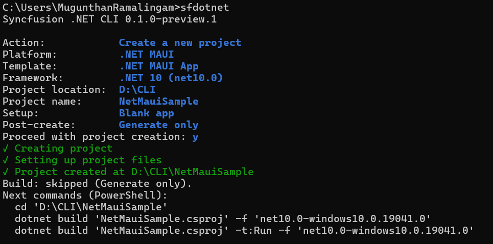

# Create a .NET MAUI project

You can create a .NET MAUI project through the interactive wizard or a direct command. For CLI installation and the main menu, refer to the [overview](/maui/dotnet-cli/overview).

## Create a project using the interactive wizard

Run `sf new`, or select **Create a new project** from the main menu. The .NET MAUI creation flow is:

1. **Platform:** Select **.NET MAUI**.

    

2. **Project template:** The **.NET MAUI App** template is the only enabled project type and is recorded automatically.
3. **Framework:** Select the .NET version.

    * .NET 10 (`net10.0`), the default
    * .NET 9 (`net9.0`)

4. **Location and name:** Enter the parent directory and the project name. The default locations are `%USERPROFILE%\source\repos` on Windows and `~/Projects` on Linux and macOS. The suggested name is `SyncfusionMauiApp`, and the first available numeric suffix is used when the destination name collides.

    

5. **Setup:** Select **Blank app** or **Include Syncfusion controls**. Blank app is the first option.

    

6. **Controls:** When you include controls, choose one or more controls from the list. Controls start unchecked, and at least one selection is required. The following controls are available:

    | Control | Control ID |
    | --- | --- |
    | AI AssistView | `assistview` |
    | Cartesian Chart | `cartesian-chart` |
    | Circular Chart | `circular-chart` |
    | DataGrid | `datagrid` |
    | Diagram | `diagram` |
    | Kanban | `kanban` |
    | ListView | `listview` |
    | PDF Viewer | `pdf-viewer` |
    | Rich Text Editor | `rich-text-editor` |
    | Scheduler | `scheduler` |

7. **Post-create:** Select **Generate only** or **Build project**.

8. **Confirmation:** Review the selected values and confirm to create the project.

N> A complete direct command does not open the wizard. When a name is missing in an interactive terminal, the wizard supplies a default and collects the remaining unspecified inputs. Missing required values in scripts produce an error.

## Create a project using direct commands

To create a blank project without the wizard:



sf new maui -n MyApp



To create a project containing Syncfusion® control samples:



sf new maui -n MyApp --control datagrid
sf new maui -n MyApp --control datagrid listview
sf new maui -n MyApp --control cartesian-chart circular-chart



## Platform and .NET version selection

The CLI supports the `maui`, `blazor`, `wpf`, `winforms`, and `winui` platforms. In a direct command, the platform is the positional argument or the `--framework/-f` option. Actions that need a platform ask for the platform first. Information (`sf info`) and general help (`sf help`) do not ask for a platform.

The framework step selects the base .NET version. It does not select Android, iOS, Windows, or Mac Catalyst individually.



sf new maui -n MyApp --target-framework net9.0



A .NET MAUI project declares multiple platform targets, such as `net10.0-android` and `net10.0-windows`. By default, builds run `dotnet build` for all configured targets. Use `--build-framework` to build one enabled target:



sf new maui -n MyApp --build-framework net10.0-android --post-action build



`--build-framework` is validated against MSBuild's evaluated targets, and an unknown target is rejected.

## Run the created project

A generated .NET MAUI project declares multiple platform targets, such as `net10.0-android` and `net10.0-windows`. Run the project with the target framework for your platform:



dotnet run --project ./MyApp/MyApp.csproj -f net10.0-windows



Native platform requirements still apply. Windows apps run on Windows, Mac Catalyst apps on macOS, and Android and iOS apps on an emulator or a connected device.

## Creation options

| Option | Description |
| --- | --- |
| `-n`, `--name` | Project name. Required when prompting is unavailable |
| `-p`, `--path` | Parent directory. Defaults to the current directory |
| `-t`, `--target-framework` | The .NET target framework, such as `net10.0` |
| `--control` | One or more control IDs, or `empty`. Omit to create an empty project |
| `--project-type` | The .NET MAUI project type: `app` |
| `--post-action` | Post-create action: `generate` or `build`. Defaults to `build` for direct commands |
| `--build-framework` | Build only this configured project target, such as `net10.0-android`. Defaults to all configured targets |
| `--dry-run` | Preview the action without making changes |
| `--force` | Allow supported overwrites. Edited control samples remain protected |
| `--no-restore` | Skip `dotnet restore` after the action |
| `--no-build` | Skip `dotnet build` after the action |
| `--no-interactive` | Disable interactive prompts |
| `--json` | Emit a JSON document instead of table output |

N> `--post-action build` conflicts with `--no-build`. Neither `--force` nor confirmation authorizes overwriting an existing project destination.

## FAQs

**Does `sf add maui datagrid` generate the DataGrid sample?**

In a CLI-generated project, yes. In an ordinary project, the command adds the NuGet package reference only and reports that no sample was generated. For details, refer to [Manage packages](/maui/dotnet-cli/manage-packages).

**Which .NET versions are supported?**

.NET 10 (`net10.0`) and .NET 9 (`net9.0`). Installed template and workload compatibility is checked separately during creation.

## See also

* [Manage packages in an existing project](/maui/dotnet-cli/manage-packages)
* [License activation](/maui/dotnet-cli/licensing)
* [Installing .NET MAUI NuGet packages](https://help.syncfusion.com/maui/installation/install-nuget-packages)
