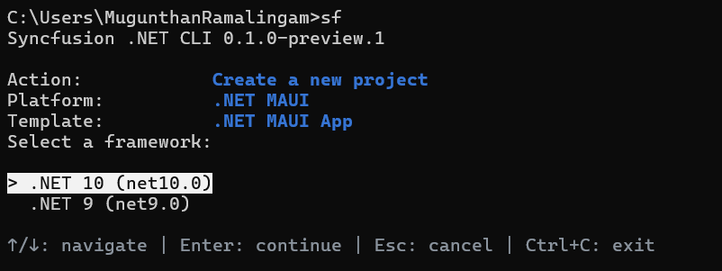
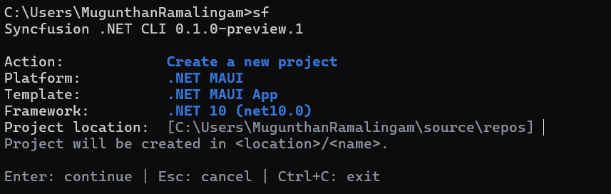
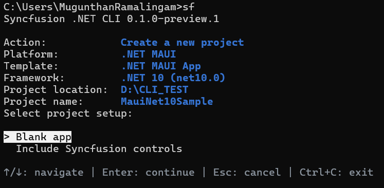

# Overview of the Syncfusion<sup>®</sup> .NET CLI

The Syncfusion<sup>®</sup> .NET CLI (`sf`) is a cross-platform command line tool that creates .NET MAUI projects and manages Syncfusion<sup>®</sup> .NET MAUI NuGet packages from a terminal. After you install the CLI, you can run `sf` with no arguments to open an interactive menu, or run a direct command such as `sf new maui` for scripted, prompt-free creation.

N> The Syncfusion<sup>®</sup> .NET CLI is currently in preview and is installed with the `--prerelease` flag.

N> Package removal (`sf remove`) is temporarily disabled across all platforms while improvements are in progress.

You can use the CLI to perform the following actions:

* Create a blank .NET MAUI app, or an app containing generated Syncfusion<sup>®</sup> control samples.
* Add or update Syncfusion<sup>®</sup> .NET MAUI NuGet package references in an existing project.
* List available and installed packages, and search the package catalog.
* Generate projects for .NET MAUI, Blazor, WPF, WinForms, and WinUI 3..

This documentation covers the .NET MAUI platform.

## Prerequisites

The following software is required before you install and use the CLI:

* [.NET SDK](https://dotnet.microsoft.com/download). The SDK selected through `PATH` takes precedence, with the running .NET installation as a fallback.
* The **.NET Multi-platform App UI development** workload.
* The .NET MAUI project templates, which are installed with the MAUI workload. The CLI creates .NET MAUI projects through the installed `maui` template.
* An internet connection so package operations can reach [nuget.org](https://www.nuget.org).

N> Syncfusion<sup>®</sup> packages resolve from the official nuget.org feed, `https://api.nuget.org/v3/index.json`. The CLI accepts only this source through `--source`.

## Installation

The CLI is published as a .NET global tool with the package ID `Syncfusion.DotNet.CLI`.

1. Open a terminal and run the following command. Add `--prerelease` while only preview versions are available.

    ```bash
    dotnet tool install -g Syncfusion.DotNet.CLI --prerelease
    ```

2. Verify the installation and print the CLI version.

    ```bash
    sf --version
    ```

To update the tool to the latest release, run:

```bash
dotnet tool update -g Syncfusion.DotNet.CLI --prerelease
```

To remove the tool, run:

```bash
dotnet tool uninstall -g Syncfusion.DotNet.CLI
```

## Initialize the CLI

Run `sf` in an interactive terminal to open the main menu. The menu shows the current CLI version and groups the available operations.


| Group | Operation | Command reference |
| --- | --- | --- |
| Project creation | Create a new project | `sf new` |
| Package management | Add a package to an existing project | `sf add` |
| Package management | Update a package in an existing project | `sf update` |
| Discovery | List available packages | `sf list <platform> packages` |
| Discovery | List installed packages in an existing project | `sf list <platform> installed` |
| Discovery | Search for packages | `sf search` |
| Help and information | View CLI information | `sf info` |
| Help and information | Show help | `sf help` |
| Exit | Exit | `Ctrl+C` |

N> The `<platform>` text is a usage placeholder. Use `maui` for .NET MAUI.

Use the following keys to navigate the interactive screens:

| Key | Action |
| --- | --- |
| Up / Down | Move through the options |
| Enter | Choose the focused option, or continue |
| Space | Toggle a checkbox in a multi-selection list |
| Escape | Cancel the current question and return to the menu |
| `Ctrl+C` | Exit the interactive session |

Complete direct commands remain usable without opening the menu. `--no-interactive` disables prompts in any command.

## Available commands

| Command | Purpose |
| --- | --- |
| `sf new maui` | Create a new .NET MAUI project |
| `sf add maui <package>` | Add a Syncfusion<sup>®</sup> package to an existing project |
| `sf update maui <package>` | Update a package in an existing project |
| `sf list maui packages` | List available packages |
| `sf list maui installed` | List installed packages in an existing project |
| `sf search maui <text>` | Search packages |
| `sf info` | Show CLI information |
| `sf help maui` | Show the .NET MAUI command map |
| `sf --version` | Show the CLI version |

## Create a .NET MAUI project

You can create a .NET MAUI project through the interactive wizard or a direct command.

### Create a project using the interactive wizard

Run `sf new`, or select **Create a new project** from the main menu. The .NET MAUI creation flow is:

1. **Platform:** Select **.NET MAUI**.

    

2. **Project template:** The **.NET MAUI App** template is the only enabled project type and is recorded automatically. Blazor Hybrid creation is temporarily disabled.
3. **Framework:** Select the .NET version.

    * .NET 10 (`net10.0`), the default
    * .NET 9 (`net9.0`)

4. **Location and name:** Enter the parent directory and the project name. The default locations are `%USERPROFILE%\source\repos` on Windows and `~/Projects` on Linux and macOS. The suggested name is `SyncfusionMauiApp`, and the first available numeric suffix is used when the destination name collides.

    

5. **Setup:** Select **Blank app** or **Include Syncfusion controls**. Blank app is the first option.

    

6. **Controls:** When you include controls, choose one or more controls from the list. Controls start unchecked, and at least one selection is required.

7. **Post-create:** Select **Generate only** or **Build project**.

8. **Confirmation:** Review the selected values and confirm to create the project.

N> A complete direct command does not open the wizard. When a name is missing in an interactive terminal, the wizard supplies a default and collects the remaining unspecified inputs. Missing required values in scripts produce an error.

### Available controls

The following controls are available in a new .NET MAUI project:

| Control | Control ID |
| --- | --- |
| AI AssistView | `assistview` |
| Cartesian Chart | `cartesian-chart` |
| Circular Chart | `circular-chart` |
| DataGrid | `datagrid` |
| Diagram | `diagram` |
| Kanban | `kanban` |
| ListView | `listview` |
| PDF Viewer | `pdf-viewer` |
| Rich Text Editor | `rich-text-editor` |
| Scheduler | `scheduler` |

### Create a project using direct commands

To create a blank project without the wizard:

```bash
sf new maui -n MyApp
```

To create a project containing Syncfusion<sup>®</sup> control samples:

```bash
sf new maui -n MyApp --control datagrid
sf new maui -n MyApp --control datagrid combobox
sf new maui -n MyApp --control cartesian-chart circular-chart
```

## Platform and .NET version selection

The CLI supports the `maui`, `blazor`, `wpf`, `winforms`, and `winui` platforms. In a direct command, the platform is the positional argument or the `--framework/-f` option. Actions that need a platform ask for the platform first. Information (`sf info`) and general help (`sf help`) do not ask for a platform.

The framework step selects the base .NET version. It does not select Android, iOS, Windows, or Mac Catalyst individually.

```bash
sf new maui -n MyApp --target-framework net9.0
```

A .NET MAUI project declares multiple platform targets, such as `net10.0-android` and `net10.0-windows`. By default, builds run `dotnet build` for all configured targets. Use `--build-framework` to build one enabled target:

```bash
sf new maui -n MyApp --build-framework net10.0-android --post-action build
```

`--build-framework` is validated against MSBuild's evaluated targets, and an unknown target is rejected.

## Manage packages in an existing project

Package operations change NuGet references only. They do not generate control files.

`<package>` accepts a canonical package alias, a canonical package ID, or an exact unambiguous package display name:

```bash
sf add maui datagrid
sf add maui Syncfusion.Maui.DataGrid
```

In a CLI-generated project, supported package aliases also integrate their samples. For example, `sf add maui datagrid` adds the DataGrid package and integrates the DataGrid sample. In an ordinary project, the same command adds the package reference only, and the CLI reports that no sample was generated.

To add generated samples directly, use `--control`:

```bash
sf add maui --control datagrid listview --path ./MyApp
```

Existing-project commands accept `-p/--path` with a project file, a project directory, or a supported subdirectory. Discovery stops at the nearest project or repository boundary. `--json` emits one JSON document for script use.

## Options reference

### Creation options

| Option | Description |
| --- | --- |
| `-n`, `--name` | Project name. Required when prompting is unavailable |
| `-p`, `--path` | Parent directory. Defaults to the current directory |
| `-t`, `--target-framework` | The .NET target framework, such as `net10.0` |
| `--control` | One or more control IDs, or `empty`. Omit to create an empty project |
| `--project-type` | The .NET MAUI project type: `app` |
| `--post-action` | Post-create action: `generate` or `build`. Defaults to `build` for direct commands |
| `--build-framework` | Build only this configured project target, such as `net10.0-android`. Defaults to all configured targets |
| `--dry-run` | Preview the action without making changes |
| `--force` | Allow supported overwrites. Edited control samples remain protected |
| `--no-restore` | Skip `dotnet restore` after the action |
| `--no-build` | Skip `dotnet build` after the action |
| `--no-interactive` | Disable interactive prompts |
| `--json` | Emit a JSON document instead of table output |

N> `--post-action build` conflicts with `--no-build`. Neither `--force` nor confirmation authorizes overwriting an existing project destination.

### Package operation options

| Option | Description |
| --- | --- |
| `-p`, `--path` | The project directory, `.csproj` file, or a supported subdirectory |
| `-v`, `--version` | The Syncfusion<sup>®</sup> NuGet package version |
| `--source` | Package source; Syncfusion<sup>®</sup> packages require `https://api.nuget.org/v3/index.json` |
| `--configfile` | The NuGet configuration file to use |
| `--dry-run` | Preview the action without making changes |
| `--force` | Allow supported overwrites |
| `--no-restore` | Skip `dotnet restore` after the action |
| `--json` | Emit one JSON document |

### Exit codes

| Exit code | Meaning |
| --- | --- |
| `0` | Success |
| `1` | Command or validation failure |
| `70` | Internal CLI error |
| `130` | `Ctrl+C` interruption |

## Examples

Create a blank project without restore, build, or prompts:

```bash
sf new maui --name MyApp --path ./apps --project-type app --target-framework net10.0 --control empty --post-action generate --no-interactive
```

Create a project containing DataGrid and Charts samples and build for Android only:

```bash
sf new maui --name MyApp --control datagrid cartesian-chart --post-action build --build-framework net10.0-android
```

Add a package to an existing project:

```bash
sf add maui datagrid -p ./MyApp
```

Search the package catalog:

```bash
sf search maui grid
```

## Troubleshooting

### `sf` command is not found

Confirm that the tool is installed and the .NET global tools directory is on your `PATH`. The .NET SDK prints the tool location at the end of a successful installation.

```bash
dotnet tool list -g
```

### Build failure after creation

The default post-create build includes restore. Missing workloads or platform tools appear as build errors after the project files are generated. The generated project is retained, and the CLI prints the quoted build command so you can retry it from any directory:

```bash
dotnet build "<generated-project.csproj>"
```

To skip the build and generate the files only, use `--post-action generate` or `--no-build`.


### Existing project is not found

Run the command from the project directory, or pass the project file or directory explicitly with `-p/--path`. Discovery stops at the nearest project or repository boundary. When a directory contains multiple .NET MAUI projects, an interactive terminal offers selection; scripts require a specific `.csproj`.

### Package source errors

Confirm that the network can reach nuget.org. The CLI resolves Syncfusion<sup>®</sup> packages only from the official nuget.org feed.

## FAQs

**Does the CLI generate a license key?** No. Syncfusion<sup>®</sup> licensing requirements continue to apply. Refer to the [licensing overview](https://help.syncfusion.com/common/essential-studio/licensing/overview) to generate and register a license key in your project.

**Does `sf add maui datagrid` generate the DataGrid sample?** In a CLI-generated project, yes. In an ordinary project, the command adds the NuGet package reference only and reports that no sample was generated.

**Which .NET versions are supported?** .NET 10 (`net10.0`) and .NET 9 (`net9.0`). Installed template and workload compatibility is checked separately during creation.

**Which platforms does the CLI support?** .NET MAUI, Blazor, WPF, WinForms, and WinUI 3. This documentation covers .NET MAUI.

## See also

* [Syncfusion .NET MAUI controls](https://www.syncfusion.com/maui-controls)
* [Syncfusion .NET MAUI help documentation](https://help.syncfusion.com/maui/introduction/overview)
* [System requirements for .NET MAUI](https://help.syncfusion.com/maui/system-requirements)
* [Installing .NET MAUI NuGet packages](https://help.syncfusion.com/maui/installation/install-nuget-packages)