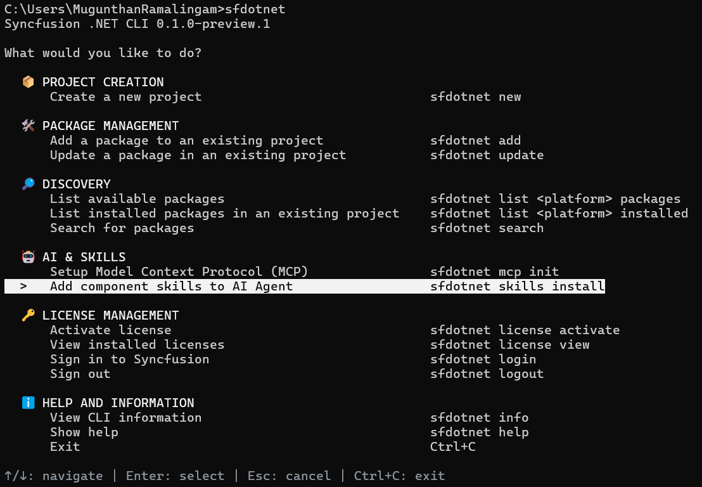
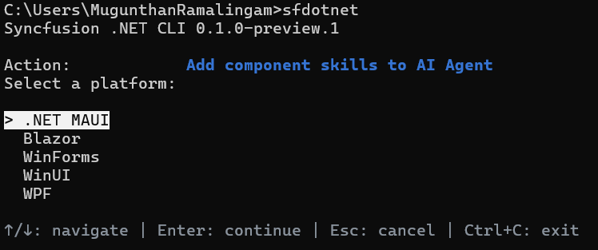
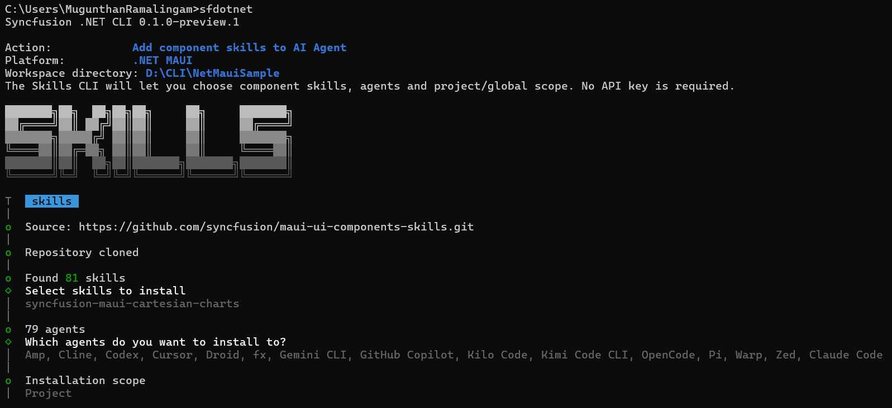
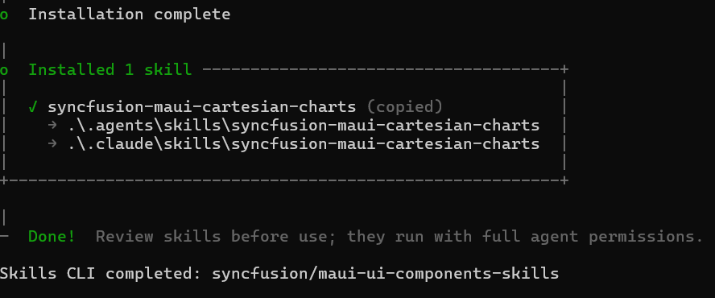

# Install AI component skills

The `sf skills install` command installs the official Syncfusion<sup>®</sup> .NET MAUI component skills for AI agents from the `syncfusion/maui-ui-components-skills` GitHub repository. Skills give AI agents product-specific guidance for generating and editing Syncfusion<sup>®</sup> control code. Skills are installed for the agents you choose, either project-local or global.

No Syncfusion<sup>®</sup> account, API key, or license is required to install or read skills.

## Prerequisites

* [Node.js](https://nodejs.org/en) 22.20 or later, installed with npm and Git, available on `PATH`.
* The setup uses the official Skills CLI (`skills@1.7.4`) through npx, which may download the CLI package and the official skills repository on first use.

## Install skills through the interactive menu

1. Run `sf` to open the main menu, and under **AI & Skills**, select **Add component skills to AI Agent**.

    

2. Select the platform. Choose **.NET MAUI**.

    

3. Enter the workspace directory. The Skills CLI then presents its own interactive flow, in which you choose the component skills, the agents, and the project or global scope. No API key is required.

    

4. After the Skills CLI completes, the CLI reports the completed status for the skills repository.

    

## Install skills using direct commands

```bash
sf skills install maui
sf skills install maui --list
sf skills install maui --agent github-copilot --skill <exact-skill-name> --yes
sf skills install maui --agent cursor claude-code --all --yes
```

* Use `--list` to list the exact skill names available in the repository without installing anything.
* Use `--agent` with one or more agent IDs: `github-copilot`, `cursor`, `codestudio`, or `claude-code`.
* Use `--skill` with one or more exact skill names, or `--all` to install all skills for the selected agents. `--all` does not mean all agents.
* Installation with `--no-interactive` requires `--agent`, `--skill` (or `--all`), and `--yes`. The scope defaults to project-local; add `--global` explicitly to install skills in the user's global agent directories.
* Skills are copied into the agent's skills location, so no elevated file-system permissions are required.

N> `completed` means the Skills CLI exited successfully, not that an AI agent has loaded or executed the skills. Reload the workspace in your AI agent so the newly installed skills are picked up.

## Skills options

| Option | Description |
| --- | --- |
| `<platform>` | The platform: `maui`, `blazor`, `wpf`, `winforms`, or `winui` |
| `--agent` | One or more agent IDs: `github-copilot`, `cursor`, `codestudio`, or `claude-code` |
| `--skill` | One or more exact skill names. Discover names with `--list` |
| `--all` | Install all skills for the selected agents, not all agents |
| `--global` | Install skills in the user's global agent directories |
| `--yes` | Confirm the no-interactive installation |
| `--list` | List repository skill names without installing |
| `-p`, `--path` | The workspace directory. Defaults to the current directory |
| `--dry-run` | Show the planned Skills CLI command without executing it |
| `--json` | Emit one JSON document |

## FAQs

**Do I need a license to install AI component skills?**

No. Skills installation requires no Syncfusion<sup>®</sup> account, API key, or license. It requires Node.js 22.20 or later with npm and Git.

## See also

* [MCP configuration](/maui/dotnet-cli/configure-mcp)
* [Syncfusion<sup>®</sup> .NET MAUI AI coding assistant skills](https://help.syncfusion.com/maui/ai-coding-assistant/skills/controls-user-skills)
