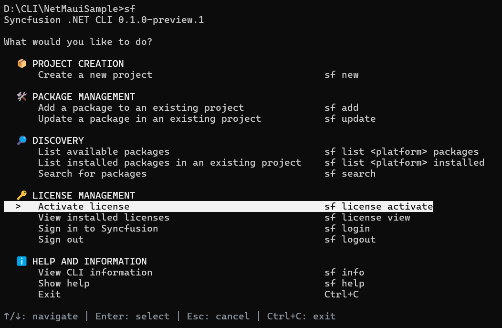
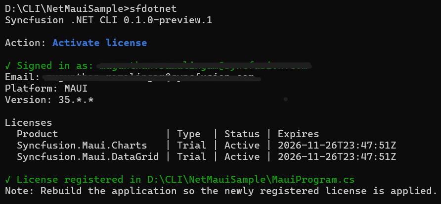
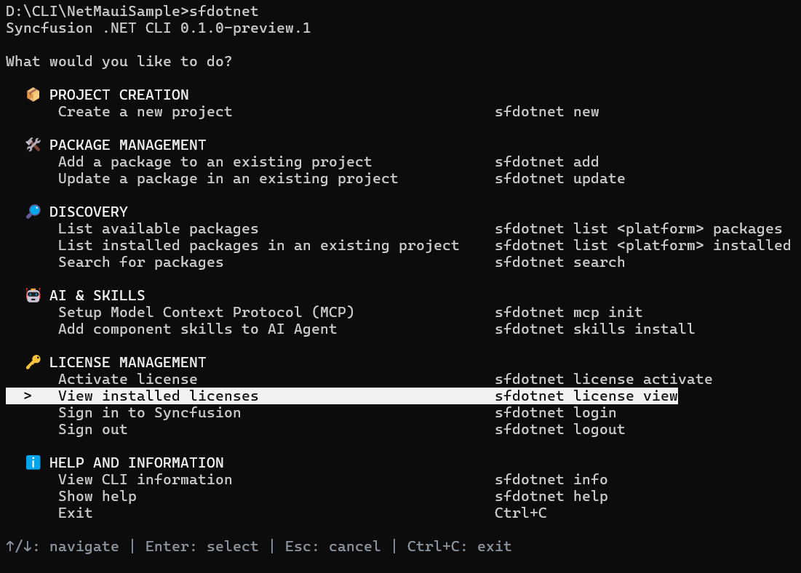
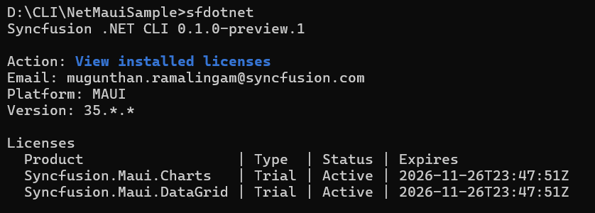

# Activate Syncfusion<sup>®</sup> licenses

The CLI detects the Syncfusion<sup>®</sup> controls used in a project, downloads the matching license keys from your Syncfusion<sup>®</sup> account, and registers the keys in the project's startup code. For example, when a sample is created with the Cartesian Chart control, the CLI registers the license for `Syncfusion.Maui.Charts` in `MauiProgram.cs` so the build runs without a license warning.

N> Open the Command Prompt or Terminal in the target sample's project directory before running the license activation command. The license operation is project-specific, and the command path must point to the intended sample.

## How license activation works

1. The CLI scans the project at the current directory or at the path you pass through `--path`. It identifies the platform from the project file (`.csproj`) and detects all Syncfusion<sup>®</sup> `PackageReference` entries whose IDs start with `Syncfusion.`.
2. It checks your Syncfusion<sup>®</sup> account for entitlements that cover each detected package. When a paid or trial entitlement is available, the matching license keys are downloaded.
3. The keys are cached in `syncfusion-license.txt` and metadata in `.syncfusion/license-meta.json` inside the project directory.
4. The CLI inserts `SyncfusionLicenseProvider.RegisterLicense(...)` into the platform-specific startup file. For .NET MAUI, the block is added to `MauiProgram.cs` before `MauiApp.CreateBuilder()`. The block is idempotent, so re-running the command refreshes the keys without duplicating the call.
5. If a control in the project is not covered by a paid entitlement, the CLI prompts you to accept the Syncfusion<sup>®</sup> trial EULA and download a trial key for the missing packages. Pass `--yes` to accept the prompt automatically.

## Activate a license through the interactive menu

1. Open the Command Prompt or Terminal in the target sample's project directory.

    ```bash
    cd D:\CLI\NetMauiSample
    ```

2. Run `sf` to open the main menu.

    ```bash
    sf
    ```

3. Under **License management**, select **Activate license**. The CLI focuses the **Activate License** entry and shows the navigation hint at the bottom of the screen.

    

4. If you are not signed in, the CLI opens your default browser to the Syncfusion<sup>®</sup> sign-in page. Complete sign in with your Syncfusion<sup>®</sup> account.

    

5. After sign in, the CLI checks your entitlements, downloads the matching keys for the Syncfusion<sup>®</sup> controls in the sample, and registers the keys in `MauiProgram.cs`.

    

6. Rebuild the application so the newly registered license is applied. The CLI prints the following reminder at the end of the activation output.

    > Note: Rebuild the application so the newly registered license is applied.

## Activate a license using a direct command

Run the activation command from the sample's project directory:

```bash
sf license activate
```

Pass `--path` to point the CLI at a specific project directory or `.csproj` file:

```bash
sf license activate --path ./MyApp
sf license activate --path ./MyApp/MyApp.csproj
```

Use `--yes` to accept the trial EULA prompt without asking:

```bash
sf license activate --yes
```

Use `--file` to activate from an existing key file. With no value, the CLI reads `./syncfusion-license.txt` from the project directory. With an absolute path, the CLI uses the specified file instead:

```bash
sf license activate --file
sf license activate --file C:\keys\syncfusion-license.txt
```

N> When a license key is supplied through `--file`, the CLI skips sign in and download and registers the keys already in the file. The file path must be absolute.

## View installed licenses

To see the licenses cached for the current project, run:

```bash
sf license view
```

The command reads the cached metadata, lists each product, the license type, the status, and the expiry date, and warns when a Syncfusion<sup>®</sup> package in the project is not covered.



The cached output reports the registered email, platform, major version, and one row per product.



## License operation notes

* License activation is project-specific. The command path must point to the intended sample, because each project is detected through its `.csproj` and scanned independently.
* The CLI writes `syncfusion-license.txt` and `.syncfusion/license-meta.json` to the project directory.
* The startup file the CLI modifies by platform is `MauiProgram.cs` for .NET MAUI, `Program.cs` for Blazor, `App.xaml.cs` for WPF, `App.xaml.cs` for WinUI, and `Program.cs` (or `Application.xaml.vb` for VB) for WinForms.
* Use `sf logout` to clear the local sign-in session. Use `sf login` to sign in again without running activation.

## License options

| Option | Description |
| --- | --- |
| `-p`, `--path` | The project directory or `.csproj`/`.vbproj` to scan for Syncfusion<sup>®</sup> packages. Defaults to the current directory |
| `-y`, `--yes` | Accept the trial EULA prompt automatically during activation |
| `--file` | Activate from an existing key file. With no value, the CLI reads `./syncfusion-license.txt` from the project directory. With an absolute path, the CLI uses the specified file |
| `--json` | Emit one JSON document instead of table output |

## FAQs

**Does the CLI register a license?** Yes. `sf license activate` scans the project for Syncfusion<sup>®</sup> `PackageReference` entries, downloads the matching license keys from your Syncfusion<sup>®</sup> account, and inserts `SyncfusionLicenseProvider.RegisterLicense(...)` into `MauiProgram.cs` (or the platform-specific startup file). The CLI signs you in through the browser the first time, or you can sign in ahead with `sf login`.

**Where does the CLI register the license for .NET MAUI?** In `MauiProgram.cs`, immediately before `MauiApp.CreateBuilder()`. For Blazor, WPF, WinUI, and WinForms, the CLI targets `Program.cs`, `App.xaml.cs`, `App.xaml.cs`, and `Program.cs` respectively.

**Can I use my own key file?** Yes. Run `sf license activate --file C:\keys\syncfusion-license.txt` with an absolute path. The CLI reads the keys from the file and registers them in the project's startup code without contacting the license service.

## See also

* [Create a .NET MAUI project](/maui/dotnet-cli/create-project)
* [Manage packages in an existing project](/maui/dotnet-cli/manage-packages)
* [Syncfusion<sup>®</sup> licensing overview](https://help.syncfusion.com/common/essential-studio/licensing/overview)
