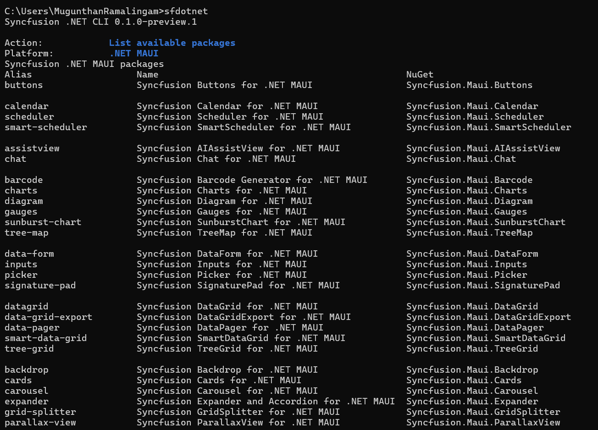

# Manage packages in an existing project

Package operations change NuGet references only. They do not generate control files.

In a CLI-generated project, supported package aliases also integrate their samples. For example, `sf add maui datagrid` adds the DataGrid package and integrates the DataGrid sample. In an ordinary project, the same command adds the package reference only, and the CLI reports that no sample was generated.

## Add a package by alias

To add a package using its short package alias:

```bash
sf add maui datagrid
```

## Add a package by package ID

To add a package using the exact NuGet package identifier:

```bash
sf add maui Syncfusion.Maui.DataGrid
```

## Add generated samples

To add generated samples directly, use `--control`:

```bash
sf add maui --control datagrid listview --path ./MyApp
```

## Update a package

To update a package in an existing project:

```bash
sf update maui datagrid
```

## List available packages

To list all Syncfusion<sup>®</sup> packages available for .NET MAUI:

```bash
sf list maui packages
```



## List installed packages

To list the Syncfusion<sup>®</sup> packages installed in an existing project:

```bash
sf list maui installed --path ./MyApp
```

## Search packages

To search the package catalog:

```bash
sf search maui grid
```

Existing-project commands accept `-p/--path` with a project file, a project directory, or a supported subdirectory. Discovery stops at the nearest project or repository boundary. `--json` emits one JSON document for script use.

## Package operation options

| Option | Description |
| --- | --- |
| `-p`, `--path` | The project directory, `.csproj` file, or a supported subdirectory |
| `-v`, `--version` | The Syncfusion<sup>®</sup> NuGet package version |
| `--source` | Package source; Syncfusion<sup>®</sup> packages require `https://api.nuget.org/v3/index.json` |
| `--configfile` | The NuGet configuration file to use |
| `--dry-run` | Preview the action without making changes |
| `--force` | Allow supported overwrites |
| `--no-restore` | Skip `dotnet restore` after the action |
| `--json` | Emit one JSON document |

## See also

* [Create a .NET MAUI project](/maui/dotnet-cli/create-project)
* [License activation](/maui/dotnet-cli/licensing)
* [Installing .NET MAUI NuGet packages](https://help.syncfusion.com/maui/installation/install-nuget-packages)
