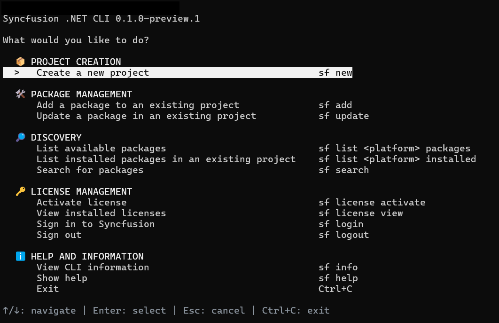

# Overview of the Syncfusion<sup>®</sup> .NET CLI

The Syncfusion<sup>®</sup> .NET CLI (`sf`) is a cross-platform command line tool that creates .NET MAUI projects, manages Syncfusion<sup>®</sup> .NET MAUI NuGet packages, and registers licenses from a terminal. After you install the CLI, you can run `sf` with no arguments to open an interactive menu, or run a direct command such as `sf new maui` for scripted, prompt-free creation.

N> The Syncfusion<sup>®</sup> .NET CLI is currently in preview and is installed with the `--prerelease` flag.

You can use the CLI to perform the following actions:

* Create a blank .NET MAUI app, or an app containing generated Syncfusion<sup>®</sup> control samples. For details, refer to [Create a .NET MAUI project](/maui/dotnet-cli/create-project).
* Add or update Syncfusion<sup>®</sup> .NET MAUI NuGet package references in an existing project. For details, refer to [Manage packages](/maui/dotnet-cli/manage-packages).
* Activate Syncfusion<sup>®</sup> licenses for the controls used in a sample, and view installed licenses. For details, refer to [License activation](/maui/dotnet-cli/licensing).
* Configure an official Syncfusion<sup>®</sup> Model Context Protocol (MCP) server for AI coding clients. For details, refer to [MCP configuration](/maui/dotnet-cli/configure-mcp).
* Install official Syncfusion<sup>®</sup> component skills for AI agents. For details, refer to [AI skills installation](/maui/dotnet-cli/install-skills).

This documentation covers the .NET MAUI platform.

## Prerequisites

The following software is required before you install and use the CLI:

* [.NET SDK](https://dotnet.microsoft.com/en-us/download/dotnet/10.0) with the **.NET Multi-platform App UI development** workload. The workload also installs the .NET MAUI project templates, which the CLI uses to create projects.
* An internet connection so package operations can reach [nuget.org](https://www.nuget.org).
* A Syncfusion<sup>®</sup> account to activate licenses. Sign in is performed through the browser during license activation.

N> Syncfusion<sup>®</sup> packages resolve from the official nuget.org feed, `https://api.nuget.org/v3/index.json`. The CLI accepts only this source through `--source`.

## Installation

The CLI is published as a .NET global tool with the package ID `Syncfusion.DotNet.CLI`.

1. Open a terminal and run the following command. Add `--prerelease` while only preview versions are available.

    ```bash
    dotnet tool install -g Syncfusion.DotNet.CLI --prerelease
    ```

2. Verify the installation and print the CLI version.

    ```bash
    sf --version
    ```

3. If `sf` is not found, add the .NET global tool directory to the `PATH` environment variable: `%USERPROFILE%\.dotnet\tools` on Windows or `$HOME/.dotnet/tools` on macOS and Linux. Then, restart the terminal.

To update the tool to the latest release, run:

```bash
dotnet tool update -g Syncfusion.DotNet.CLI --prerelease
```

To remove the tool, run:

```bash
dotnet tool uninstall -g Syncfusion.DotNet.CLI
```

## Initialize the CLI

Run `sf` in an interactive terminal to open the main menu. The menu shows the current CLI version and groups the available operations.



N> The `<platform>` text is a usage placeholder. Use `maui` for .NET MAUI.

Use the following keys to navigate the interactive screens:

| Key | Action |
| --- | --- |
| Up / Down | Move through the options |
| Enter | Choose the focused option, or continue |
| Space | Toggle a checkbox in a multi-selection list |
| Escape | Cancel the current question and return to the menu |
| `Ctrl+C` | Exit the interactive session |

Complete direct commands remain usable without opening the menu. `--no-interactive` disables prompts in any command.

## Available commands

| Command | Purpose | For details, refer to |
| --- | --- | --- |
| `sf new maui` | Create a new .NET MAUI project | [Create a .NET MAUI project](/maui/dotnet-cli/create-project) |
| `sf add maui <package>` | Add a Syncfusion<sup>®</sup> package to an existing project | [Manage packages](/maui/dotnet-cli/manage-packages) |
| `sf update maui <package>` | Update a package in an existing project | [Manage packages](/maui/dotnet-cli/manage-packages) |
| `sf list maui packages` | List available packages | [Manage packages](/maui/dotnet-cli/manage-packages) |
| `sf list maui installed` | List installed packages in an existing project | [Manage packages](/maui/dotnet-cli/manage-packages) |
| `sf search maui <text>` | Search packages | [Manage packages](/maui/dotnet-cli/manage-packages) |
| `sf mcp init maui` | Configure a project-local Syncfusion<sup>®</sup> MCP client | [MCP configuration](/maui/dotnet-cli/configure-mcp) |
| `sf skills install maui` | Install Syncfusion<sup>®</sup> component skills for AI agents | [AI skills installation](/maui/dotnet-cli/install-skills) |
| `sf login` | Sign in to Syncfusion through the browser | [License activation](/maui/dotnet-cli/licensing) |
| `sf logout` | Sign out and clear the local session | [License activation](/maui/dotnet-cli/licensing) |
| `sf license activate` | Download the license for the project's packages and register it in the project's startup code | [License activation](/maui/dotnet-cli/licensing) |
| `sf license view` | Show the licenses cached for the project (no network call) | [License activation](/maui/dotnet-cli/licensing) |
| `sf info` | Show CLI information | |
| `sf help maui` | Show the .NET MAUI command map | |
| `sf --version` | Show the CLI version | |

## FAQs

**How do I use the interactive menu?**

Run `sf` without arguments and use the arrow keys and Enter to navigate. Direct commands remain usable without opening the menu.

## See also

* [Syncfusion .NET MAUI controls](https://www.syncfusion.com/maui-controls)
* [Syncfusion .NET MAUI help documentation](https://help.syncfusion.com/maui/introduction/overview)
* [System requirements for .NET MAUI](https://help.syncfusion.com/maui/system-requirements)
