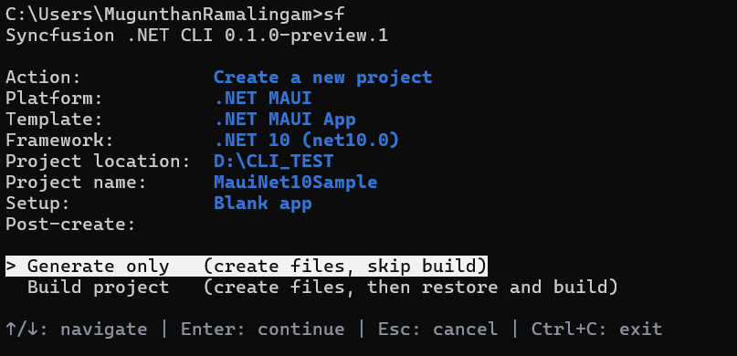
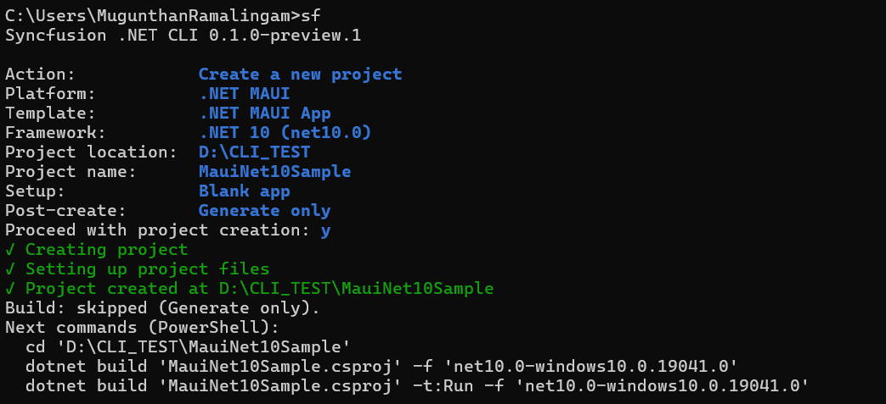

# Troubleshooting

## `sf` command is not found

Confirm the tool is installed and the .NET global tools directory is on your `PATH`.

```bash
dotnet tool list -g
sf --version
```

## Build failure after creation

The default post-create build includes restore. Missing workloads or platform tools appear as build errors after creation. The generated project is retained and the CLI prints the quoted build command so you can retry it from any directory.

```bash
dotnet build "<generated-project.csproj>"
```

A build failure returns a nonzero exit code with `generationSucceeded: true` and `buildSucceeded: false` in JSON output. Incomplete generation is rolled back. To skip the build and only generate the files, use `--post-action generate` or `--no-build`.





## Package source errors

Syncfusion<sup>®</sup> packages resolve from the official nuget.org feed, `https://api.nuget.org/v3/index.json`. The CLI accepts only this source through `--source`; local NuGet configuration cannot override the CLI feed. Confirm that the network can reach nuget.org.

## Restore required for control compatibility

Native workloads and platform tools are necessary for selected control package compatibility checks. A blank project needs only the .NET SDK and the .NET MAUI templates. Use `--no-restore` with care: it keeps an add as a package operation because sample compatibility cannot be established without restore.

## Destination conflicts

Neither `--force` nor confirmation authorizes overwriting an existing destination. Only an accepted default name receives an available numeric suffix when its destination exists. Choose a different name or parent directory when creation reports a destination conflict.

## Removal conflicts

Package removal validates before deleting anything. Edited generated files, a modified registry, or user code that references a generated sample produce a conflict, and the operation leaves the project unchanged. `--force` does not bypass these sample-ownership conflicts. Remove user references to a generated sample before removing that sample.

N> Package removal (`sf remove`) is temporarily disabled across all platforms while improvements are in progress.

## Interactive session cancelled

`Ctrl+C` exits the interactive session with exit code 130 and prints `The operation was canceled.` Escape cancels the current question without using a default and returns to the menu.

## Older CLI versions

For older CLI installations, move to an existing directory before starting `sf` again, so executable lookup does not fail after a rollback deletes a directory.

```bash
cd "$HOME"
sf
```