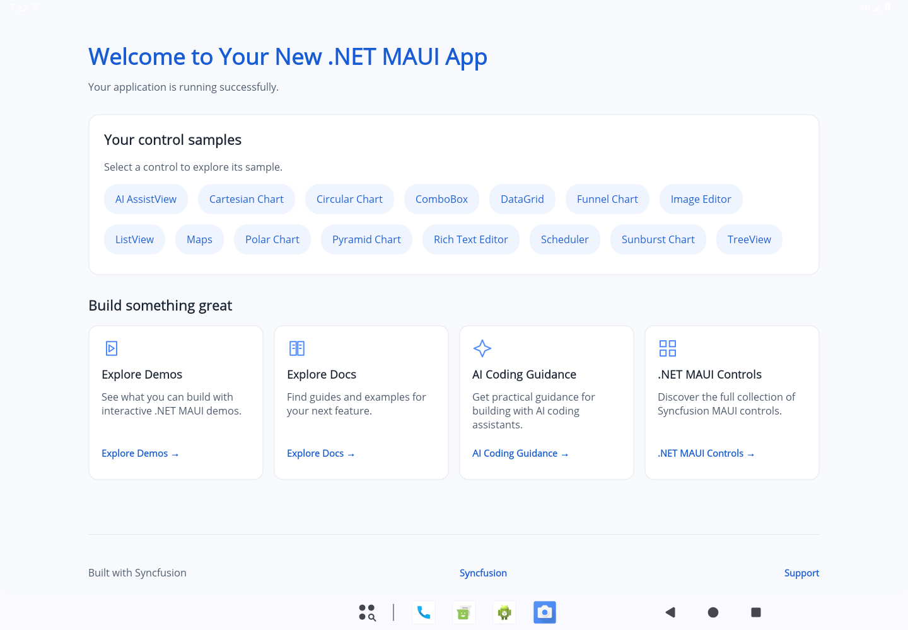
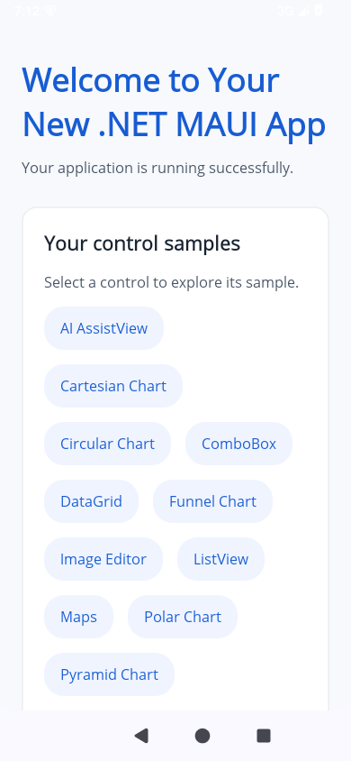
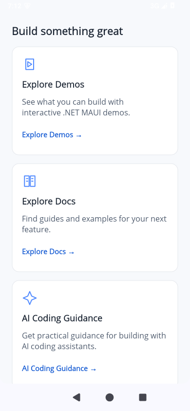

# MAUI welcome screen validation

Validation performed on Linux with .NET SDK 10.0.100, the stable MAUI Android workload set 10.0.100, Android SDK 36, JDK 21, and an Android 15 (API 35) x86_64 emulator. Screenshots below are native MAUI captures, without a browser rendering or image editing. The wide-window capture exercises desktop-width layout on Android; it is not a Windows or Mac Catalyst capture.

## Automated and package checks

- **411 tests passed**, none failed or skipped. Coverage includes all 15 sample registrations, blank/final-control states, schema validation and legacy manifest compatibility, aliases and package-only commands, repeated operations, missing/modified generated files, edited registry/registration/navigation blocks, shared packages, custom-code references, untracked files, changed/user-owned references, cancellation, failed builds/NuGet operations, and byte-for-byte rollback (including UTF-8 BOM and binary content).
- CLI build and release tool packaging succeeded without warnings or errors. The packed tool installed locally and generated a blank native project noninteractively.
- Real CLI operations against an Android project verified repeated add, edited-file conflict without mutations, shared Charts dependency retention, package removal cleaning up its chart samples, final-control removal producing an empty registry, custom dependency retention, absent removal without changes, and subsequent unused-package/registration cleanup.

Reproduction commands, with build/cache directories kept outside the checkout:

```sh
dotnet test tests/Syncfusion.DotNet.Cli.Tests/Syncfusion.DotNet.Cli.Tests.csproj \
  --artifacts-path /tmp/sf-artifacts -p:RestorePackagesPath=/tmp/sf-nuget

dotnet pack src/Syncfusion.DotNet.Cli/Syncfusion.DotNet.Cli.csproj -c Release \
  --artifacts-path /tmp/sf-artifacts -p:RestorePackagesPath=/tmp/sf-nuget

sfdotnet new maui --name WelcomeApp --path /tmp --project-type app \
  --target-framework net10.0 --control empty --post-action generate --no-interactive
sfdotnet add maui --control datagrid listview cartesian-chart circular-chart --path /tmp/WelcomeApp
sfdotnet remove maui --control circular-chart --path /tmp/WelcomeApp
sfdotnet remove maui charts --path /tmp/WelcomeApp
```

Interactive-rendering tests need a terminal with a nonzero height, or explicit `COLUMNS=120 LINES=40` when run through redirected CI output.

## Native builds and UI checks

| Check | Result |
| --- | --- |
| Blank native app, `net10.0-android` | Build passed; native startup displayed the friendly empty state; no warnings/errors |
| All 15 generated sample templates, `net10.0-android` | Build passed; no warnings/errors |
| Project after removing the final control and unused packages | Android build passed; no warnings/errors |
| Wide window, 1440 × 1000 at density 160 | Four aligned resource columns; control buttons wrap |
| Tablet window, 768 × 1024 | Two resource columns |
| Phone window, 390 × 844 | Wrapped controls, one resource column, scrolling to all cards/footer |
| Device rotation | Native UI hierarchy reported rotation 1; layout reflowed |
| Light/dark theme | Native colors updated without changing generated code |
| Larger text, system font scale 1.5 | Text and control buttons grew; buttons rewrapped, cards expanded, and scrolling remained available |
| Touch navigation | DataGrid opened with all five in-memory orders |
| Keyboard navigation | Tab focused native sample buttons; Enter opened DataGrid with the same data |
| .NET 9 generation | Compatible safe-area XAML verified by tests; native .NET 9 workload unavailable |

For standalone APK installation during validation, builds used `-p:EmbedAssembliesIntoApk=true -p:RuntimeIdentifiers=android-x64`. This avoids the debugger's normal fast-deployment dependency. These flags are not written into generated projects. The emulator has no CPU acceleration; cold launches required an emulator-only debugging startup workaround. No debugging workaround or test license key is generated by the CLI.

Explicit zero minimum sizes on generated native containers/labels prevent unset minimums from becoming oversized native Android dimensions. Rows and labels still measure naturally and expand with text.

## Screenshots

[Blank startup](../images/welcome/blank.png) · [Larger text](../images/welcome/large-text.png)

[Wide window](../images/welcome/desktop-width.png) · [Dark theme](../images/welcome/desktop-dark.png) · [Tablet](../images/welcome/tablet.png) · [Phone](../images/welcome/mobile.png) · [Phone resource cards](../images/welcome/mobile-resources.png) · [Remaining phone cards and footer](../images/welcome/mobile-resources-lower.png) · [Rotation](../images/welcome/mobile-landscape.png) · [DataGrid sample](../images/welcome/datagrid-sample.png)






## Limits

Windows, Mac Catalyst, and iOS builds/runtime checks require their native hosts and platform tools and were unavailable on this Linux environment. Native runtime sample checks covered representative navigation/DataGrid data; all 15 templates compiled, but their complete interactive feature sets were not exhaustively exercised.

The four requested resource URLs are preserved exactly and opened through MAUI's browser API; footer links use Syncfusion's official domain. Live HTTP/browser reachability could not be verified because the workspace proxy blocked Syncfusion website requests. Syncfusion displayed its standard trial-license dialog during emulator validation; it was dismissed for captures. Production apps still require an appropriate Syncfusion license.
